# 골프 타운 — 미니골프 레벨 디자인 · 플레이 시스템 기술 문서

> 개인 프로젝트 (Unity 3D 수업 과제) · 레벨 디자인, 샷 조작, 스테이지 진행·해금, UI 담당

---

## 0. 한 장 요약

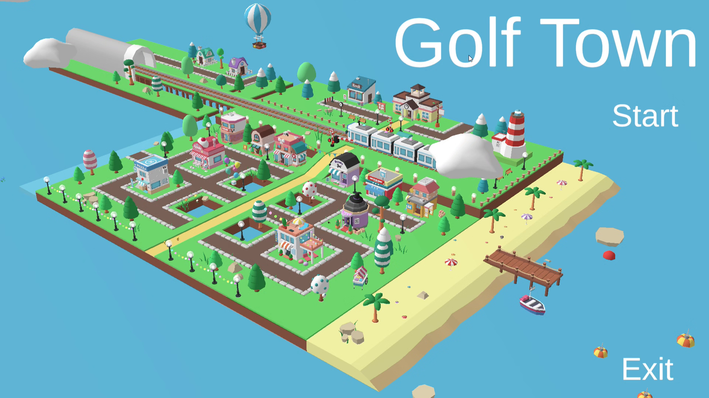

**골프 타운**은 마을 로비를 공으로 굴러다니며 스테이지 입구를 찾아 들어가고, 스테이지마다 다른 기믹을 넘어 홀인하는 3D 미니골프 게임입니다. 수업에서 제공된 골프공 물리·카메라·입력 코드를 바탕으로, **스테이지 4개의 레벨 디자인과 그것을 플레이 가능한 게임으로 묶는 조작·진행·UI**를 혼자 만들었습니다.

| 항목 | 내용 |
|---|---|
| 장르 | 3D 미니골프 (로비 + 스테이지 4개) |
| 기간 · 인원 | 2026.10.04 ~ 2026.10.08 (커밋 기준 5일) · 1인 (수업 과제) |
| 분량 | 씬 7개 (메인 · 로비 · 스테이지 4개 · 엔딩), 구간 9개, 처음부터 엔딩까지 약 6분 |
| 내 역할 | 레벨 디자인(스테이지 1~4 · 애니메이션 기믹), 샷 조작, 로비 이동, 스테이지 진행·해금, 튜토리얼·일시정지(Pause) UI |
| 환경 | Unity 6 (6000.3.15f1, C#, URP), Input System, DOTween, ProBuilder, Animator · 에셋: CartoonTown LowPoly, Polyverse Skies · AI: Claude(옵션 UI 빌더 스크립트), ChatGPT(튜토리얼 이미지) |
| 링크 | [GitHub](https://github.com/KooHoo-Dev/3rd-minigolf_level_design-crescentyun-stack) · [시연 영상](https://youtu.be/50UMRtVQfls) |

**핵심 기술 3가지**

| # | 기술 | 한 줄 설명 | 문서 위치 |
|---|---|---|---|
| 1 | **마우스로 당겨 치는 샷** | 마우스 드래그 한 번으로 방향(좌우)·세기(위아래)·취소(조금만 당기면 발사 안 함)를 모두 정하고, 친 공이 살짝 떠오르게(`hopRatio`) 해서 낮은 턱을 넘길 수 있게 했습니다 | 3.1 |
| 2 | **클리어할수록 채워지는 마을** | 메뉴 버튼 대신 로비를 공으로 굴러다니며 입구 구역에 들어가 스테이지를 시작하고, 스테이지를 깰 때마다 로비 마을에 건물이 하나씩 생기다가 모두 깨면 상점가와 기차가 움직이는 마을이 완성되게 했습니다 | 4장 |
| 3 | **애니메이션으로 만든 기믹 레벨** | 풍차, 장애물이었다가 발판이 되는 기차, 도개교를 Animator로 만들어 스테이지마다 새 기믹을 하나씩 더해 갔습니다 | 6장 |

---

## 1. 프로젝트 개요

### 1.1 무엇을 만들었나 (What)

골프 타운은 마을 전체가 하나의 미니골프 코스인 게임입니다. 플레이어는 로비에서 공을 직접 굴려 스테이지 입구로 이동하고, 입구에 들어가면 해당 스테이지가 시작됩니다. 각 스테이지는 여러  **구간(Level)** 으로 나뉘어 있어서, 한 구간에서 홀인하면 다음 구간의 시작 지점으로 이동하고, 마지막 구간을 통과하면 로비로 돌아옵니다. 스테이지 4개를 모두 깨면 엔딩(Clear) 씬으로 이어집니다.

| 스테이지 | 구간 | 새로 배우는 것 | 기믹 |
|---|---|---|---|
| Stage 1 | 3 | 기본 조작 | 장애물 없이 샷 조작에 익숙해지는 코스 |
| Stage 2 | 2 | 타이밍 | 홀 입구 앞에서 도는 풍차 날개 (날개 사이로 타이밍을 맞춰 통과) |
| Stage 3 | 2 | 장애물의 역할 바꾸기 | 구간 1에서는 피해야 하는 기차가, 구간 2에서는 타이밍에 맞춰 올라타는 발판 |
| Stage 4 | 2 | 응용 | 한쪽으로 열리는 도개교, 양쪽에서 열리는 도개교 (다리가 열린 사이로 배가 지나감) |

모든 코스는 바다로 둘러싸인 섬 위에 있어서, 공이 코스 밖으로 튕겨 나가면 바다에 빠지고 마지막으로 친 위치로 자동으로 돌아옵니다.

### 1.2 왜 만들었나 (Why)

#### 과제 배경

수업에서는 골프공 물리(`GolfBall`), 카메라(`GolfPlainCamera`), 조준선(`GolfAimIndicator`), 입력(`SimpleInput`)이 제공됐습니다. 과제는 이 위에 **새 장애물을 3종 이상 만들고, 소개 → 응용 → 심화 순서로 배치해 플레이어가 배우고 익히고 시험받게 만드는 것**이었습니다(총 플레이 3분 이상, 마감 10/8). 작업지시서의 핵심 문장은 **"난이도는 장애물 안에 있지 않고 배치 안에 있다"**였습니다.

| 과제 요구 | 이 프로젝트에서 |
|---|---|
| 새 장애물 3종 이상 | 풍차(타이밍), 기차(장애물 → 발판), 도개교(+ 지나가는 배) |
| 소개 · 응용 · 심화 코스 | 스테이지 2~4는 모두 **구간 1 = 소개, 구간 2 = 응용**으로 구성. 스테이지 1은 장애물 없이 조작만 익히는 3구간 |
| 처음 보는 장애물을 위험한 곳에서 만나게 하지 않기 | 스테이지 첫 진입 시 튜토리얼 팝업으로 먼저 소개 |

#### 게임 컨셉: 골프공이 되어 마을을 살린다

과제의 코스들을 단순히 이어 붙이지 않고, 하나의 이야기로 묶었습니다. 플레이어는 멈춰 있는 마을 **골프 타운**에 놓인 골프공입니다. 스테이지를 하나 깰 때마다 그 입구 자리에 건물이 지어지고, 네 스테이지를 모두 깨면 마을이 완성되어 멈춰 있던 기차가 다시 달립니다. 엔딩에서는 폭죽이 터지고, 카메라가 하늘로 올라가 골프공처럼 생긴 달을 비춥니다.

| 진행 | 마을의 변화 |
|---|---|
| 시작 | 빈 터가 많고 기차가 멈춰 있는 마을 |
| 스테이지 1 ~ 4 클리어 | 클리어한 입구 자리에 집 · 풍차 · 집 · 호텔이 하나씩 지어짐 |
| 4개 모두 클리어 | 상점가와 집들이 채워지고 기차가 움직이기 시작, 엔딩 입구가 열림 |
| 엔딩 | 폭죽, 카메라가 하늘로 올라가며 골프공 모양의 달을 비춤 |

#### 레벨 설계 기준: 스테이지마다 새 기믹 하나

레벨을 만들며 세운 기준은 **"한 스테이지에서는 새 요소를 하나만 배운다"**였습니다. 처음부터 움직이는 장애물이 많으면 플레이어는 조작이 서툴러서 실패한 것인지, 기믹을 몰라서 실패한 것인지 구분할 수 없습니다. 그래서 1.1의 표처럼 조작 → 타이밍(풍차) → 역할이 바뀌는 기차 → 도개교 순서로 하나씩 더했습니다.

| 기준 | 적용 |
|---|---|
| 새 요소는 한 번에 하나 | 스테이지 1은 장애물 없이 조작만, 2부터 기믹을 하나씩 추가 (6장) |
| 처음 보는 기믹은 설명부터 | 스테이지에 처음 들어갈 때마다 튜토리얼 팝업을 띄우고, ESC 일시정지 창(Pause)의 TIP에서 언제든 다시 볼 수 있게 함 (5장) |
| 실패해도 바로 다시 | 바다에 빠지면 별도 입력 없이 마지막으로 친 위치로 돌아감. R 키는 스테이지 시작 지점으로 돌아가는 보조 수단 (3.3) |

#### 기믹 제작 방식: 왜 애니메이션인가

이전에 만든 첫 2D 프로젝트에서는 애니메이션을 잘 다루지 못해, 움직이는 요소를 모두 코드로 처리했습니다. 이후 수업과 별도 공부로 Animator를 익혔고, 이번 프로젝트에서는 **움직이는 기믹을 애니메이션으로 만드는 것**을 개인 목표로 잡았습니다. 그래서 기차, 도개교, 배는 스크립트 없이 직접 만든 애니메이션 클립과 컨트롤러로 움직였습니다. 풍차는 에셋에 포함된 애니메이션을 그대로 썼습니다(6.3).

이 문서는 전체 구조(2장), 샷·이동(3장), 스테이지 진행·해금(4장), UI(5장), 스테이지별 레벨 디자인(6장), 개발 과정(7장), 문제 해결 기록(8장), 돌아보기(9장)를 차례로 설명합니다.

### 1.3 조작법

| 장소 | 입력 | 결과 |
|---|---|---|
| 로비 | `W` `A` `S` `D` | 카메라 기준으로 공 굴리기 |
| 로비 | `Space` | 점프 |
| 로비 | 좌클릭 + 좌우 드래그 | 카메라 회전 |
| 스테이지 | 좌클릭 + 좌우 드래그 | 조준 방향 회전 |
| 스테이지 | 좌클릭 + 아래로 당기기 / 위로 당기기 | 앞으로 / 뒤로 치는 세기 충전 (당긴 거리만큼 강해짐) |
| 스테이지 | 좌클릭 떼기 | 발사 (조금만 당겼으면 취소) |
| 스테이지 | 우클릭 | 카메라 시점 전환 |
| 공통 | `R` | 지금 있는 씬의 시작 지점으로 이동 |
| 공통 | `ESC` | 일시정지 창 **Pause** (`Main` 메인화면 · `Play` 이어하기 · `TIP` 튜토리얼 모아보기) |

### 1.4 핵심 루프

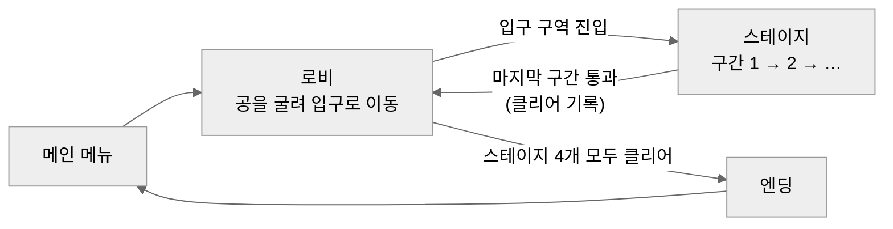

로비 → 스테이지 → 로비를 반복하는 동안 클리어 기록이 쌓이고, 기록이 쌓일수록 로비 마을에 건물이 하나씩 늘어납니다. 플레이어는 마을이 채워지는 모습으로 자신의 진행도를 확인합니다.

### 1.5 제공 코드와 내가 작성한 범위

| 구분 | 클래스 | 하는 일 |
|---|---|---|
| 제공 | `GolfBall` | 공 물리, 정지 판정(`IsStopped`), 발사(`Shoot`), 위치 이동(`PlaceAt` · `ReturnToLasShotPosition`) |
| 제공 | `GolfPlainCamera` · `GolfAimIndicator` · `SimpleInput` | 카메라 회전, 조준선 표시, 입력 래퍼 |
| 제공 | `GolfPlayer` | 스페이스바를 누르는 시간으로 세기를 정하는 샷 예제 → `Golf`로 대체 |
| **수정** | `GolfBall.hopRatio` | 칠 때 세기에 비례해 위로 띄우는 값 추가 (3.1) |
| **작성** | `Golf` | 마우스로 당겨 치는 샷, 취소, 시작 지점 리스폰 (3.1) |
| **작성** | `LobbyController` | 로비에서 공 굴리기 · 점프 · 속도 제한 (3.2) |
| **작성** | `WaterTrigger` · `ClearZone` | 바다에 빠지면 복귀, 구간 클리어 시 다음 구간으로 이동 (3.3) |
| **작성** | `StageZone` · `GameProgress` · `ListUnlocker` | 스테이지 입장 · 클리어 기록 · 로비 건물 해금 · 최종 해금 (4장) |
| **작성** | `TutorialPopup` · `OptionUI` · `OptionUIBuilder` · `CameraRotation` · `MainMenu` | 튜토리얼, ESC 일시정지(Pause) 창, UI를 코드로 생성하는 에디터 툴, 카메라 연출, 메인 메뉴 (5장) |
| **작성** | 씬 7개, 애니메이션 클립 · 컨트롤러 | 메인 · 로비 · 스테이지 1~4 · 엔딩, 기차 · 배 · 도개교 애니메이션 (6장) |
| **작성** | `TestUnlock` · `TestMoveScene` | 테스트용 단축키 (1: 해금, Q: 로비 이동) |

---

## 2. 전체 구조

### 2.1 씬 구성

| 씬 | 역할 | 주요 스크립트 |
|---|---|---|
| `00. Main` | 메인 메뉴. 시작 버튼에서 튜토리얼 기록 초기화 (8.2) | `MainMenu` |
| `01. List` | 로비(골프 타운). 공을 굴려 스테이지 입구로 이동, 클리어 기록에 따라 건물 표시 | `LobbyController`, `StageZone` ×5, `ListUnlocker` |
| `02. Stage01` ~ `05. Stage04` | 스테이지. 구간 2~3개, 마지막 구간에서 로비로 복귀하며 클리어 기록 | `Golf`, `ClearZone`, `WaterTrigger`, `StageZone` |
| `99. Clear` | 엔딩. 폭죽과 하늘을 올려다보는 카메라 연출 | `CameraRotation` |

메인 메뉴를 뺀 모든 씬에 `OptionUI`(ESC)가 있고, 로비와 스테이지 1~4에는 `TutorialPopup`이 있습니다.

### 2.2 아키텍처

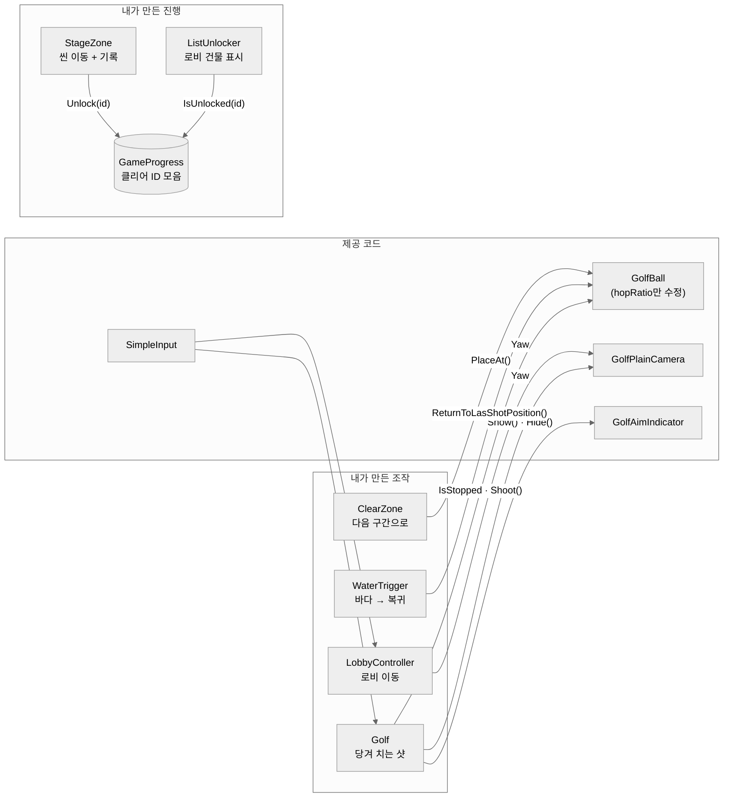

제공 코드 쪽으로 가는 화살표는 모두 **이미 공개된 함수와 속성 호출**입니다. 제공 코드는 `GolfBall`에 값 하나(`hopRatio`)를 더한 것 말고는 고치지 않았고, 새 기능은 그 바깥에 클래스로 붙였습니다.

### 2.3 클래스 역할

| 클래스 | 하는 일 | 하지 않는 일 |
|---|---|---|
| `Golf` | 마우스 입력을 방향·세기로 바꿔 발사 요청, 조준선 갱신, R 리스폰 | 공의 물리 처리, 정지 판정 (`GolfBall`) |
| `LobbyController` | 로비에서 카메라 기준 이동, 점프, 수평 속도 제한 | 샷 (로비에서는 치지 않음) |
| `WaterTrigger` | 공이 닿으면 마지막으로 친 위치로 되돌리라고 요청 | 위치 계산 (`GolfBall`이 기억) |
| `ClearZone` | 공이 닿으면 다음 구간 시작 지점으로 옮김 | 클리어 기록 |
| `StageZone` | 공이 닿으면 클리어 ID를 기록하고 씬 이동 | 무엇이 해금되는지 판단 |
| `GameProgress` | 클리어 ID를 모아 두고 조회 | 화면 표시, 저장 |
| `ListUnlocker` | 로비 시작 시 기록을 보고 건물을 켜고, 1~4가 모두 있으면 최종 해금 | 기록 추가 (최종 ID 제외) |

### 2.4 고민과 선택: 클리어 기록을 씬 사이에 어떻게 넘길 것인가

> **결정 대상:** 스테이지 씬에서 생긴 "클리어했다"는 사실을, 씬이 바뀐 뒤 로비 씬이 알아야 합니다. 씬이 바뀌면 오브젝트는 사라지는데, 기록을 어디에 둘 것인가?

| | [A] `DontDestroyOnLoad` 매니저 오브젝트 | [B] `PlayerPrefs`에 저장 | [C] `static` 클래스 + `HashSet<string>` ✓ |
|---|---|---|---|
| 방식 | 매니저를 씬 전환에도 남겨 두고 기록 | 디스크에 키-값으로 저장 | 씬과 무관한 정적 클래스에 ID를 모음 |
| 장점 | 인스펙터에서 상태 확인 가능 | 게임을 껐다 켜도 유지 | 씬에 놓을 오브젝트가 없음. 어느 스크립트에서든 한 줄로 기록·조회 |
| 단점 | 첫 씬에 반드시 있어야 하고, 중복 생성을 막는 코드 필요 | 문자열 키 관리, 메인 메뉴의 `DeleteAll`과 함께 지워짐 | 게임을 끄면 기록이 사라짐 |

**[최종 결정]** [C]를 선택했습니다. 이 게임은 메인 메뉴에서 시작해 한 번에 끝까지 플레이하는 짧은 구성이라, 실행 중에만 기록이 유지되면 충분했습니다. 또 스테이지는 `StageZone`의 `unlockId`, 로비는 `ListUnlocker`의 `id`를 **인스펙터에 같은 문자열**로 적으면 연결되므로, 스테이지를 추가할 때 코드를 고칠 필요가 없습니다.

```csharp
// GameProgress.cs — 씬이 바뀌어도 남는 클리어 기록
public static class GameProgress
{
    private static HashSet<string> unlocked = new HashSet<string>();

    public static void Unlock(string id) => unlocked.Add(id);         // 중복 추가해도 하나만 남음
    public static bool IsUnlocked(string id) => unlocked.Contains(id);
}
```

**[감수한 대가]** 게임을 종료하면 진행도가 사라집니다. 또 ID를 문자열로 맞추기 때문에, 한쪽 인스펙터에서 오타가 나면 오류 없이 해금만 되지 않습니다. 저장 기능이 필요해지면 `GameProgress` 안에서만 저장·불러오기를 추가하면 되도록, 기록과 조회를 이 클래스 한 곳에 모아 두었습니다(9.4).

---

## 3. 시스템 ① 샷과 이동

### 3.1 마우스로 당겨 치는 샷

#### 개요

스테이지에서 공이 멈춰 있으면 마우스 왼쪽 버튼을 누른 채 끌어서 칩니다. 좌우로 끌면 조준 방향이 돌고, 위아래로 끈 거리만큼 세기가 차며, 버튼을 떼면 발사됩니다. 제공된 예제(`GolfPlayer`)는 스페이스바를 누르는 동안 세기 게이지가 오르내리는 방식이었는데, 이를 `Golf` 클래스로 새로 만들었습니다.

| 입력 | 결과 | 설정값 (인스펙터) |
|---|---|---|
| 좌우로 끌기 | 카메라와 조준 방향 회전 | `yawSensitivity` = 1픽셀당 0.2도 |
| 아래로 당기기 | 앞으로 치는 세기 충전 | `maxPullDistance` = 200픽셀에서 최대 세기 |
| 위로 당기기 | 뒤로 치는 세기 충전 | 같음 |
| 버튼 떼기 | `minPower` ~ `maxPower` 사이 세기로 발사 | — |
| 조금만 당기고 떼기 | 발사 취소 | `cancelThreshold` = 최대의 5% 미만 |

#### 핵심 기능 ① 당긴 거리를 세기로 바꾸기

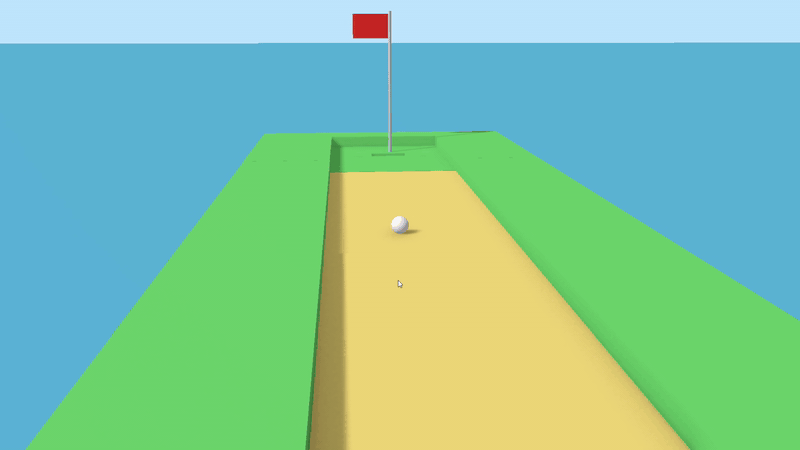

```csharp
// Golf.cs — 공이 멈춰 있을 때만 입력을 받는다
if (canShoot)   // ball.IsStopped
{
    if (SimpleInput.GetMouseButtonDown(SimpleInput.MouseButton.Left))
        ResetPull();

    if (SimpleInput.GetMouseButton(SimpleInput.MouseButton.Left))
    {
        Vector2 delta = SimpleInput.GetMouseDelta();
        cam.Yaw += delta.x * yawSensitivity;                       // 좌우 → 방향

        // 상하 → 당김 누적 (아래로 당기면 음수), 최대 거리에서 멈춤
        pullAmount = Mathf.Clamp(pullAmount + delta.y, -maxPullDistance, maxPullDistance);
        power01 = Mathf.Abs(pullAmount) / maxPullDistance;         // 0~1로 정규화
    }

    // 아래로 당기면 앞, 위로 당기면 뒤
    shotDirection = pullAmount <= 0.0f ? aimDirection : -aimDirection;

    if (SimpleInput.GetMouseButtonUp(SimpleInput.MouseButton.Left))
    {
        // (Why) 실수로 클릭만 했을 때 공이 굴러가지 않도록
        if (power01 >= cancelThreshold)
            ball.Shoot(shotDirection, Mathf.Lerp(minPower, maxPower, power01));

        ResetPull();
    }
}
else
{
    ResetPull();   // 공이 굴러가는 동안 쌓인 입력은 버린다
}
```

조준선(`GolfAimIndicator`)에는 매 프레임 `power01`과 방향을 넘겨, 당기는 동안 세기와 방향이 바로 보이게 했습니다.

#### 핵심 기능 ② 살짝 띄워 치기 (`hopRatio`)

제공된 `GolfBall`은 공을 바닥과 평행하게만 밀었습니다. 그래서 낮은 턱이나 기차 발판처럼 **바닥보다 조금 높은 곳**으로는 공을 올릴 수 없었습니다. 제공 코드에서 수정한 것은 발사 속도에 위쪽 성분을 더한 이 한 줄뿐입니다.

```csharp
// GolfBall.cs (제공 코드 수정)
public float hopRatio = 0.3f;   // 세기 대비 위쪽 속도 비율 (0이면 기존과 같음)

public void Shoot(Vector3 direction, float power)
{
    shotRequested = true;
    shotVelocity = direction * power + Vector3.up * (power * hopRatio);   // ★ 추가
    lastPosition = transform.position;
}
```

세기에 비례하므로 약하게 치면 거의 뜨지 않고, 세게 치면 높이 뜹니다. `hopRatio`를 0으로 두면 원래 동작과 같아서 기존 코스에는 영향을 주지 않습니다.

#### 예외 처리

| 상황 | 처리 |
|---|---|
| 공이 굴러가는 중 클릭 | `IsStopped`가 아니면 입력을 받지 않고 당김값 초기화 |
| 클릭만 하고 뗌 | 세기가 5% 미만이면 발사 취소 |
| 너무 멀리 당김 | `maxPullDistance`에서 멈춤 (최대 세기 고정) |

#### 고민과 선택: 세기를 어떻게 입력받을 것인가

> **결정 대상:** 제공 예제처럼 스페이스바 게이지로 세기를 정할 것인가, 다른 방식으로 바꿀 것인가?

| | [A] 스페이스바 게이지 (제공 예제) | [B] 마우스로 당긴 거리 ✓ |
|---|---|---|
| 방식 | 누르는 동안 세기가 0 → 1 → 0으로 왕복, 떼는 순간의 값으로 발사 | 끌어당긴 거리에 비례, 떼면 발사 |
| 장점 | 구현이 간단. 타이밍 실력이 들어감 | 방향과 세기를 한 동작으로 정함. 원하는 세기에서 멈춰 놓고 다시 조절 가능 |
| 단점 | 방향(마우스)과 세기(키보드)를 따로 조작. 원하는 세기를 맞추려면 왕복 타이밍을 노려야 함 | 마우스 감도에 따라 세기 체감이 달라짐 |

**[최종 결정]** [B]를 선택했습니다.

**[정리하며 본 결과]** 문서를 정리하며 두 방식을 다시 비교해 보니, [B]는 이 게임의 장애물 구성과도 잘 맞았습니다. 풍차·기차·도개교처럼 **어려움이 장애물의 타이밍**에 있는 코스에서, 세기까지 오르내리는 게이지의 타이밍으로 맞춰야 했다면 실패의 원인이 장애물인지 게이지인지 구분하기 어려웠을 것입니다. 또 조금만 당기면 취소되므로, 타이밍을 기다리며 미리 잡아 둔 샷을 부담 없이 풀 수 있습니다.

### 3.2 로비 이동

#### 개요

로비(골프 타운)에서는 공을 치지 않고 `W` `A` `S` `D`로 직접 굴리고 `Space`로 점프합니다. 마을을 자유롭게 돌아다니며 원하는 스테이지 입구를 찾아가는 **오픈월드 느낌**을 주기 위해서입니다.

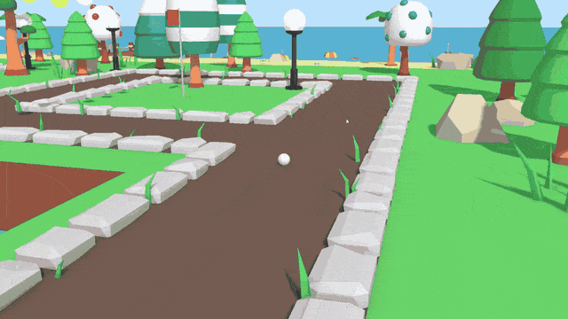

#### 핵심 기능: 입력은 Update, 물리는 FixedUpdate

```csharp
// LobbyController.cs
private void Update()                       // 입력은 매 프레임 읽어 두기만
{
    moveInput = SimpleInput.GetMoveAxisRaw();
    if (SimpleInput.GetKeyDown(Key.Space)) jumpRequested = true;
    if (SimpleInput.GetKeyDown(Key.R))     respawnRequested = true;
    UpdateCamera();
}

private void FixedUpdate()                  // 물리는 고정 주기에서 처리
{
    if (respawnRequested) { Respawn(); return; }

    CheckGround();          // 아래로 Raycast 해서 바닥 판정
    Move();                 // 카메라 기준 방향으로 AddForce
    Jump();
    LimitHorizontalSpeed();
}

private void Jump()
{
    // (Why) 요청은 이번 물리 프레임에서 무조건 비운다
    //       → 공중에서 누른 점프가 착지한 뒤 늦게 발동하는 것을 막음
    bool wantJump = jumpRequested;
    jumpRequested = false;
    if (wantJump == false || IsGrounded == false) return;

    Vector3 velocity = rBody.linearVelocity;
    velocity.y = jumpSpeed;                 // (Why) 힘이 아닌 속도 지정 → 항상 같은 높이
    rBody.linearVelocity = velocity;
}
```

`GetKeyDown`은 `Update`에서만 정확하게 잡히고, 물리 처리는 `FixedUpdate`에서 해야 프레임레이트와 무관하게 같은 결과가 나옵니다. 그래서 입력은 플래그로 남겨 두고 `FixedUpdate`에서 소비하도록 나눴습니다. 속도 제한은 수평 성분에만 걸어서 점프와 낙하 속도에는 영향을 주지 않습니다.

#### 고민과 선택: 로비에서 스테이지를 어떻게 고르게 할 것인가

> **결정 대상:** 플레이어가 다음에 할 스테이지를 어떤 방식으로 고르게 할 것인가?

| | [A] 메뉴 화면에서 버튼으로 선택 | [B] 로비를 공으로 돌아다니며 입구로 들어감 ✓ |
|---|---|---|
| 장점 | 구현이 간단. 순서와 진행도를 한눈에 보여주기 쉬움 | 마을을 탐험하는 느낌. 클리어 후 건물이 지어지는 모습을 직접 보게 됨 |
| 단점 | 마을이 살아나는 컨셉을 보여줄 공간이 없음 | 이동 조작을 따로 만들어야 함. 어디로 가야 할지 안내가 필요 |

**[최종 결정]** [B]를 선택했습니다. "골프공이 되어 마을을 살린다"는 컨셉에서는 플레이어가 마을 안에 있어야 건물이 생기고 기차가 달리는 변화를 직접 볼 수 있습니다. 또 스테이지 순서를 정하지 않고 **플레이어가 스스로 고른 순서로** 깨 나가게 하고 싶었습니다.

**[감수한 대가]** 순서를 강제하지 않았더니, 테스트에서 가장 쉬운 스테이지 1을 가장 나중에 깨는 플레이어가 나왔습니다. 자유로운 선택은 지키되 권장 순서는 보여줬어야 했습니다(9.2).

### 3.3 실패와 복귀

#### 개요

모든 코스는 바다 위의 섬이어서, 공이 코스 밖으로 튕겨 나가면 바다에 떨어집니다. 공이 원래 자리로 돌아오는 경로는 세 가지입니다.

| 경로 | 언제 | 어디로 | 담당 |
|---|---|---|---|
| 자동 복귀 | 공이 바다(`WaterTrigger`)에 닿음 | 마지막으로 친 위치 | `GolfBall.ReturnToLasShotPosition()` (제공) |
| 구간 이동 | 공이 구간 끝(`ClearZone`)에 닿음 | 다음 구간 시작 지점 | `GolfBall.PlaceAt()` (제공) |
| 수동 리스폰 | `R` 키 | 스테이지 시작 지점 | `Golf.Respawn()` |

#### 핵심 기능: 구간을 넘어가도 복귀 위치가 따라오게

```csharp
// ClearZone.cs — 구간 끝에 닿으면 다음 구간 시작 지점으로
private void OnTriggerEnter(Collider other)
{
    if (!other.CompareTag("Player")) return;

    // (Why) 콜라이더가 자식에 있어도 찾을 수 있도록 부모까지 검색
    GolfBall ball = other.GetComponentInParent<GolfBall>();
    if (ball == null) return;

    ball.PlaceAt(destination.position);   // 위치 이동 + 속도 초기화 + 복귀 지점 갱신
}
```

처음 버전은 `Rigidbody`의 위치와 속도만 직접 바꿨고, `Loop` 커밋에서 제공 함수 `PlaceAt()`을 쓰도록 바꿨습니다. `PlaceAt()`은 위치와 함께 **마지막으로 친 위치**도 새 구간의 시작 지점으로 갱신합니다. 위치만 옮기면 이 값이 이전 구간에 남아서, 구간 2에서 쳐 보기도 전에 바다에 빠지면 구간 1로 돌아갈 수 있습니다.

#### 고민과 선택: R 키는 어디로 돌려보낼 것인가

> **결정 대상:** 바다에 빠지는 경우는 자동으로 복귀합니다. 그렇다면 R 키는 어떤 상황을 위해, 어디로 보낼 것인가?

| | [A] 마지막으로 친 위치 | [B] 정해 둔 시작 지점 ✓ |
|---|---|---|
| 장점 | 진행한 만큼은 유지됨 | 어떤 상황에서도 확실히 빠져나옴. 위치를 기록할 필요가 없음 |
| 단점 | 마지막으로 친 위치 자체가 나쁜 자리(구석, 장애물 사이)면 다시 갇힘 | 진행한 만큼 손해 |

**[최종 결정]** [B]를 선택했습니다. 코스 밖으로 나가는 실패는 바다가 자동으로 처리하므로, R 키가 필요한 경우는 **공이 코스 안에서 끼거나 멈출 수 없는 자리에 갔을 때**뿐이라고 봤습니다. 이때는 마지막으로 친 위치로 돌아가도 같은 자리에 다시 갇힐 수 있으므로, 이전 위치를 기록하지 않고 확실한 시작 지점으로 보냈습니다.

**[감수한 대가]** 시작 지점을 `Awake`에서 한 번만 저장하기 때문에, 구간 2에서 R을 누르면 구간 1의 시작으로 돌아갑니다. 자동 복귀가 대부분의 실패를 처리해서 플레이 중 크게 드러나지는 않았지만, `ClearZone`에서 시작 지점도 함께 갱신하면 해결할 수 있는 부분입니다(9.4).

---

## 4. 시스템 ② 스테이지 진행과 해금

### 4.1 개요

스테이지의 마지막 구간을 통과하면 클리어 기록이 남고 로비로 돌아옵니다. 로비 씬은 시작할 때 기록을 확인해 클리어한 스테이지의 입구 자리에 건물을 세우고, 네 스테이지가 모두 기록되어 있으면 마을을 완성하고 기차를 움직이며 엔딩 입구를 엽니다.

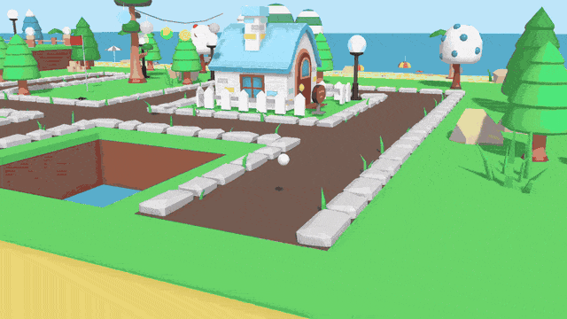

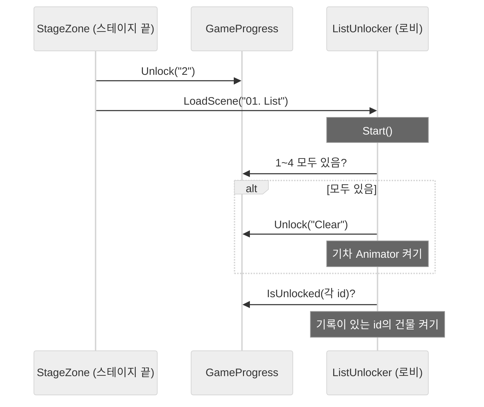

### 4.2 하나의 컴포넌트로 입구와 출구 모두 처리

`StageZone`은 공이 닿으면 기록을 남기고 씬을 옮기는 것만 합니다. `unlockId`를 비워 두면 기록 없이 이동만 하므로, **로비의 입구와 스테이지의 출구에 같은 컴포넌트**를 씁니다.

```csharp
// StageZone.cs
public class StageZone : MonoBehaviour
{
    public string sceneName = "01. List";
    public string unlockId;               // 비워 두면 기록 없이 이동만

    private void OnTriggerEnter(Collider other)
    {
        if (!other.CompareTag("Player")) return;

        if (!string.IsNullOrEmpty(unlockId))
            GameProgress.Unlock(unlockId);

        SceneManager.LoadScene(sceneName);
    }
}
```

| 위치 | `sceneName` | `unlockId` |
|---|---|---|
| 로비 입구 1 ~ 4 | `02. Stage01` ~ `05. Stage04` | (비움) |
| 로비 엔딩 입구 | `99. Clear` | (비움) |
| 각 스테이지 마지막 구간 | `01. List` | `1` ~ `4` |

### 4.3 기록을 보고 마을 채우기

`ListUnlocker`는 "어떤 ID가 기록되면 어떤 오브젝트를 켤지"를 인스펙터의 목록으로 받습니다. 건물은 씬에 미리 배치하되 꺼 둔 상태로 두고, 로비가 시작될 때 기록이 있는 것만 켭니다.

```csharp
// ListUnlocker.cs
[System.Serializable]
public class UnlockTarget { public string id; public GameObject target; }

public UnlockTarget[] targets;          // id → 켤 오브젝트
public string[] requiredIds;            // 최종 해금 조건 ("1" ~ "4")
public string finalId = "Clear";
public Behaviour[] enableOnFinal;       // 최종 해금 시 켤 컴포넌트 (기차 Animator)

private void Start()
{
    // (Why) 건물을 켜기 전에 최종 해금을 먼저 판정
    //       → 4번째 스테이지를 깨고 돌아온 바로 그 순간 마을 전체가 완성되어 보이게
    CheakFinalUnlock();

    if (GameProgress.IsUnlocked(finalId))
        foreach (Behaviour b in enableOnFinal) b.enabled = true;

    foreach (UnlockTarget t in targets)
        if (GameProgress.IsUnlocked(t.id)) t.target.SetActive(true);
}

private void CheakFinalUnlock()
{
    if (requiredIds.Length == 0) return;
    foreach (string id in requiredIds)
        if (!GameProgress.IsUnlocked(id)) return;   // 하나라도 없으면 중단

    GameProgress.Unlock(finalId);
}
```

**로비 씬에 설정한 값**

| id | 켜지는 것 |
|---|---|
| `1` | 파란 집 (`House_1Room_Blue`) |
| `2` | 풍차 (`Windmill_Blue`) |
| `3` | 분홍 집 (`House_3Rooms_Pink`) |
| `4` | 호텔 (`Hotel`) |
| `Clear` | 상점가(`Shops`), 명소(`Locations`), 주택가(`Houses`) + 기차 Animator 활성화 |

기차는 오브젝트를 켜는 대신 **Animator 컴포넌트만 꺼 두었다가 켜는** 방식입니다. 기차는 처음부터 마을에 서 있다가, 마을이 완성되는 순간 움직이기 시작합니다. 그래서 `targets`(GameObject)와 별도로 `enableOnFinal`(Behaviour) 목록을 두었습니다.

### 4.4 고민과 선택: 해금 결과를 어떻게 화면에 반영할 것인가

> **결정 대상:** "스테이지 2를 깨면 풍차가 생긴다" 같은 규칙을 어디에 둘 것인가?

| | [A] 스테이지마다 코드로 작성 | [B] id와 오브젝트를 짝지은 목록을 인스펙터에 ✓ |
|---|---|---|
| 방식 | `if (IsUnlocked("2")) windmill.SetActive(true);`를 스테이지 수만큼 | `ListUnlocker` 하나가 목록을 돌며 처리 |
| 장점 | 흐름이 코드에 그대로 보임 | 건물을 바꾸거나 추가할 때 코드 수정이 없음. 최종 해금도 같은 목록에 `Clear` id로 추가 |
| 단점 | 스테이지나 건물이 바뀔 때마다 코드 수정 | id를 문자열로 맞추므로 오타가 나면 조용히 동작하지 않음 |

**[최종 결정]** [B]를 선택했습니다. 마을의 어디에 무엇을 세울지는 레벨을 만들면서 계속 바뀌는 **배치 작업**이라, 씬을 보며 인스펙터에서 바로 바꿀 수 있는 쪽이 맞았습니다. 같은 id에 오브젝트를 여러 개 연결할 수 있어서, 최종 해금 때 상점가·명소·주택가를 한 번에 켜는 것도 목록에 세 줄을 추가하는 것으로 끝났습니다.

**[감수한 대가]** 입구는 처음부터 네 곳 모두 열려 있고, 어느 스테이지가 쉬운지, 어디부터 가면 좋은지를 알려주는 표시가 없습니다(3.2, 9.2). 또 테스트용 `TestUnlock`(숫자 1키로 해금)이 로비 씬에 켜진 채 남아 있어, 빌드에서도 동작할 수 있습니다(9.4).

---

## 5. 시스템 ③ UI와 연출

### 5.1 스테이지 튜토리얼 팝업

#### 개요

로비와 각 스테이지에 처음 들어가면 그곳의 조작이나 기믹을 설명하는 팝업이 뜨고, 확인을 누를 때까지 게임이 멈춥니다. 한 번 본 팝업은 같은 플레이에서 다시 뜨지 않습니다. 튜토리얼 이미지는 직접 그린 초안을 ChatGPT에 넘겨 완성했습니다(7.2).

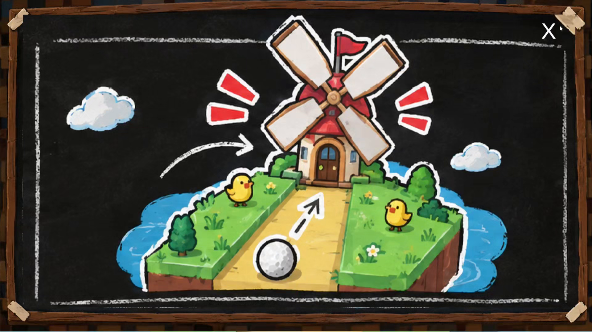

```csharp
// TutorialPopup.cs — 씬마다 stageKey만 다르게 설정 (List, Stage1 ~ Stage4)
private string PrefsKey => $"Tutorial_Seen_{stageKey}";

private void Start()
{
    if (PlayerPrefs.GetInt(PrefsKey, 0) == 0) ShowTutorial();   // 처음이면 표시
    else tutorialPanel.SetActive(false);
}

public void ShowTutorial()
{
    tutorialPanel.SetActive(true);
    if (pauseGameOnStart) Time.timeScale = 0f;   // (Why) 읽는 동안 공과 기믹이 움직이지 않게
}

public void CloseTutorial()
{
    tutorialPanel.SetActive(false);
    PlayerPrefs.SetInt(PrefsKey, 1);             // 이 스테이지는 봤음
    PlayerPrefs.Save();
    if (pauseGameOnStart) Time.timeScale = 1f;
}
```

메인 메뉴의 시작 버튼은 `PlayerPrefs.DeleteAll()`을 부릅니다. 그래서 **새 게임을 시작할 때마다 튜토리얼이 처음부터 다시 나옵니다.** 테스트용으로는 인스펙터 우클릭 메뉴(`ContextMenu`)에 "이 스테이지 기록만 초기화"와 "전체 초기화"를 두었습니다.

#### 고민과 선택: "봤음" 기록을 어디에 둘 것인가

| | [A] `GameProgress`(실행 중에만 유지)에 함께 기록 | [B] `PlayerPrefs`에 스테이지별 키로 저장 ✓ |
|---|---|---|
| 장점 | 기록 위치가 한 곳 | 컴포넌트 하나로 끝남. 다른 스크립트와 무관하게 동작. 테스트 중 키 단위로 초기화 가능 |
| 단점 | 클리어 기록과 성격이 다른 데이터가 섞임 | 문자열 키 관리. 새 게임에서 지우려면 메인 메뉴에서 따로 지워야 함 |

**[최종 결정]** [B]를 선택했습니다. 다만 빌드본에서는 에디터에서 지운 기록과 무관하게 이전 실행의 기록이 남아 팝업이 뜨지 않는 문제가 있어(8.2), 새 게임을 시작할 때 기록을 지우도록 했습니다. 이 게임은 한 번에 처음부터 끝까지 플레이하는 구성이라, 새로 시작한 플레이어가 설명을 다시 보는 것도 의도에 맞았습니다.

**[감수한 대가]** `DeleteAll()`은 튜토리얼 키뿐 아니라 **모든 `PlayerPrefs`를 지웁니다.** 나중에 볼륨 같은 설정을 저장하면 새 게임마다 함께 초기화되므로, 그때는 튜토리얼 키만 골라 지워야 합니다.

### 5.2 ESC 일시정지 창(Pause)과 튜토리얼 모아보기

#### 개요

메인 메뉴를 뺀 모든 씬에서 `ESC`를 누르면 게임이 멈추고 일시정지 창(**Pause**)이 열립니다. `Main`(메인화면으로), `Play`(이어하기), `TIP`(**튜토리얼 모아보기**) 버튼 중 하나를 고를 수 있습니다. 모아보기에서는 튜토리얼 이미지 6장을 이전 · 다음 버튼으로 넘겨 봅니다.

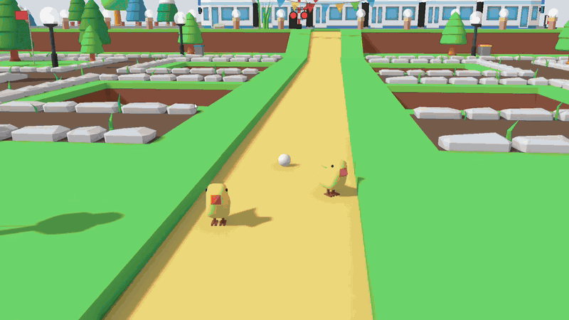

```csharp
// OptionUI.cs — ESC는 "가장 위에 열린 창"부터 닫는다
private void Update()
{
    if (!SimpleInput.GetKeyDown(Key.Escape)) return;

    if (tutorialViewerPanel.activeSelf) CloseTutorialViewer();   // 모아보기가 위에 있으면 그것만 닫기
    else if (isOptionOpen)              CloseOption();
    else                                OpenOption();
}

public void ShowNextPage()
{
    currentTutorialIndex++;
    if (currentTutorialIndex >= tutorialSprites.Length)
        currentTutorialIndex = 0;                                // 마지막 장 다음은 첫 장으로
    UpdateTutorialPage();
}
```

| 상황 | 처리 |
|---|---|
| 모아보기가 열린 채 ESC | Pause 창은 두고 모아보기만 닫기 |
| 메인화면으로 이동 | 씬을 옮기기 전에 `Time.timeScale = 1` 복원 (멈춘 채로 다음 씬이 시작되지 않게) |
| 씬이 사라질 때 | `OnDestroy`에서 버튼 리스너 모두 해제 |

### 5.3 Pause 화면을 코드로 조립하는 에디터 툴

#### 개요

Pause 창의 화면은 `OptionUIBuilder`로 만들었습니다. 빈 오브젝트에 붙이고 컴포넌트 우클릭 메뉴에서 `1. Build UI`를 누르면 캔버스, 반투명 배경, 제목, 버튼 3개가 기준 해상도 1920×1080에 맞춰 생성됩니다. 이 스크립트는 Claude에 UI 빌더 프롬프트와 시안을 주고 만들었습니다(7.2).

| 설계 | 내용 |
|---|---|
| 화면과 로직 분리 | 빌더는 **화면만 만들고 게임 로직은 연결하지 않음.** 버튼 동작은 `OptionUI`가 인스펙터 참조로 연결 |
| 다시 만들기 안전 | 같은 이름의 루트가 있으면 생성을 멈추고 `2. Clear UI`를 먼저 안내. 생성 · 삭제 모두 `Undo` 등록 |
| 수치는 상수로 | 버튼 크기(340×240), 간격, 색상을 맨 위 상수로 모아, 시안이 바뀌면 숫자만 수정 |
| 빌드에서 제외 | 파일 전체를 `#if UNITY_EDITOR`로 감쌈 |

### 5.4 엔딩 카메라 연출

엔딩 씬이 시작되면 카메라가 수평에서 1초 기다린 뒤, 2초 동안 하늘로 고개를 들어 골프공 모양의 달을 비춥니다.

```csharp
// CameraRotation.cs — X축(위아래)만 돌리고 Y·Z는 유지
cameraTransform.eulerAngles = new Vector3(-1f, currentRot.y, currentRot.z);   // 수평에서 시작

cameraTransform.DORotate(new Vector3(-36f, currentRot.y, currentRot.z), rotateDuration)
    .SetDelay(waitTime)
    .SetEase(Ease.InOutQuad);   // 천천히 출발해 천천히 멈춤
```

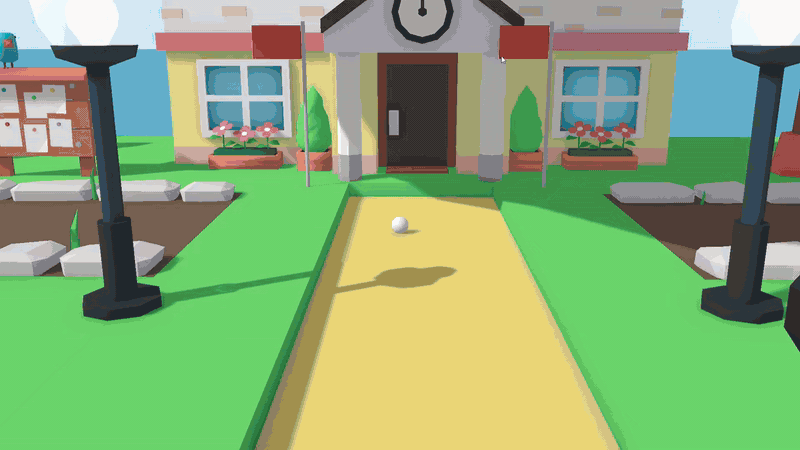

---

## 6. 레벨 디자인

### 6.1 설계 원칙

작업지시서는 "장애물 하나는 플레이어에게 던지는 **질문 하나**"이고, "난이도는 장애물 안에 있지 않고 **배치 안에** 있다"고 정의합니다. 이 기준에 맞춰 스테이지마다 질문 하나를 정하고, **구간 1에서 그 질문을 안전하게 소개한 뒤 구간 2에서 조건을 바꿔 다시 묻는** 구조로 만들었습니다.

| 스테이지 | 장애물이 묻는 것 | 구간 1 (소개) | 구간 2 (응용) | 구간 3 |
|---|---|---|---|---|
| 1 · 기본 조작 | "원하는 대로 칠 수 있어?" | 가드가 있는 코스에서 마우스 조작 익히기 | 홀 뒤 가드 제거 → **세기 조절** | 양옆 가드 제거 → **방향 조절** |
| 2 · 풍차 | "날개 사이로 언제 칠래?" | 풍차를 피해 홀로 | 풍차 수 증가 | — |
| 3 · 기차 | "움직이는 기차와 타이밍을 맞출 수 있어?" | 기차 = **장애물**. 지나가지 않을 때 선로를 건너기 | 기차 = **발판**. 지나가는 순간에 맞춰 기차 위로 건너기 | — |
| 4 · 도개교 | "다리가 열린 틈을 노릴 수 있어?" | 한쪽으로 열리는 도개교 | 양쪽에서 열리는 도개교 + 지나가는 배 | — |

**사용한 난이도 요소** (작업지시서의 "난이도를 결정짓는 요소" 기준)

| 요소 | 쓴 곳 |
|---|---|
| 실패의 대가 (가드 제거 → 바다로 낙하) | 스테이지 1 구간 2 · 3 |
| 파워 정밀도 | 스테이지 1 구간 2 (홀 뒤가 비어 있어 너무 세면 바다로) |
| 조준 정밀도 | 스테이지 1 구간 3 (양옆이 비어 있어 방향이 틀리면 바다로) |
| 타이밍 창 | 스테이지 2 ~ 4 (풍차 날개, 기차, 도개교) |
| 배치 수 · 겹침 | 스테이지 2 ~ 4의 구간 2 (장애물 수 증가, 도개교 + 배) |
| 같은 장애물의 역할 바꾸기 | 스테이지 3 (피하던 기차를 구간 2에서 발판으로 사용) |

### 6.2 스테이지별 구성

#### Stage 1 · 기본 조작

장애물 없이 **가드(난간)를 하나씩 빼는 것**만으로 난이도를 올렸습니다. 구간 1은 가드가 공을 받아 줘서 조작만 익히면 되고, 구간 2는 홀 뒤 가드가 없어 세기를, 구간 3은 양옆 가드가 없어 방향을 정확히 맞춰야 합니다. 새 장애물은 없지만, 이후 스테이지에서 필요한 세기와 방향 조절을 따로 떼어 연습시키는 구간입니다.

#### Stage 2 · 풍차

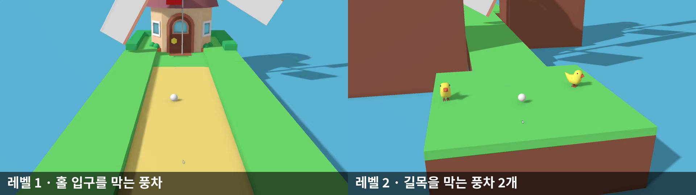

홀 입구 앞에서 풍차 날개가 돌고 있어, 날개 사이가 열린 순간에 맞춰 쳐야 합니다. 풍차는 CartoonTown 에셋의 프리팹과 회전 애니메이션을 그대로 사용했습니다. 구간 2에서는 풍차 수를 늘렸습니다.

#### Stage 3 · 기차

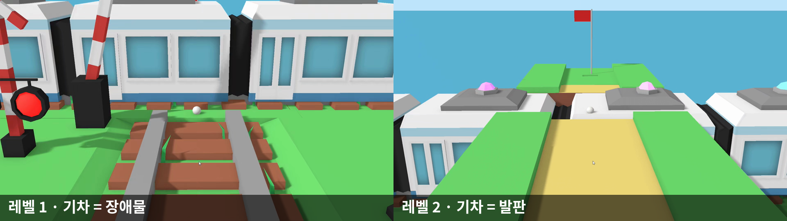

같은 기차를 두 구간에서 **반대 역할**로 썼습니다. 구간 1에서 기차는 선로를 가로지르는 장애물이라, 기차가 지나가지 않는 틈에 건너야 합니다. 구간 1에서 "기차가 언제 지나가는지"를 익힌 플레이어는, 구간 2에서 그 타이밍을 거꾸로 이용해 **지나가는 기차 위로** 공을 건너보내야 합니다. 새 장애물을 추가하지 않고도, 이미 배운 규칙을 다른 조건에서 다시 쓰게 만드는 응용 구간입니다. 기차 이동 애니메이션은 구간마다 따로 만들었습니다(`Stage03Level01TrainMove`, `Stage03Level02TrainMove`).

#### Stage 4 · 도개교

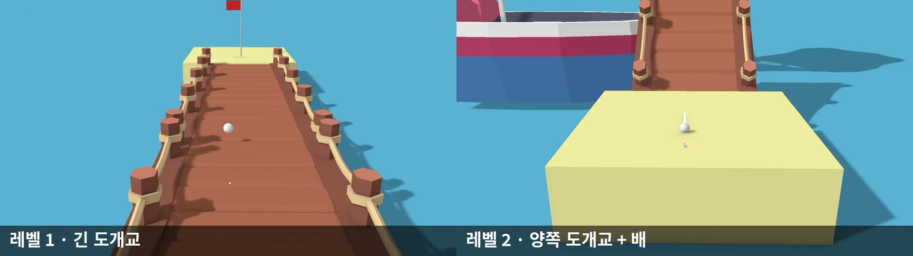

구간 1은 한쪽으로 열리는 도개교 하나로 "다리가 닫혀 있을 때 건넌다"는 규칙을 소개합니다. 구간 2는 양쪽에서 열리는 도개교로 바뀌고, 다리가 열린 사이로 배가 지나갑니다. 다리와 배가 **함께 움직이는 장면**이 되어, 마지막 스테이지다운 볼거리를 주었습니다.

### 6.3 애니메이션으로 만든 기믹

| 기믹 | 애니메이션 | 제작 |
|---|---|---|
| 풍차 날개 | 에셋 기본 회전 애니메이션 | 에셋 그대로 |
| 스테이지 3 기차 | `Stage03Level01TrainMove`, `Stage03Level02TrainMove` | 직접 제작 |
| 한쪽 도개교 | `Bridge01` | 직접 제작 |
| 양쪽 도개교 | `Bridge02` | 직접 제작 |
| 스테이지 4 배 | `Stage04Level02BoatMove` | 직접 제작 |
| 로비 기차 (엔딩 직전 출발) | `Train` | 직접 제작 |

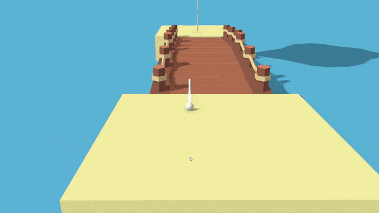

스테이지 4 구간 2: 공이 다리를 건넌 뒤 양쪽 도개교가 들어 올려지고, 그 사이로 배가 지나갑니다.

회전하는 다리와 배는 오브젝트를 바로 애니메이션하지 않고, 빈 부모(`BridgePivot`, `Boat Pivot`) 아래에 넣어 **자식의 로컬 좌표를 애니메이션**했습니다. 이유는 8장에서 설명합니다.

#### 고민과 선택: 움직이는 기믹을 스크립트로 만들 것인가, 애니메이션으로 만들 것인가

| | [A] 스크립트 (제공 예제의 왕복 · 회전 스크립트 방식) | [B] Animator 애니메이션 클립 ✓ |
|---|---|---|
| 장점 | 속도 · 주기를 숫자 하나로 조절. 물리 갱신 주기에 맞추기 쉬움 | 다리가 열리는 각도, 기차의 감속처럼 **움직임의 모양**을 키프레임으로 직접 디자인. 코드 없이 씬에서 바로 확인 |
| 단점 | 단순한 왕복 · 회전 외의 움직임은 코드가 길어짐 | 타이밍을 바꾸려면 클립을 수정해야 함. 오브젝트 위치에 따라 엉뚱한 곳에서 재생되는 문제(8장) |

**[최종 결정]** [B]를 선택했습니다. 첫 2D 프로젝트에서는 애니메이션을 다루지 못해 움직임을 모두 코드로 처리했고, 그 뒤 따로 공부한 Animator를 이번 프로젝트에서 직접 써 보는 것이 개인 목표였습니다(1.2). 레벨 디자인 과제라 움직임의 **모양과 타이밍**이 곧 난이도였기 때문에, 그것을 눈으로 보며 조정할 수 있는 애니메이션이 잘 맞았습니다.

**[감수한 대가]** 각 기믹의 주기와 속도가 클립 안에 들어 있어서, 난이도를 조금만 바꾸려 해도 키프레임을 다시 옮겨야 합니다. 또 처음에는 오브젝트 자체의 위치값 때문에 애니메이션이 엉뚱한 방향이나 위치에서 재생되는 문제가 있었습니다(8장).

---

## 7. 개발 과정

### 7.1 개발 타임라인

마감(10/8)까지 커밋 6개로 진행했습니다. 커밋 작성자는 `Yun Seung Min`과 `seungmin` 두 이름이 섞여 있는데, 모두 본인입니다.

| 날짜 | 커밋 | 한 일 |
|---|---|---|
| 10/01 | `Initial commit` (강사) | 과제 레포 생성, 제공 코드와 예제 씬 |
| 10/04 | `Test.md, CartoonTown Assets` | 마을 에셋(CartoonTown) 도입 |
| 10/05 | `Main, List, Stage01, Stage02` | 메인 · 로비 · 스테이지 1~3 씬 배치, 당겨 치는 샷(`Golf`), 로비 이동(`LobbyController`), `hopRatio` |
| 10/06 | `Stage` | 스테이지 입장(`StageZone`), 메인 메뉴, 스테이지 4 착수 |
| 10/06 | `StageUnlock` | 클리어 기록(`GameProgress`), 로비 건물 해금(`ListUnlocker`), 구간 이동(`ClearZone`) |
| 10/07 | `Loop` | 엔딩 씬, 최종 해금, 바다 복귀(`WaterTrigger`), 로비 기차 애니메이션 → **처음부터 끝까지 한 바퀴 도는 흐름 완성** |
| 10/08 | `Build` | 스테이지 4 완성(도개교 · 배), 튜토리얼 · ESC 일시정지(Pause) 창 · UI 빌더, 엔딩 카메라, 하늘(Polyverse Skies), 빌드 설정(커서, 씬 등록) |

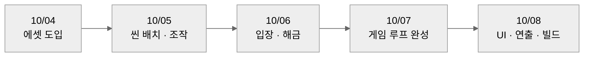

처음 사흘은 **씬 배치와 조작**, 그다음 하루는 **처음부터 끝까지 이어지는 흐름**을 만드는 데 썼고, 튜토리얼 · 옵션 같은 편의 UI와 엔딩 연출은 마지막 날에 붙였습니다.

### 7.2 AI와 외부 리소스 활용

| 대상 | 도구 · 출처 | 내가 한 일 | 맡긴 일 |
|---|---|---|---|
| Pause 화면 빌더 (`OptionUIBuilder`) | Claude | 시안과 UI 빌더 프롬프트 작성, 결과 확인 후 `OptionUI`와 연결 | 시안대로 캔버스 · 버튼을 생성하는 에디터 스크립트 작성 |
| 튜토리얼 이미지 6장 | ChatGPT | 화면 구성 초안을 직접 그려서 전달 | 초안을 바탕으로 완성 이미지 생성 |
| 마을 · 풍차 · 기차 · 다리 · 배 모델 | CartoonTown LowPoly 에셋 | 배치, 기차 · 다리 · 배 애니메이션 직접 제작 | 모델, 풍차 회전 애니메이션 |
| 하늘 | Polyverse Skies 에셋 | 적용 | 하늘 셰이더 |
| 공 물리 · 카메라 · 입력 | 수업 제공 코드 | `hopRatio` 추가, 그 위에 조작 · 진행 · UI 작성 (1.5) | — |

AI에는 **정해진 시안을 그대로 옮기는 반복 작업**(UI 계층 생성, 이미지 완성)을 맡기고, 무엇을 어디에 어떻게 보여줄지는 직접 정했습니다.

---

## 8. 문제 해결 기록

### 8.1 애니메이션이 엉뚱한 위치 · 방향에서 재생되는 문제

- **(문제)** 도개교와 배에 애니메이션을 넣자, 씬에 배치한 자리가 아닌 엉뚱한 위치에서 움직이거나 의도와 다른 방향으로 회전했습니다.
- **(원인)** 애니메이션 클립의 위치 · 회전 키는 그 오브젝트 자체의 Transform 값을 덮어씁니다. 그래서 오브젝트를 직접 애니메이션하면 씬에서 옮겨 둔 위치보다 클립에 기록된 값이 우선하고, 회전도 모델의 원점을 축으로 일어납니다. 도개교처럼 **한쪽 끝을 축으로 들어 올려야 하는** 물체는 모델 원점이 축과 다르면 엉뚱하게 돕니다.
- **(해결)** 빈 부모 오브젝트(`BridgePivot`, `Boat Pivot`)를 원하는 위치와 회전축에 두고, 모델은 그 자식으로 넣은 뒤 **자식의 로컬 값을 애니메이션**했습니다. 배치는 부모로, 움직임은 자식으로 나눈 것입니다.
- **(결과)** 도개교는 씬에 놓은 자리에서 한쪽 끝을 축으로 열리고, 배도 배치한 위치에서 출발해 다리 사이를 지나가게 됐습니다. 부모만 옮기면 애니메이션을 다시 만들지 않고도 위치를 조정할 수 있습니다.
- **(배운 점)** 움직이는 오브젝트는 "어디에 놓는가(부모)"와 "어떻게 움직이는가(자식)"를 처음부터 나눠 두면, 같은 애니메이션을 다른 자리에 재사용할 수 있습니다.

### 8.2 빌드에서 튜토리얼 팝업이 다시 뜨지 않는 문제

- **(문제)** 에디터에서 튜토리얼 기록을 전체 초기화(`Reset ALL Tutorial Records`)한 뒤 빌드해도, 빌드본을 실행하면 튜토리얼을 이미 본 것으로 처리되어 팝업이 뜨지 않았습니다.
- **(원인)** Windows에서 `PlayerPrefs`는 레지스트리에 저장되는데, **에디터와 빌드본은 서로 다른 경로에 저장**합니다. 에디터에서 지운 것은 에디터의 기록뿐이고, 빌드본이 한 번 실행되며 남긴 "봤음" 기록은 그대로 남아 있었습니다.
- **(해결)** 메인 메뉴의 시작 버튼(`MainMenu.StartGame()`)에서 `PlayerPrefs.DeleteAll()`을 호출해, 어느 환경에서든 새 게임을 시작하면 튜토리얼 기록이 초기화되도록 했습니다.
- **(결과)** 빌드본에서도 새 게임을 시작하면 로비와 각 스테이지의 튜토리얼 팝업이 처음 들어갈 때 다시 표시됩니다.
- **(남은 점)** `DeleteAll()`은 튜토리얼 외의 저장값까지 모두 지웁니다. 지금은 다른 저장값이 없어 문제가 없지만, 설정 값을 저장하게 되면 튜토리얼 키만 지우도록 바꿔야 합니다(5.1, 9.4).
- **(배운 점)** 에디터에서의 초기화가 빌드에도 적용된다고 가정하면 안 됩니다. 저장 데이터는 **게임 안에서 초기화하는 경로**를 따로 만들어 두어야 합니다.

### 8.3 빌드에서 하늘의 해가 사라지는 문제

- **(문제)** 에디터의 Game 뷰에서는 Polyverse Skies 하늘에 해가 보였지만, 빌드한 실행 파일에서는 해가 사라졌습니다.
- **(원인)** 하늘 머티리얼의 해 방향 설정(`Sun Direction`)이 기본값 **Global From Script**였습니다. 이 모드는 `PolyverseSkies` 스크립트가 매 프레임 넣어 주는 전역 셰이더 값(`PolyverseSunDir`)으로 해의 위치를 정합니다. 그런데 이 스크립트가 게임 씬에 없어서, 빌드에서는 해 방향 값을 받지 못해 해가 그려지지 않았습니다. 에디터에서는 이 스크립트가 편집 모드에서도 실행되는 스크립트(`ExecuteInEditMode`)라서, 에셋을 확인하며 넣어 둔 값이 에디터에 남아 보였던 것으로 보입니다.
- **(해결)** 사용하는 하늘 머티리얼(`Sky 01`)의 설정을 **Local From Material**로 바꿔, 스크립트 없이 머티리얼에 저장된 방향값으로 해를 그리게 했습니다.
- **(결과)** 빌드에서도 에디터와 같은 위치에 해가 표시됩니다. 해 방향이 머티리얼에 저장되므로, 씬에 하늘 스크립트를 따로 두지 않아도 됩니다.
- **(배운 점)** 에디터에서만 보이는 결과는 에디터 전용 실행(편집 모드 스크립트, 에디터 세션에 남은 전역 값)에 기대고 있을 수 있습니다. 외부 에셋은 **빌드에서 무엇에 의존하는지** 설정 항목을 먼저 확인해야 합니다.

---

## 9. 돌아보기

### 9.1 과제 요구사항은 지켜졌나

| 요구 | 결과 | 비고 |
|---|---|---|
| 새 장애물 3종 이상 | ✅ | 풍차, 기차(장애물 → 발판), 도개교 + 배 |
| 소개 코스 | ✅ | 스테이지 2~4의 구간 1 |
| 응용 코스 | ✅ | 스테이지 2~4의 구간 2 |
| 심화 코스 | △ | 따로 만들지 못함 (9.3) |
| 처음 보는 장애물을 위험한 곳에서 만나게 하지 않기 | ✅ | 튜토리얼 팝업 + 구간 1 소개 |
| 총 플레이 3분 이상 | ✅ | 처음부터 엔딩까지 약 5분 51초 (녹화 영상 기준) |

과제 요구 외에 **로비와 마을이 살아나는 컨셉**, 진행에 따른 해금, 엔딩 연출을 더해 코스 묶음이 아닌 하나의 게임으로 완성했습니다.

### 9.2 플레이 테스트에서 알게 된 것

다른 사람들에게 테스트를 부탁했더니, **가장 쉬운 스테이지 1을 가장 나중에 깨는** 경우가 나왔습니다. 오픈월드 느낌을 위해 순서를 강제하지 않았는데(3.2), 순서를 강제하지 않는 것과 **안내하지 않는 것**은 다른 문제였습니다. 조작을 익히는 스테이지 1을 건너뛴 플레이어는 가드가 없는 구간이나 움직이는 기믹을 기본 조작이 서툰 상태로 만나게 되고, 이는 제가 세운 "새 요소는 한 번에 하나" 원칙(1.2)을 플레이어 쪽에서 깨뜨리게 됩니다. 선택은 자유롭게 두되, 입구에 번호나 난이도 표시를 두어 **권장 순서는 보여줬어야** 했습니다.

### 9.3 아쉬운 점: 심화 코스

과제의 심화 코스는 "여러 질문이 겹쳐도 풀 수 있는가, 위험과 보상을 고를 수 있는가"를 묻는 단계입니다. 이번에는 스테이지마다 소개와 응용까지만 만들었고, 스테이지 4 구간 2(도개교 + 배)가 그나마 두 움직임이 겹치는 구간이었습니다. 풍차 · 기차 · 도개교를 **한 코스에서 함께** 만나게 하거나, 위험한 지름길과 안전한 우회로 중 하나를 고르게 하는 코스가 있었다면 과제의 세 단계를 모두 채울 수 있었을 것입니다.

### 9.4 남은 과제

| 항목 | 현재 | 개선 방향 |
|---|---|---|
| 권장 순서 표시 | 입구 4개에 순서 · 난이도 정보 없음 | 입구에 번호나 난이도 표지판 추가 (자유 선택은 유지) |
| 심화 코스 | 없음 | 세 기믹을 겹친 마지막 코스, 지름길 / 우회로 선택 |
| R 리스폰 위치 | 구간 2에서도 스테이지 처음으로 이동 | `ClearZone`에서 `Golf`의 시작 지점도 함께 갱신 |
| 테스트 단축키 | `TestUnlock`이 로비 씬에 켜진 채 빌드에 포함 | 에디터에서만 동작하도록 `#if UNITY_EDITOR`로 감싸기 |
| 새 게임 초기화 | `PlayerPrefs.DeleteAll()`로 모든 저장값 삭제 | 튜토리얼 키만 골라 삭제 |
| 진행도 저장 | 게임을 끄면 클리어 기록 사라짐 | `GameProgress` 안에서만 저장 · 불러오기 추가 (2.4) |

### 9.5 다음 작업에 가져갈 것

- **같은 장애물의 역할을 바꾸면 새 장애물 없이도 응용이 된다.** 스테이지 3에서 피하던 기차를 발판으로 바꾼 것처럼, 응용 구간은 무엇을 더할지보다 이미 배운 규칙을 **어떻게 다시 물을지**로 설계할 수 있습니다.
- **움직이는 오브젝트는 부모(배치)와 자식(움직임)으로 나눈다** (8.1).
- **플레이 테스트와 빌드는 일찍, 자주.** 스테이지 순서 문제(9.2), 빌드에서 튜토리얼이 뜨지 않은 문제(8.2), 해가 사라진 문제(8.3)는 모두 다른 사람의 손이나 실제 빌드에서만 드러났습니다.

---
