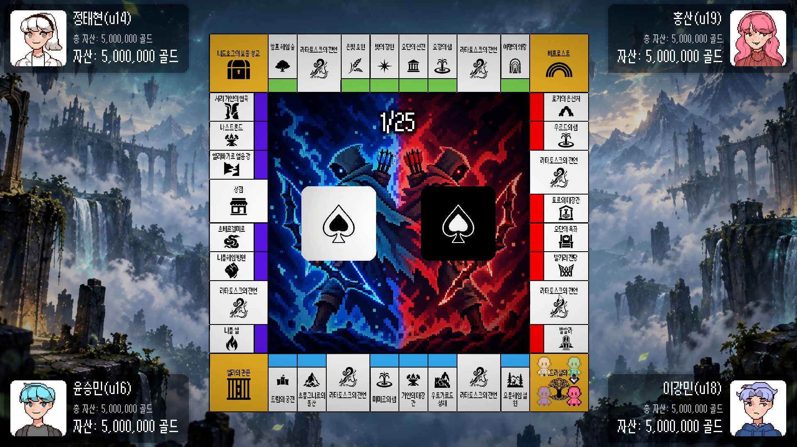
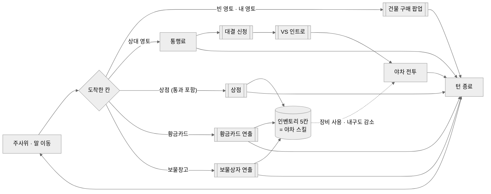
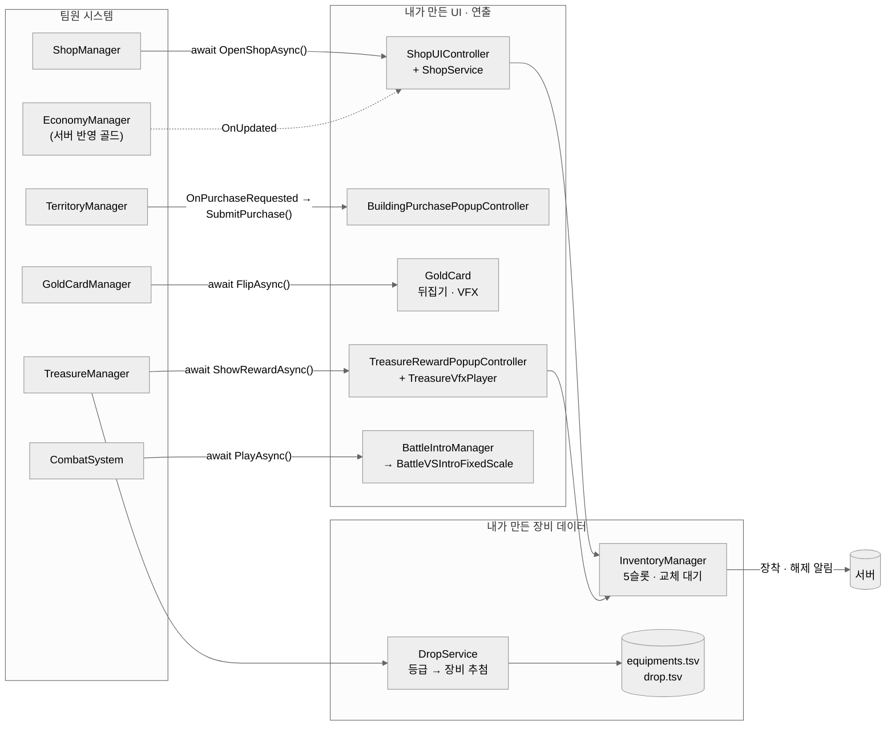
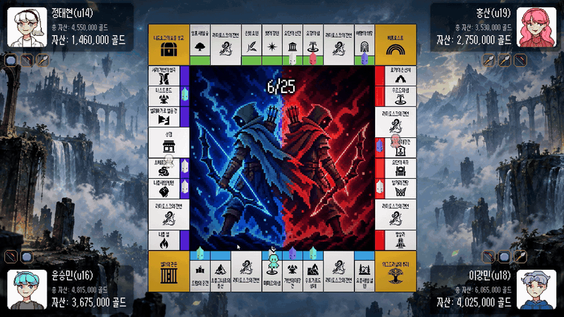
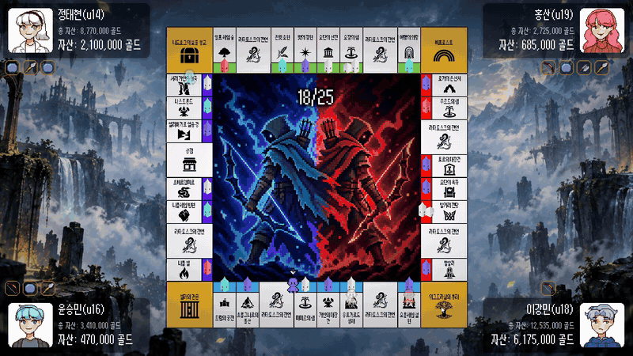
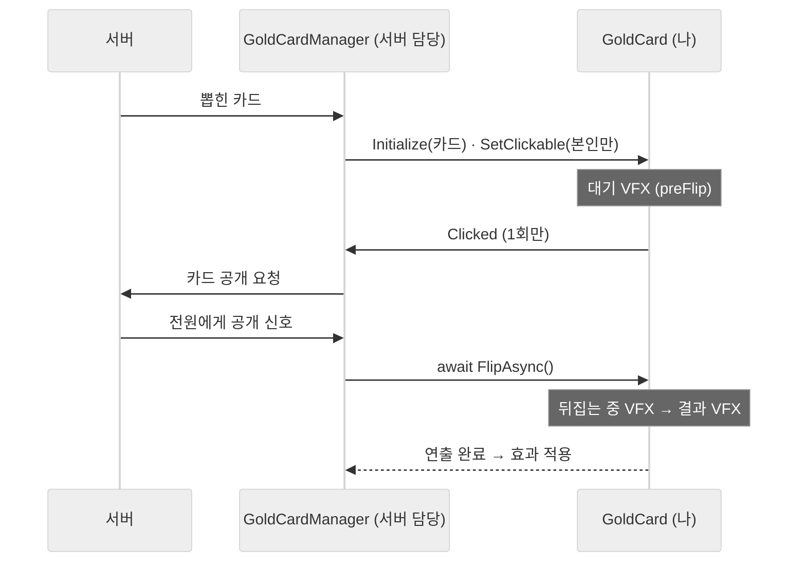
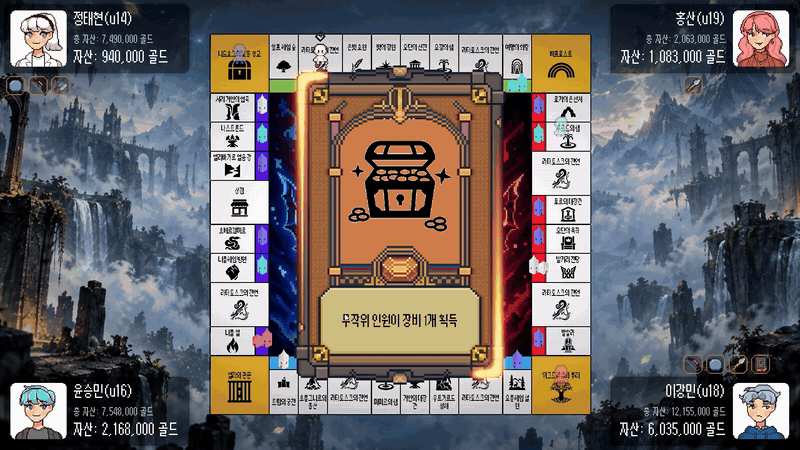
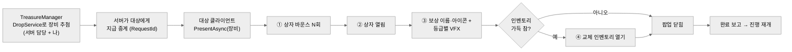
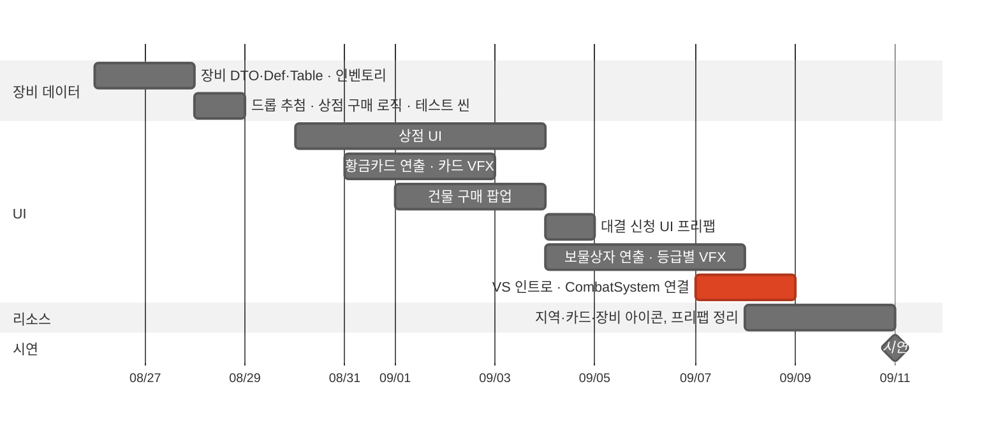
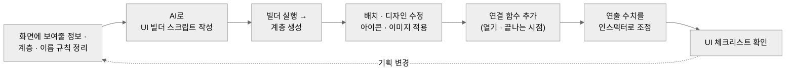

# 이그드라실 — UI · VFX · 장비 시스템 기술 문서

> 팀 프로젝트 · 보드 디자인, UI, VFX, 장비 · 인벤토리 담당

---

## 0. 한 장 요약



**이그드라실**은 부루마블식 자산 경쟁과 1:1 실시간 대전 **'야차'**를 결합한 2~4인 온라인 보드게임입니다. 저는 3인 팀에서 **보드 디자인과 UI·VFX 연출, 장비·인벤토리·드롭 데이터 시스템**을 맡았습니다.

| 항목 | 내용 |
|---|---|
| 장르 | 부루마블 + 1:1 실시간 대전 (북유럽 신화 배경) |
| 기간 · 인원 | 2026.08.20 ~ 2026.09.11 (약 3주) · 3인 (시작 4인, 1인 중도 이탈) |
| 내 역할 | 보드 디자인(메인 이미지·지역 아이콘·에셋), UI(상점·구매 팝업·황금카드·보물상자·대결 신청·전투 인트로), VFX, 장비·인벤토리·드롭 데이터 |
| 환경 | Unity 6 (6000.3.15f1, C#, uGUI), UniTask, DOTween, Odin Inspector, ParrelSync, AI(UI 빌더 스크립트 생성 보조), ChatGPT(메인 이미지 생성, 5.4) |
| 링크 | [GitHub (팀 레포)](https://github.com/KooHoo-Dev/3rd-TeamProject-KM) · 시연 영상: https://youtu.be/CQVLYCzNcjQ |

**핵심 기술 3가지**

| # | 기술 | 한 줄 설명 | 문서 위치 |
|---|---|---|---|
| 1 | **await 가능한 UI** | 상점·보물상자·전투 인트로를 "끝날 때까지 기다릴 수 있는 함수"로 만들어, 게임 로직이 UI 내부를 몰라도 `await` 한 줄로 연출이 끝난 뒤 진행하게 했습니다 | 3.1 · 3.4 · 3.6 |
| 2 | **하나로 모은 장비 획득 경로** | 상점 구매와 보물상자·황금카드 보상이 같은 `TryAddEquipment`를 거쳐, 인벤토리가 가득 찼을 때의 교체 흐름을 한 곳에서 처리했습니다 | 4.2 |
| 3 | **데이터로 조정하는 장비·드롭** | 장비 10종과 드롭 확률(획득처 3종 × 등급 3)을 TSV로 분리하고 "등급 → 장비" 2단계 추첨으로 만들어, 확률 조정을 코드 수정 없이 했습니다 | 4.1 · 4.3 |

---

## 1. 프로젝트 개요

### 1.1 무엇을 만들었나 (What)

이그드라실은 북유럽 신화 세계를 배경으로, 플레이어들이 영토를 사고 서로의 땅을 걸고 대결을 하는 경쟁 멀티플레이 형식의 보드게임입니다. 상대 영토에 도착하면 통행료를 낸 뒤 1:1 횡스크롤 대전 '야차'를 걸어 그 영토를 빼앗을 수 있고, 보드에서 모은 장비가 야차의 스킬이 됩니다.

이 프로젝트에서 저는 보드의 전반적인 디자인과 UI, VFX 그리고 장비 및 인벤토리를 담당했습니다. 보드 규칙과 서버는 서버 담당 팀원이, 야차 전투는 팀장이 만들었으므로, 이 문서에서는 **제가 만든 화면·연출·장비 데이터와 그것을 두 팀원의 시스템에 연결한 지점**까지만 다룹니다.

**핵심 루프와 내 화면이 나오는 지점** (굵은 테두리가 제가 만든 화면)



플레이어는 보드를 돌며 **영토를 늘리고 장비를 모으고**, 상대 영토에서는 모은 장비로 싸울지 고릅니다. 제가 만든 화면은 이 루프에서 **플레이어가 무언가를 얻거나 고르는 순간**에 나옵니다.


**레퍼런스와 다른 점**

| 레퍼런스 | 가져온 것 | 이그드라실에서 다른 점 |
|---|---|---|
| 부루마블 | 영토 구매 · 건물 · 통행료로 이어지는 보드 진행 | 상대 영토에서 통행료만 내지 않고 **결투로 영토를 빼앗을 수 있음**, 보드에서 장비를 모음 |
| 니드호그 | 상대와 직접 맞붙는 1:1 결투 | 결투 전에 **보드에서 모은 장비가 스킬**이 되어, 보드의 선택이 결투에 이어짐 |

### 1.2 왜 만들었나 (Why)

#### 기획 배경: 왜 북유럽 신화 보드게임인가

이 게임이 주려는 경험은 영토를 두고 플레이어끼리 직접 맞붙는 부루마블입니다. 팀은 PVP 게임 '니드호그'와 보드게임을 합치는 방향으로 기획을 시작했습니다. 부루마블에서는 영토를 사고 통행료를 받는 보드 진행 구조를, 니드호그에서는 상대와 직접 맞붙는 결투 방식을 가져왔습니다.

다만 두 장르를 합치는 것만으로는 게임을 관통하는 뚜렷한 방향성이 부족하다고 느꼈고, 이를 하나로 묶어줄 테마가 필요했습니다.

고민하던 중 두 가지 공통점에 주목했습니다. 하나는 플레이어들이 영토를 두고 서로 싸운다는 점, 다른 하나는 부루마블이 같은 길을 반복해서 순환하는 구조라는 점입니다. 이 두 특징에서 북유럽 신화의 생명과 파괴의 순환을 상징하는 세계수 '이그드라실'이 떠올랐습니다.

팀원들과 논의한 끝에 게임의 테마를 북유럽 신화로 확정했고, 이에 맞춰 보드의 각 칸 이름을 북유럽 신화의 대표적인 지역으로 구성했습니다. 또한 각 지역의 분위기에 어울리는 아이콘을 제작해 적용함으로써, 보드를 도는 경험 자체가 신화 속 세계를 여행하는 느낌을 주도록 했습니다.

#### UI 설계 기준: 왜 이렇게 구현했나

UI는 플레이어가 게임과 만나는 접점이지만, 게임의 결과를 정하는 곳은 아닙니다. 이 프로젝트에서 세운 기준은 **"UI는 확정된 결과를 보여주고, 연출이 끝났다는 사실만 알린다"** 였습니다.

이 기준은 세 가지 형태로 드러납니다.

| 기준 | 적용 |
|---|---|
| UI는 결과를 계산하지 않는다 | 상점의 골드 표시는 직접 계산하지 않고, 서버에 반영된 골드 갱신 이벤트(`EconomyManager.OnUpdated`)를 받아 표시합니다. 황금카드는 어떤 카드가 나올지 서버가 정하고, 카드 UI는 받은 카드를 뒤집어 보여주기만 합니다 |
| UI는 "끝났다"만 알린다 | 상점·보물상자·전투 인트로를 `UniTask`를 돌려주는 함수로 만들어, 게임 로직은 연출이 끝날 때까지 `await`로 기다리기만 합니다(3장) |
| 수치는 데이터에 둔다 | 기획 변경이 잦았기 때문에 장비 능력치·가격·드롭 확률을 TSV로 분리하고(4장), 연출 수치는 인스펙터 값으로 열어 코드 수정 없이 조정했습니다 |

마지막 기준은 실제로 필요했습니다. 장비 수치는 **시연 이틀 전(09-09)에도 10종 전체가 한꺼번에** 바뀌었습니다. 예를 들어 투척 단검은 가격 100 → 250,000, 쿨타임 2.0 → 4.0초, 내구도 3 → 5로 바뀌었는데, 초기 자금(5,000,000) 규모에 맞춰 경제 밸런스를 다시 잡은 것입니다. 이런 변경이 코드 수정으로 이어졌다면 시연 직전에 화면과 로직을 다시 테스트해야 했습니다(결과는 7.2).

이 문서는 전체 구조와 연결 지점(2장), 화면과 연출(3장), 장비·인벤토리·드롭 데이터(4장), 협업 방식(5장), 문제 해결 기록(6장), 돌아보기(7장)를 차례로 설명합니다.

### 1.3 팀 구성과 내 역할

| 담당 | 역할 |
|---|---|
| 팀장 | 일정·범위 관리, 야차 전투 클라이언트 (조작·장비 스킬·판정) |
| 서버 담당 팀원 | 보드 규칙 전체, 서버, 클라이언트 네트워크, 전투 온라인 연동 |
| **나** | 보드 디자인, UI·VFX 연출, 장비·인벤토리·드롭 데이터 |
| (중도 이탈 팀원) | 전투 초기 기반 코드 |

**내가 작성한 범위** (git blame 기준, 현재 코드)

| 영역 | 주요 클래스 | 비고 |
|---|---|---|
| 상점 | `StoreUIBuilder`, `ShopUIController`, `ShopService`, 슬롯 교체 확인 팝업 | `ShopUIController`의 구매 처리는 온라인 연동 때 서버 담당 팀원이 골드 대기 부분을 함께 수정 |
| 건물 구매 팝업 | `BuildingPurchasePopup`, `PurchaseCheckboxChain`, `BuildingPurchasePopupController`(화면 부분) | `TerritoryManager`와의 구독·제출 연결은 서버 담당 팀원과 함께 정리 |
| 황금카드 | `GoldCard`(뒤집기 연출 · VFX), 카드 프리팹 | 카드 뽑기·공개 동기화·효과는 서버 담당 팀원 |
| 보물상자 | `TreasureRewardPopupController`, `TreasureVfxPlayer`, `TreasureUIbuilder` | 지급 요청과 완료 동기화(`TreasureManager`의 RequestId)는 서버 담당 팀원 |
| 대결 신청 | `FightUI` 프리팹 (화면 구성) | 신청·응답 모드 전환, 거절 성공률·내구도 표시 코드(`FightUI.cs`)는 서버 담당 팀원 |
| 전투 인트로 | `BattleVSIntroFixedScale`, `BattleIntroManager`, `CombatSystem` 호출 한 줄 | 전투 UI(`CombatUI`)는 팀장 |
| 장비 · 드롭 | `EquipmentDTO`·`EquipmentDef`·`EquipmentTable`, `InventoryManager`, `DropDef`·`DropTable`·`DropService`, `equipments.tsv`, `drop.tsv` | 장비 사용(스킬)은 팀장 |
| 리소스 | 보드 메인 이미지, 보드 지역 아이콘, 황금카드 아이콘, 장비 아이콘·프리팹, 보물상자·VS 인트로·승패 프리팹 | 메인 이미지는 ChatGPT로 생성, 아이콘은 직접 제작 (5.4) |

### 1.4 화면 기능 한눈에 보기

| 시스템 | 언제 나오나 | 한 줄 요약 | 상세 |
|---|---|---|---|
| 상점 | 상점 칸에 도착하거나 지나갈 때 | 일반 등급 장비 5종 구매, 가득 찼으면 슬롯 교체 | 3.1 |
| 건물 구매 팝업 | 빈 영토 · 내 영토에 도착 | 영토 → 건물 → 랜드마크를 한 팝업에서 선택 | 3.2 |
| 황금카드 | 황금카드 칸 도착 | 카드 뒤집기와 단계별 VFX | 3.3 |
| 보물상자 | 보물창고 칸 · 장비 획득 황금카드 | 상자 바운스 → 열림 → 등급별 VFX → 교체 | 3.4 |
| 대결 신청 | 상대 영토에서 통행료를 낸 뒤 / 신청을 받았을 때 | 두 플레이어의 초상화와 장비 5칸을 나란히 보여주고 결투 여부 선택 | 3.5 |
| 전투 VS 인트로 | 야차 시작 직전 | 단어 등장 · 카메라 흔들림 · 피날레 VFX | 3.6 |

---

## 2. 전체 구조

### 2.1 아키텍처



팀원 시스템에서 내 UI로 들어오는 화살표는 모두 **함수 호출 하나 또는 이벤트 하나**입니다. 팀원 쪽은 화면이 어떻게 생겼는지 모르고, "열어라 / 끝날 때까지 기다린다"만 압니다.

### 2.2 클래스 역할

| 클래스 | 하는 일 | 하지 않는 일 |
|---|---|---|
| `ShopUIController` | 상점 패널 표시, 카드 5개·인벤토리 슬롯 5개 갱신, 구매·교체 입력, 닫힐 때 대기 해제 | 구매 가능 여부 판단, 골드 차감 |
| `ShopService` | 상점 목록(일반 등급) 조회, 자금 확인 → 인벤토리 추가 → 골드 차감 | 화면 갱신 |
| `BuildingPurchasePopupController` | 구매 요청을 받아 체크박스 초기 상태 설정, 합계 가격 표시, 결과 제출 | 실제 영토·건물 변경 (`TerritoryManager`) |
| `PurchaseCheckboxChain` | 건물 ↔ 랜드마크 체크박스 연쇄 | 게임 데이터 참조 (토글 두 개만 앎) |
| `GoldCard` | 카드 표시, 클릭 1회 수신, 뒤집기 트윈과 단계별 VFX | 어떤 카드가 나올지, 카드 효과 |
| `TreasureRewardPopupController` | 상자 바운스 → 열림 → 보상 표시 → (가득 찼으면) 교체 인벤토리 | 무엇을 줄지 추첨 (`DropService`) |
| `TreasureVfxPlayer` | 등급별 파티클 생성 · 재생 · 정리 | 보상 정보 표시 |
| `BattleIntroManager` | 등록된 인트로를 켜고, 끝날 때까지 기다린 뒤 끔 | 연출 내용 |
| `InventoryManager` | 5슬롯 보관, 교체 대기 상태, 내구도 감소·파괴, 장착·해제를 서버에 알림 | 장비 사용(스킬) |
| `DropService` | 획득처별 등급 확률로 등급을 뽑고, 그 등급의 장비 하나를 뽑음 | 지급 · 연출 |

**왜 이렇게 나눴나.** 화면(`…UIController`)과 규칙(`ShopService`, `DropService`)과 상태(`InventoryManager`)를 나눈 것은 **화면이 가장 자주 바뀌었기 때문**입니다. 상점 화면을 여러 번 다시 만드는 동안 구매 규칙과 인벤토리는 그대로였고, 규칙은 화면 없이 테스트 씬(`ShopServiceTest`, `DropTest`)에서 먼저 검증할 수 있었습니다.

### 2.3 연결 지점

| 연결 | 팀원 쪽 | 내 쪽 | 방식 |
|---|---|---|---|
| 상점 | `ShopManager.OpenAsync()`가 `await` | `OpenShopAsync()`가 패널이 꺼질 때 완료 | 비동기 함수 |
| 영토 구매 | `TerritoryManager.OnPurchaseRequested` 발행 후 결과 대기 | 팝업 표시 → `SubmitPurchase(땅, 건물, 랜드마크)` | 이벤트 + 결과 제출 |
| 황금카드 | `GoldCardManager`가 카드 생성 · 클릭 수신 · 공개 신호 처리 | `Initialize` · `SetClickable` · `FlipAsync` | 함수 호출 |
| 보물상자 | `TreasureManager.PresentAsync(장비)` | 팝업이 `Awake`에서 `SetPresenter(this)`로 자신을 등록 | 등록된 표시 객체 호출 |
| 대결 신청 | `TerritoryManager`(신청) · `CombatSystem`(응답)이 `FightUI.ShowAsync()`를 `await` | 신청·응답에 함께 쓰는 화면 프리팹 | 화면 제공 → 서버 담당이 스크립트로 연결 |
| 전투 인트로 | `CombatSystem`이 전투 시작 신호를 받으면 `await` | `BattleIntroManager.PlayAsync()` | 비동기 함수 |
| 장비 | 야차가 슬롯 1~5의 장비를 스킬로 사용 · 종료 후 내구도 감소 | `InventoryManager.GetAt` · `LossDurabilityAll` | 함수 호출 |

### 2.4 고민과 선택: 팀원 코드와 어떻게 연결할 것인가

> **결정 대상:** 팀원의 시스템(영토·상점·전투)이 아직 만들어지는 중일 때, 내 UI를 어떻게 먼저 만들고 붙일 것인가?

| | [A] 팀원 매니저 안에 UI 코드를 직접 넣음 | [B] 내 UI를 "열기 함수 / 이벤트" 뒤에 두고, 팀원은 호출 한 줄만 ✓ |
|---|---|---|
| 방식 | `TerritoryManager` 등에서 팝업을 직접 찾아 켜고 버튼 결과를 읽음 | 팀원은 이벤트를 발행하거나 `await` 함수를 부르기만 하고, 화면 처리는 모두 내 클래스 안에서 |
| 장점 | 파일 수가 적음 | 서로의 파일을 고치지 않아 병합 충돌이 적음. 팀원 기능이 없어도 테스트 씬에서 UI를 먼저 완성 가능 |
| 단점 | 같은 파일을 두 사람이 동시에 고침. 팀원 매니저가 화면 구조를 알게 됨 | 연결 함수 이름과 시점을 미리 맞춰야 함 |

**[최종 결정]** [B]를 선택했습니다. 개발 초반(08-26 ~ 08-28)에는 서버 담당의 경제 시스템이 아직 없었기 때문에, 골드를 인터페이스(`IGold`)와 임시 구현(`Gold`)으로 두고 **상점 구매 로직과 드롭 추첨을 테스트 씬(`ShopServiceTest`, `DropTest`)에서 먼저 검증**했습니다. 이후 서버 담당 팀원의 `EconomyManager`가 들어오면서 임시 구현은 정리됐고(09-04), 구매 로직은 실제 골드 조회로 바뀌었습니다.

**[얻은 것]** 팀원 매니저 쪽에는 `await ...OpenShopAsync()`, `await BattleIntroManager.Instance.PlayAsync()` 같은 **호출 한 줄씩만** 남았습니다. 예를 들어 전투 인트로는 팀장의 `CombatSystem`을 수정하지 않고, 전투 시작 지점에 호출 한 줄만 연결했습니다.

**[감수한 대가]** 초반에는 화면(프리팹)만 넘기는 경우가 있었는데, 그러면 받는 쪽이 버튼이 각각 무엇을 하는지, 화면이 언제 끝나는지를 다시 파악해야 했습니다. 연결 함수를 만드는 것만큼 **"이 화면은 어떻게 열고, 언제 끝나는지"를 같이 넘기는 것**이 중요했습니다(5.3).

---

## 3. 시스템 ① 화면과 연출

### 3.1 상점

상점 칸에 도착하거나 지나가면 상점 패널이 열립니다. 일반 등급 장비 5종을 살 수 있고, 인벤토리 5칸이 가득 차면 교체할 슬롯을 고릅니다. 상점이 열려 있는 동안 보드 진행은 멈추고, 다른 플레이어 화면에는 "상점 둘러보는중..." 말풍선이 뜹니다(활동 상태 표시는 서버 담당 팀원 구현).


| 구성 | 역할 |
|---|---|
| `StoreUIBuilder` | 상점 화면 계층(헤더·카드 5개·인벤토리 5칸)을 생성하는 에디터 빌더. 게임 로직 없음 |
| `ShopUIController` | 표시와 입력. 카드·슬롯의 컴포넌트 참조는 `Awake`에서 한 번만 찾아 캐싱 |
| `ShopService` | 구매 규칙만 담당하는 순수 C# 클래스 |
| 슬롯 교체 확인 팝업 | 장비가 있는 칸을 고르면 "A를 B로 바꿀까요?" 확인 |

#### 사용법

| 호출 | 결과 |
|---|---|
| `await ShopUIController.OpenShopAsync(playerId)` | 상점 패널이 열리고, 플레이어가 상점을 닫을 때 완료 |
| `ShopService.TryPurchaseAsync(번호, playerId, inventory)` | `true`: 장착 완료 또는 교체 대기 / `false`: 자금 부족 · 잘못된 번호 |

#### 핵심 기능 ① 닫힐 때까지 기다릴 수 있는 상점

```csharp
// ShopUIController.cs — 상점을 열고, 닫힐 때까지 기다릴 수 있는 Task를 돌려준다
private UniTaskCompletionSource shopClosedTcs;

public UniTask OpenShopAsync(string playerId)
{
    Init(playerId, InventoryManager.Instance);

    shopClosedTcs = new UniTaskCompletionSource();   // 새 "닫힘 대기" 신호
    gameObject.SetActive(true);                      // OnEnable에서 화면 갱신
    return shopClosedTcs.Task;                       // 호출한 쪽은 닫힐 때까지 await
}

private void OnDisable()
{
    EconomyManager.Instance.OnUpdated -= RefreshGoldText;

    // (Why) X 버튼이든 씬 전환이든, 패널이 꺼지는 모든 경로에서 대기를 풀어 보드 진행이 멈추지 않게
    shopClosedTcs?.TrySetResult();
    shopClosedTcs = null;
}
```

#### 핵심 기능 ② 구매 순서와 중복 구매 방지

구매는 **자금 확인 → 인벤토리 추가 → 골드 차감** 순서입니다. 인벤토리가 가득 차면 `InventoryManager`가 교체 대기 상태로 바뀌고, 이때는 골드를 차감하지 않습니다(교체를 확정할 때 차감, 4.2).

```csharp
// ShopService.cs
public async UniTask<bool> TryPurchaseAsync(int shopIndex, string playerId, InventoryManager inventory)
{
    EquipmentDef def = GetShopList()[shopIndex];

    if (!EconomyManager.Instance.TryGetGold(playerId, out int gold) || gold < def.Price)
        return false;                                         // 자금 부족

    if (inventory.TryAddEquipment(def))                       // 빈 칸이 있으면 바로 장착
        await EconomyManager.Instance.LoseGoldTo(playerId, def.Price); // 서버 반영까지 대기

    return true;                                              // 장착 완료 또는 교체 대기
}
```

```csharp
// ShopUIController.cs — 서버의 골드 갱신이 끝날 때까지 다음 구매를 막는다
private async UniTask OnPurchaseClickedAsync(int shopIndex)
{
    if (isPurchasing) return;

    isPurchasing = true;
    RefreshShopList();                       // BUY 버튼 비활성화
    try
    {
        bool purchased = await shopService.TryPurchaseAsync(shopIndex, currentPlayerId, inventory);
        if (purchased) RefreshInventoryDisplay();
    }
    finally
    {
        isPurchasing = false;                // 예외가 나도 반드시 해제
        RefreshShopList();
    }
}
```

헤더의 골드는 `EconomyManager.OnUpdated`를 구독해, **서버에 반영된 값**으로만 갱신합니다.

#### 예외 처리

| 상황 | 처리 |
|---|---|
| 구매 버튼 연타 | `isPurchasing` 동안 무시, BUY 버튼 비활성화 |
| 교체 대기 중 다른 장비 구매 | 교체 대기 중에는 모든 BUY 버튼 비활성화 |
| 교체 확정 시점에 골드가 부족해짐 | 교체를 취소하고 대기 상태 해제 (`CancelReplace`) |
| 빈 칸 클릭 | 확인 팝업 없이 바로 배치 |

#### 고민과 선택: 상점이 열린 동안 보드 진행을 어떻게 멈출 것인가

> **결정 대상:** 상점을 보고 있는 동안 말 이동이 멈춰 있어야 합니다. 보드 쪽에 "상점이 닫혔다"를 어떻게 알릴 것인가?

| | [A] 닫기 버튼에서 보드 쪽 콜백 호출 | [B] 여는 함수가 `UniTask`를 돌려주고, 패널이 꺼질 때 완료 ✓ |
|---|---|---|
| 방식 | 보드 쪽이 콜백을 넘기고, X 버튼을 누르면 상점이 그 콜백을 부름 | `OpenShopAsync()`가 Task를 돌려주고, `OnDisable`에서 완료 |
| 장점 | 흐름이 눈에 잘 보임 | 보드 쪽은 `await` 한 줄. 닫히는 경로가 여러 개여도 완료 지점은 하나 |
| 단점 | X 버튼 외의 경로(패널 비활성화 등)로 닫히면 콜백이 불리지 않아 진행이 멈춤 | "패널이 꺼짐 = 상점 종료"라는 가정에 의존 |

**[최종 결정]** [B]를 선택했습니다. 상점 화면은 헤더·목록·인벤토리를 한 패널로 통합해 두었기 때문에, **패널이 꺼지는 순간을 상점 종료로 보는 것**이 가장 빠뜨릴 경로가 적다고 판단했습니다.

**[얻은 것]** 서버 담당 팀원의 `ShopManager`는 활동 상태를 알리고 `await OpenShopAsync()`만 하면 됐고, 상점 안의 구매·교체·팝업은 보드 쪽 코드와 무관하게 수정할 수 있었습니다.

**[감수한 대가]** 다른 이유로 상점 패널을 잠깐 끄면 그 순간 상점이 끝난 것으로 처리됩니다. 지금은 패널이 하나라 문제가 없지만, 상점 화면을 여러 패널로 나눈다면 종료 신호를 따로 만들어야 합니다.

### 3.2 건물 구매 팝업

빈 영토나 내 영토에 도착하면 영토 · 건물 · 랜드마크를 한 팝업에서 고릅니다. 체크박스를 누를 때마다 합계 가격을 다시 계산하고, 보유 골드를 넘으면 구매 버튼을 끕니다.



| 구성 | 역할 |
|---|---|
| `BuildingPurchasePopup` | 팝업 화면 생성 |
| `PurchaseCheckboxChain` | 건물 ↔ 랜드마크 체크박스 연쇄. **게임 데이터를 전혀 참조하지 않는** 순수 UI |
| `BuildingPurchasePopupController` | `TerritoryManager.OnPurchaseRequested`를 구독해 팝업 표시, 결과 제출 |

#### 사용법

| 호출 | 결과 |
|---|---|
| `TerritoryManager.OnPurchaseRequested(tile, gold)` 발행 | 팝업이 열리고, 살 수 없는 항목은 비활성화 |
| (플레이어가 구매 / X) | `TerritoryManager.SubmitPurchase(땅, 건물, 랜드마크)`가 한 번 호출됨. X는 `(false, false, false)` |

#### 핵심 기능 ① 체크박스 연쇄

랜드마크는 건물이 있어야 지을 수 있습니다. 그래서 랜드마크를 체크하면 건물도 체크되고, 건물을 해제하면 랜드마크도 해제됩니다.

```csharp
// PurchaseCheckboxChain.cs
private void OnLandmarkChanged(bool isOn)
{
    if (!isOn) return;
    SetToggleSilently(buildingToggle, true);    // 랜드마크 → 건물 자동 체크
}

private void OnBuildingChanged(bool isOn)
{
    if (isOn) return;
    SetToggleSilently(landmarkToggle, false);   // 건물 해제 → 랜드마크 해제
}

private void SetToggleSilently(Toggle toggle, bool value)
{
    if (toggle == null || toggle.isOn == value) return;
    // (Why) 값을 바꿀 때 onValueChanged가 다시 불리면 두 토글이 서로를 부르며 무한 재귀
    toggle.SetIsOnWithoutNotify(value);
}
```

#### 핵심 기능 ② 닫아도 턴이 멈추지 않게

`TerritoryManager`는 구매 결과가 제출될 때까지 기다립니다. 그래서 X 버튼이나 팝업 비활성화로 닫힐 때도 **"아무것도 사지 않음"을 반드시 제출**합니다.

```csharp
// BuildingPurchasePopupController.cs
private void OnCloseClicked()
{
    TerritoryManager.Instance.SubmitPurchase(false, false, false);   // 구매 포기
    HidePopup();
}

private void OnDisable()
{
    if (TerritoryManager.IsInitialized)
    {
        TerritoryManager.Instance.OnPurchaseRequested -= HandlePurchaseRequested;
        if (currentTile != null)                                     // 팝업이 떠 있는 채로 꺼지면
            TerritoryManager.Instance.SubmitPurchase(false, false, false);
    }
}
```

팝업을 켜기 전에는 `SetToggleState`로 각 체크박스의 초기값(이미 지은 건물은 체크)과 선택 가능 여부(살 수 있는 골드가 있는지)를 먼저 정리합니다.

#### 고민과 선택: 연쇄 규칙을 어디에 둘 것인가

> **결정 대상:** "랜드마크는 건물이 있어야 한다"는 체크박스 규칙을 컨트롤러 안에 둘 것인가, 따로 둘 것인가?

| | [A] 컨트롤러 안에서 함께 처리 | [B] 토글 두 개만 아는 별도 컴포넌트 ✓ |
|---|---|---|
| 장점 | 파일이 하나 | 가격 계산·제출 코드와 섞이지 않음. 팝업 화면만 있어도 연쇄 동작을 바로 확인 가능 |
| 단점 | 가격 계산·제출·연쇄가 한 클래스에 섞임 | 컴포넌트 하나가 늘고, 두 컴포넌트가 같은 토글 이벤트를 구독 |

**[최종 결정]** [B]를 선택했습니다. 구매 팝업 화면은 `TerritoryManager`보다 먼저 만들어졌기 때문에, 게임 데이터 없이 동작해야 하는 부분(체크박스 연쇄)과 데이터가 필요한 부분(가격·제출)을 나눠 두었습니다.

**[감수한 대가]** 가격 배수가 컨트롤러 안에 숫자로 들어가 있습니다. 문서를 정리하며 다시 보니 팝업은 랜드마크를 **땅값 × 3**으로 계산하는데, 실제 구매 가격은 `config.json`의 **× 4**를 씁니다. 표시 가격과 실제 차감 가격이 다를 수 있는 문제로, 7.5에 개선 계획을 남겼습니다.

### 3.3 황금카드 연출

황금카드 칸에 도착하면 모든 화면에 뒷면 카드가 나오고, 뽑은 플레이어만 카드를 눌러 뒤집을 수 있습니다. **카드 뽑기·공개 동기화·효과 적용은 서버 담당 팀원이 구현**했고, 저는 카드가 보이고 뒤집히는 화면과 VFX를 맡았습니다.





#### 사용법

| 호출 | 결과 |
|---|---|
| `card.Initialize(def)` | 카드 아이콘 · 설명을 채우고 대기 VFX 재생 |
| `card.SetClickable(true)` | 뽑은 플레이어 화면에서만 클릭 허용. 클릭되면 `Clicked` 이벤트 1회 |
| `await card.FlipAsync()` | 뒤집기 연출과 VFX가 끝나면 완료 |

#### 핵심 기능: 단계별 VFX와 1회 클릭

```csharp
// GoldCard.cs
public void OnClicked()
{
    if (clickable == false) return;
    clickable = false;            // (Why) 첫 클릭 즉시 잠가 중복 뒤집기 방지
    Clicked?.Invoke();
}

public async UniTask FlipAsync()
{
    StopVfx(preFlipVfx);
    PlayVfx(durationFlipVfx);                                   // 뒤집는 중

    flipTween = transform.DORotate(new Vector3(0, 180f, 0), flipDuration);
    await flipTween.ToUniTask();

    StopVfx(durationFlipVfx);
    PlayVfx(resultFlipVfx);                                     // 결과 공개
}

private void OnDisable() => Clear();   // 트윈 · 파티클 · 회전 초기화 → 재사용해도 잔상 없음
```

| 단계 | VFX | 시점 |
|---|---|---|
| 대기 | `preFlipVfx` | 카드가 나타났을 때 (`ResetVisual`) |
| 뒤집는 중 | `durationFlipVfx` | 공개 신호를 받아 회전하는 동안 |
| 결과 | `resultFlipVfx` | 회전이 끝난 뒤 |

`PlayVfx`는 재생 전에 `StopEmittingAndClear`로 이전 파티클을 지워, 같은 카드를 연속으로 써도 이전 연출이 남지 않게 했습니다.

#### 예외 처리

| 상황 | 처리 |
|---|---|
| 뽑지 않은 플레이어의 클릭 · 연타 | `clickable`이 `false`면 무시, 첫 클릭에서 바로 잠금 |
| 연출 중 팝업이 닫힘 · 씬 전환 | `OnDisable`에서 트윈 종료, 파티클 정리, 회전 초기화 |
| 카드 데이터에 아이콘이 없음 | 기존 스프라이트를 그대로 유지 |

### 3.4 보물상자 보상 연출

보물창고 칸에 도착하거나 장비를 얻는 황금카드가 나오면, 대상 플레이어의 화면에서 보물상자 연출이 재생됩니다. **지급 요청을 서버로 보내고 대상 화면의 연출 완료를 기다리는 흐름(RequestId)은 서버 담당 팀원이 만들었고**, 저는 그 흐름이 기다리는 **보상 팝업과 VFX**를 만들었습니다.





#### 사용법

| 호출 | 결과 |
|---|---|
| `await TreasureManager.PresentAsync(장비)` | 등록된 팝업이 상자 → 보상 → (필요하면) 교체까지 진행한 뒤 완료 |
| `TreasureManager.SetPresenter(this)` (팝업의 `Awake`) | 팝업이 자신을 표시 객체로 등록 |

#### 핵심 기능 ① 자동 진행 팝업

확인 버튼 없이 전부 자동으로 진행하고, 끝날 때까지 `await`할 수 있습니다.

```csharp
// TreasureRewardPopupController.cs
public async UniTask ShowRewardAsync(EquipmentDef reward)
{
    if (isShowing) return;                    // 진행 중인 연출에 같은 요청이 겹치면 무시

    isShowing = true;
    try
    {
        await RoomClient.Instance.AnnouncePlayerActivity(PlayerActivityType.Treasure); // 다른 화면에 "보물 확인 중"
        await ShowRewardInternalAsync(reward);
    }
    finally
    {
        chestPanel.SetActive(false);
        isShowing = false;                    // (Why) 연출 중 예외가 나도 상태를 반드시 되돌림
        await RoomClient.Instance.AnnouncePlayerActivity(PlayerActivityType.None);
    }
}
```

```csharp
// ① 바운스: DOTween 시퀀스로 "정확히 N번" 튀게
float single = chestShakeDuration / (chestBounceCount * 2f);
Sequence bounce = DOTween.Sequence();
for (int i = 0; i < chestBounceCount; i++)
{
    bounce.Append(chestRect.DOAnchorPosY(originalPos.y + chestShakeStrength, single).SetEase(Ease.OutQuad));
    bounce.Append(chestRect.DOAnchorPosY(originalPos.y, single).SetEase(Ease.InQuad));
}
await UniTask.Delay(TimeSpan.FromSeconds(chestShakeDuration));

// ② 열림 → ③ 보상 표시 + 등급별 VFX → ④ 가득 찼을 때만 교체 인벤토리
chestAnimator.SetTrigger(OpenTrigger);
await UniTask.Delay(TimeSpan.FromSeconds(chestOpenDuration));

ApplyRewardInfo(reward);
if (vfxPlayer != null) await vfxPlayer.PlayAsync(reward.Grade);

await UniTask.Delay(TimeSpan.FromSeconds(rewardDisplayDuration));
if (InventoryManager.Instance.IsWaitingReplace)
    await inventoryPresenter.ShowAsync();
```

팝업은 `Awake`에서 `TreasureManager.SetPresenter(this)`로 **스스로 등록**하고 `OnDestroy`에서 해제합니다. `TreasureManager`는 팝업을 찾지 않고 등록된 것을 부르기만 합니다.

#### 핵심 기능 ② 등급별 VFX와 대기 상한

```csharp
// TreasureVfxPlayer.cs
ParticleSystem prefab = vfxByGrade.FirstOrDefault(e => e.Grade == grade).Prefab
                     ?? vfxByGrade.FirstOrDefault().Prefab;   // 등급 VFX가 없으면 첫 항목으로 대체

ParticleSystem instance = Instantiate(prefab, spawnAnchor.position, Quaternion.identity);
instance.Play();

float duration = instance.main.duration + instance.main.startLifetime.constantMax;
const float maxWaitSeconds = 3f;   // (Why) 루프형 프리팹이 잘못 들어와도 팝업이 무한 대기하지 않도록
await UniTask.Delay(TimeSpan.FromSeconds(Mathf.Min(duration, maxWaitSeconds)));

Destroy(instance.gameObject);
```

등급별 파티클은 인스펙터에서 매핑하고, 에셋은 Epic LootBox Effects를 사용했습니다. 3D 파티클이 UI 위에 보이도록 Canvas를 **Screen Space - Camera** 모드로 바꿨습니다(6.2).

#### 고민과 선택: 연출이 끝나는 시점을 무엇으로 정할 것인가

> **결정 대상:** 보물 연출이 끝났다는 신호를 언제 보낼 것인가? 연출이 끝나야 서버 담당 쪽 흐름이 완료를 보고하고 다음 진행이 이어집니다.

| | [A] 확인 버튼을 눌러야 닫힘 | [B] 정해진 순서대로 자동 진행 후 닫힘 ✓ |
|---|---|---|
| 장점 | 플레이어가 보상을 충분히 봄 | 다른 플레이어가 기다리는 시간이 일정함. 버튼을 안 누르고 자리를 비워도 진행이 멈추지 않음 |
| 단점 | 대상이 버튼을 누르지 않으면 모두가 기다림 | 보상을 보는 시간이 고정 (인스펙터 값으로 조정) |

**[최종 결정]** [B]를 선택했습니다. 황금카드의 "모두 장비 획득"처럼 **여러 명에게 동시에 보상이 가는 경우**, 한 사람이라도 확인을 누르지 않으면 전원이 멈춥니다. 플레이어의 입력이 꼭 필요한 순간은 "인벤토리가 가득 차서 버릴 장비를 고를 때"뿐이므로, 그때만 인벤토리를 열도록 했습니다.

**[감수한 대가]** 교체 인벤토리가 열리면 그때부터는 플레이어가 고를 때까지 기다립니다. 교체 화면에는 제한 시간을 넣지 못했습니다.

### 3.5 대결 신청 UI


상대 영토에 도착해 통행료를 낸 뒤, 공격자의 화면에 **"결투를 신청하시겠습니까?"** 창이 뜹니다. 신청하면 방어자의 화면에는 같은 창이 **"결투 신청을 받았습니다."**로 바뀌어 뜨고, 승낙하거나 거절할 수 있습니다. 저는 이 **창의 화면 구성(프리팹)**을 만들었고, 신청·응답 모드 전환과 거절 성공률·내구도 표시 코드(`FightUI.cs`)는 결투 서버 흐름을 맡은 서버 담당 팀원이 이 프리팹에 연결했습니다.


| 영역 | 구성 | 화면에서 하는 일 |
|---|---|---|
| 헤더 | `Title Txt` | 신청 / 응답 문구 |
| 대결 정보 | `1Player` · `VerSus` · `2Player` | 공격자와 방어자의 초상화 · 닉네임을 VS 구도로 배치 |
| 장비 | `1PInventory` · `2PInventory` (각 5칸) | 양쪽이 지금 가진 장비 = 야차에서 쓸 스킬 |
| 버튼 | `Go` · `Back` | 신청 시 "결투 / 취소", 응답 시 "승낙 / 거절" (거절 버튼 아래에 성공률) |

#### 사용법

| 호출 | 결과 |
|---|---|
| `await FightUI.ShowAsync(Challenge, 공격자, 방어자)` | 신청 창. "결투" → `true`, "취소" → `false` |
| `await FightUI.ShowAsync(Response, 공격자, 방어자, 거절 확률)` | 응답 창. "승낙" → `true`, "거절" → `false` |

#### 핵심 기능: 한 화면을 신청과 응답에 함께 쓰기

신청 화면과 응답 화면은 **보여줘야 하는 정보가 같습니다.** 누가 누구에게 싸움을 거는지, 양쪽이 어떤 장비를 들고 있는지입니다. 달라지는 것은 제목과 버튼 문구뿐이므로, 프리팹은 하나만 만들고 문구만 바뀌도록 구성했습니다.

```csharp
// FightUI.cs (서버 담당 팀원 코드) — 같은 프리팹을 모드에 따라 문구만 바꿔 사용
titleText.SetText(mode == FightUIMode.Challenge
    ? "결투를 신청하시겠습니까?"
    : "결투 신청을 받았습니다.");

SetButtonText(primaryButton,   mode == FightUIMode.Challenge ? "결투" : "승낙");
SetButtonText(secondaryButton, mode == FightUIMode.Challenge ? "취소" : "거절");
```

스크립트는 프리팹의 오브젝트 이름(`FightPannel`, `Go`, `Back`, `1PInventory` …)으로 참조를 찾습니다. 그래서 **화면 계층과 이름을 먼저 정해 넘긴 것**이 연결 작업의 기준이 됐습니다.

#### 고민과 선택: 대결 신청 창에 무엇을 보여줄 것인가

> **결정 대상:** 결투를 걸지, 받을지 고르는 순간에 플레이어에게 어떤 정보를 보여줄 것인가?

| | [A] 신청 문구와 버튼만 | [B] 양쪽의 초상화 · 닉네임 · 장비 5칸을 VS 구도로 ✓ |
|---|---|---|
| 장점 | 화면이 단순하고 빨리 만들 수 있음 | 상대가 어떤 장비를 들고 있는지 보고 판단할 수 있음. 결투 직전의 긴장감 |
| 단점 | 무엇을 근거로 싸울지 판단할 정보가 없음 | 장비 슬롯을 양쪽 모두 채워야 해서, 다른 플레이어의 장비 정보가 필요 |

**[최종 결정]** [B]를 선택했습니다. 야차에서는 **보드에서 모은 장비가 그대로 스킬**이 되므로, 결투를 걸지·받을지의 판단 근거는 결국 "내 장비와 상대 장비"입니다. 그래서 두 플레이어의 장비 5칸을 같은 화면에 나란히 놓고, 가운데 VS를 두어 이어서 나올 전투 VS 인트로(3.6)와 분위기가 이어지게 했습니다.

**[얻은 것]** 서버 담당 팀원이 이 창에 **거절 성공률**과 **내 장비의 남은 내구도**를 붙이면서, 방어자는 "상대 장비가 강한지, 내 장비가 곧 부서지는지, 거절에 성공할 확률이 얼마인지"를 한 화면에서 보고 고를 수 있게 됐습니다. 다른 플레이어의 장비는 인벤토리가 장착·해제를 서버에 알리는 구조(4.2) 덕분에 표시할 수 있었습니다.

**[감수한 대가]** 상대 장비는 아이콘만 보이고, 상대 장비의 내구도는 보이지 않습니다(서버에 장비 ID와 슬롯만 동기화되기 때문). 또 화면 참조를 오브젝트 이름으로 찾기 때문에, 프리팹에서 이름을 바꾸면 연결이 조용히 끊깁니다.

### 3.6 전투 VS 인트로


야차가 시작되기 직전 "GET → READY → BATTLE" 단어가 하나씩 튀어나오고, 단어마다 효과음과 짧은 카메라 흔들림, 마지막에 피날레 VFX와 큰 흔들림이 재생됩니다.


| 클래스 | 역할 |
|---|---|
| `BattleVSIntroFixedScale` | 단어 등장(원본 크기 기준 펀치 스케일), 카메라 흔들림, 효과음, 피날레 VFX |
| `BattleIntroManager` | 인트로를 등록받아 `PlayAsync()`로 켜고, 끝날 때까지 기다린 뒤 끔 |

#### 사용법

| 호출 | 결과 |
|---|---|
| `await BattleIntroManager.Instance.PlayAsync()` | 인트로를 켜고 재생이 끝나면 완료. 등록된 인트로가 없으면 바로 완료 |
| `Register(this)` / `Unregister(this)` (인트로의 `Awake` · `OnDestroy`) | 전투 씬의 인트로가 스스로 등록 · 해제 |

#### 핵심 기능: 등록하고 기다리는 인트로

```csharp
// BattleIntroManager.cs — 전투 씬의 인트로가 스스로 등록
public void Register(BattleVSIntroFixedScale intro) => currentIntro = intro;

public async UniTask PlayAsync()
{
    if (currentIntro == null)
    {
        Debug.LogWarning("[BattleIntroManager] 등록된 배틀 인트로가 없습니다.");
        return;                                   // (Why) 인트로가 없어도 전투는 시작되게
    }

    currentIntro.gameObject.SetActive(true);
    await currentIntro.PlayAsync();
    currentIntro.gameObject.SetActive(false);
}
```

```csharp
// CombatSystem.cs (팀장 코드) — 내가 연결한 한 줄
public async UniTaskVoid BeginCombatFromNetwork(CombatStartedMessage message)
{
    if (message == null || message.CombatId != CombatId) return;
    await BattleIntroManager.Instance.PlayAsync();   // ★ 인트로 → 전투 시작 순서 보장
    StartCombatRuntime();
}
```

등장 속도·튕김 배율·흔들림 세기는 인스펙터 값으로 열어, 코드 수정 없이 조정했습니다.

#### 예외 처리

| 상황 | 처리 |
|---|---|
| 인트로가 등록되지 않음 | 경고 로그만 남기고 바로 완료 → 전투는 그대로 시작 |
| 이전 전투 씬의 인트로가 늦게 해제됨 | `Unregister`는 **등록된 것이 자기 자신일 때만** 지움 |
| 카메라 참조가 비어 있음 | `Camera.main`으로 대체, 그래도 없으면 흔들림만 생략 |

#### 고민과 선택: 인트로를 어떻게 찾을 것인가

> **결정 대상:** 인트로 오브젝트는 전투 씬이 추가로 로드될 때만 존재합니다. 매니저가 인트로를 어떻게 알게 할 것인가?

| | [A] 재생할 때 `Find`로 탐색 | [B] 인트로가 `Awake`/`OnEnable`에서 스스로 등록 ✓ |
|---|---|---|
| 장점 | 등록 코드가 필요 없음 | 씬 로드 순서와 무관. 같은 종류가 여러 개여도 "지금 등록된 것"이 분명함 |
| 단점 | 이름·타입이 겹치면 엉뚱한 대상을 찾음. 비활성 오브젝트는 못 찾음 | 등록 · 해제를 빠뜨리면 이전 씬의 인트로를 참조할 수 있음 |

**[최종 결정]** [B]를 선택했습니다. 보물상자 팝업(`SetPresenter`)에서 같은 방식을 이미 썼고, `Find`로 비슷한 오브젝트를 잘못 찾은 경험(6.2)이 있었습니다. 해제는 `Unregister`에서 **등록된 것이 자기 자신일 때만** 지우도록 했습니다.

**[감수한 대가 — 다른 파트에 준 영향]** 인트로는 약 4초(단어 3개 × 0.35초 + 흔들림 0.4초 + 여운 2.5초)입니다. 그런데 서버는 전투 시작 신호를 보낸 순간부터 30초를 재고, 클라이언트는 인트로가 끝난 뒤 30초 타이머를 시작했기 때문에, **화면에 시간이 남았는데 결투가 끝나는 문제**가 생겼습니다. 서버 담당 팀원이 시연 직전에 서버 제한 시간을 34초로 늘려 보정했습니다. 연출을 추가할 때 **연출 길이가 진행 시간에 영향을 주는지 팀에 먼저 공유했어야** 했습니다(5.3, 7.5).

---

## 4. 시스템 ② 장비 · 인벤토리 · 드롭 데이터

### 4.1 장비 데이터


장비 10종(일반 5 · 희귀 3 · 전설 2)은 `equipments.tsv`의 한 줄씩입니다. TSV 한 줄을 그대로 담는 `EquipmentDTO`를 게임에서 쓰는 읽기 전용 `EquipmentDef`로 바꾸고, `DataManager`가 다른 표들과 함께 불러옵니다.

**`equipments.tsv` 일부**

| Id | Name | Grade | AttackType | BaseDamage | Cooldown | MaxDurability | Price | Prefab |
|---|---|---|---|---|---|---|---|---|
| 1 | 투척 단검 | Common | Straight | 7 | 4.0 | 5 | 250000 | Equipment/Projectiles/ThrowingDagger |
| 7 | 화염구 | Rare | Parabola | 18 | 7.0 | 3 | 0 | Equipment/Projectiles/Fireball |
| 9 | 운석 낙하 | Legendary | Area | 30 | 12.0 | 2 | 0 | Equipment/Projectiles/Meteor |

| 쓰는 곳 | 읽는 열 |
|---|---|
| 상점 (나) | `Grade`(일반만 판매), `Price`, `IconKey` |
| 보물상자·드롭 (나) | `Grade` |
| 인벤토리 (나) | `MaxDurability` |
| 야차 (팀장) | `AttackType`, `BaseDamage`, `Cooldown`, `Prefab` |

희귀·전설 장비는 가격을 0으로 두어 상점에서 팔지 않고, 보물상자·황금카드로만 얻게 했습니다. 등급에 따라 내구도를 다르게(5 / 3 / 2) 두어, **강한 장비일수록 빨리 닳도록** 했습니다.

### 4.2 인벤토리


인벤토리는 5칸 고정 배열이고, 슬롯 번호가 그대로 야차의 숫자키 1~5가 됩니다. 별도의 덱 편성 없이 **인벤토리가 곧 전투에서 쓰는 장비**입니다. 장착·해제는 서버에 알려, 모든 플레이어의 프로필에 보유 장비 아이콘이 표시됩니다(프로필 동기화는 서버 담당 팀원).


#### 사용법

| 호출 | 결과 |
|---|---|
| `InventoryManager.Instance.TryAddEquipment(def)` | `true`: 빈 칸에 장착 / `false`: 교체 대기 상태(`IsWaitingReplace`) |
| `ReplaceAt(슬롯)` / `CancelReplace()` | 교체 확정 / 포기 |
| `GetAt(슬롯)`, `LossDurabilityAll()` | 야차에서 슬롯 장비 조회, 종료 후 내구도 1 감소 · 0이면 제거 |

#### 핵심 기능: 교체 대기 상태

```csharp
// InventoryManager.cs
public EquipmentDef ReplaceDef { get; private set; }     // null이 아니면 "교체 대기 중"
public bool IsWaitingReplace => ReplaceDef is not null;

public bool TryAddEquipment(EquipmentDef def)
{
    int empty = FindEmptySlot();
    if (empty == -1)
    {
        ReplaceDef = def;          // (Why) 거절하지 않고 보관 → 플레이어가 버릴 슬롯을 고르게
        return false;
    }

    slots[empty] = new Equipment(def, nextInstanceId++, empty);
    NotifyEquipmentSet(slots[empty]);   // 서버에 장착 알림
    return true;
}

public void ReplaceAt(int slotIndex)    // 교체 확정
{
    if (IsWaitingReplace == false) return;
    slots[slotIndex] = new Equipment(ReplaceDef, nextInstanceId++, slotIndex);
    ReplaceDef = null;
    NotifyEquipmentSet(slots[slotIndex]);
}

public void CancelReplace() => ReplaceDef = null;   // 교체 포기
```

야차가 끝나면 팀장의 전투 코드가 `LossDurabilityAll()`을 호출해 모든 장비의 내구도를 1씩 줄이고, 0이 된 장비는 지운 뒤 뒤쪽 슬롯을 앞으로 당깁니다.

#### 고민과 선택: 인벤토리가 가득 찼을 때 새 장비를 어떻게 할 것인가

> **결정 대상:** 5칸이 가득 찬 상태에서 장비를 얻으면 어떻게 할 것인가?

| | [A] 획득 거부 | [B] 교체 대기 상태로 두고 플레이어가 슬롯 선택 ✓ |
|---|---|---|
| 방식 | 빈 칸이 없으면 구매·획득 실패 | 새 장비를 `ReplaceDef`에 보관 → 슬롯을 고르면 교체, 포기하면 버림 |
| 장점 | 구현이 단순 | 전설 장비를 얻었을 때 약한 장비를 버리고 바꿀 수 있음. "무엇을 들고 싸울지" 고르는 선택이 생김 |
| 단점 | 가득 차면 상점·보물이 의미 없어짐 | 교체 화면과 대기 상태 관리가 필요 |

**[최종 결정]** [B]를 선택했습니다. 장비는 야차의 스킬이므로 **어떤 장비 5개를 들고 있을지가 곧 전략**입니다. 그리고 상점 구매와 보물상자·황금카드 보상이 **모두 같은 `TryAddEquipment`를 거치게** 해, 가득 찼을 때의 처리를 한 곳에 모았습니다.

| 획득처 | 가득 찼을 때 |
|---|---|
| 상점 | 골드를 차감하지 않고 교체 대기 → 슬롯을 고르면 그때 골드 차감 (3.1) |
| 보물상자 · 황금카드 | 보상 연출 후 교체 인벤토리를 열어 선택 (3.4) |

**[감수한 대가]** 교체 대기는 한 번에 하나만 보관됩니다. 또 상점에서는 "교체 확정 시 골드 차감"이 따로 일어나므로, 교체를 확정하는 시점에 골드를 다시 확인해야 했습니다.

### 4.3 드롭 추첨

보물상자와 황금카드에서 어떤 장비가 나올지는 `drop.tsv`의 확률로 정합니다. **획득처마다 등급 확률이 다르고**, 등급이 정해지면 그 등급의 장비 중 하나를 균등하게 뽑습니다.

**`drop.tsv`**

| 획득처 | Common | Rare | Legendary |
|---|---|---|---|
| Treasure (보물창고) | 0.5 | 0.3 | 0.2 |
| GoldenKey (황금카드) | 0.4 | 0.3 | 0.3 |
| BattleReward (전투 보상) | 0.6 | 0.3 | 0.1 |

#### 사용법

| 호출 | 결과 |
|---|---|
| `DropService.DrawEquipment(DropType.Treasure)` | 보물창고 확률로 장비 하나 |
| `DropService.DrawEquipment(DropType.GoldenKey)` | 황금카드 확률로 장비 하나 |

#### 핵심 기능: 2단계 추첨

```csharp
// DropService.cs — 1단계: 누적 확률로 등급 결정
public static EquipmentGrade DrawGrade(DropType dropType)
{
    List<DropDef> table = DataManager.Instance.Drops.GetDefs()
                                     .Where(def => def.Type == dropType).ToList();
    float roll = Random.value;
    float total = 0f;

    foreach (DropDef def in table)
    {
        total += def.Probability;          // 0~0.5 일반 / 0.5~0.8 희귀 / 0.8~1 전설
        if (roll <= total) return def.Grade;
    }
    return table[^1].Grade;                // 부동소수 합이 1에 조금 못 미칠 때의 안전장치
}

// 2단계: 그 등급의 장비 중 균등 추첨
public static EquipmentDef DrawEquipment(DropType dropType)
    => DrawEquipmentByGrade(DrawGrade(dropType));
```

#### 예외 처리

| 상황 | 처리 |
|---|---|
| 확률 합이 부동소수 오차로 1에 조금 못 미침 | 마지막 등급을 돌려줌 |
| **뽑힌 등급에 장비가 하나도 없음** | 처리하지 못함. 빈 목록에서 뽑아 오류가 남 (7.5) |

#### 고민과 선택: 확률을 어떤 단위로 정할 것인가

> **결정 대상:** 장비마다 확률을 줄 것인가, 등급마다 확률을 줄 것인가?

| | [A] 장비마다 가중치 | [B] 등급 확률 → 등급 안에서 균등 ✓ |
|---|---|---|
| 방식 | 장비 10종 × 획득처 3종에 각각 가중치 | 획득처 3종 × 등급 3개 = 9줄 |
| 장점 | 장비 하나하나의 희귀도를 세밀하게 조정 | 장비를 추가해도 확률표를 고칠 필요가 없음. "전설이 나올 확률"을 한 숫자로 조정 |
| 단점 | 장비를 추가할 때마다 모든 가중치를 다시 맞춰야 함 | 같은 등급 안에서는 장비별 확률을 다르게 줄 수 없음 |

**[최종 결정]** [B]를 선택했습니다. 플레이어가 체감하는 것은 "어떤 장비가 나왔나"보다 **"전설이 나왔나"**라고 보았고, 장비 종류가 계속 바뀌는 상황에서 확률표를 매번 맞추는 것은 비용이 컸습니다.

**[얻은 것]** 보물창고와 황금카드가 **같은 추첨 코드를 쓰고 데이터 행만 다릅니다.** 확률 조정은 `drop.tsv` 수정만으로 끝나고, 확률이 의도대로 나오는지는 테스트 씬(`DropTest`)에서 키를 눌러 반복 추첨해 확인했습니다.

**[감수한 대가]** `BattleReward`(전투 승리 보상) 행은 만들어 두었지만, 승리 보상이 골드로 정해지면서 **지금은 쓰이지 않습니다**(7.5).

---

## 5. 협업 방식

### 5.1 개발 타임라인




08-27에 팀원 1명이 이탈하면서 역할을 다시 나눴고, 저는 UI·이펙트를 맡으면서 처음부터 맡던 장비 데이터를 이어서 담당했습니다. 초반에는 다른 시스템이 아직 없어도 만들 수 있는 **장비 데이터와 구매·추첨 로직**을 테스트 씬으로 먼저 만들었고, 보드 규칙이 들어오는 순서에 맞춰 상점 → 황금카드 → 구매 팝업 → 대결 신청 → 보물상자 → 전투 인트로 순으로 화면을 붙였습니다.

### 5.2 프로젝트 규칙: 커밋과 병합

초반에 팀원 브랜치를 main에 합칠 때 충돌이 한꺼번에 쏟아진 뒤, 강사 피드백을 받아 아래 규칙으로 작업했습니다.

| 규칙 | 내용 | 이유 |
|---|---|---|
| 하루 1커밋 이상 | 그날 작업한 내용은 그날 내 작업 브랜치에 커밋 | 작업 단위가 작아야 충돌이 나도 원인을 빨리 찾음. 다른 팀원이 진행 상황을 커밋으로 확인 가능 |
| 병합 전 main 받기 | main에 합치기 전에 main을 내 브랜치로 먼저 받아, 충돌은 내 브랜치에서 해결 | main이 깨지지 않게, 충돌은 그 코드를 아는 사람이 해결 |
| 완성 후 병합 · 공지 | 기능이 완성되면 main에 병합하고 팀원에게 무엇이 바뀌었는지 공지 | 다른 팀원이 바로 main을 받아 새 기능에 맞춰 작업 |

UI는 프리팹과 씬 파일이 많아 충돌이 나면 직접 풀기가 어려웠기 때문에, 이 규칙의 효과를 가장 크게 본 파트였습니다.

### 5.3 화면을 넘기는 방식

UI는 제가 만들고 동작은 팀원의 게임 로직이 결정하므로, 화면을 **어떤 형태로 넘기느냐**가 곧 협업 방식이었습니다.

| 시기 | 넘긴 것 | 생긴 일 |
|---|---|---|
| 초반 | 화면(프리팹)만 | 받는 쪽이 버튼마다 역할과 닫히는 시점을 다시 파악해야 했고, 화면은 있는데 아직 동작하지 않는 상태가 생김 |
| 이후 | 화면 + **여는 함수** + **끝나는 시점** (`OpenShopAsync`, `PresentAsync`, `PlayAsync`) | 받는 쪽은 `await` 한 줄로 연결. 화면 내부를 고쳐도 받는 쪽 코드는 그대로 |
| 놓친 것 | 연출의 **길이** | 전투 인트로(약 4초)가 서버의 결투 시간과 어긋나, 서버 담당 팀원이 제한 시간을 34초로 보정 (3.6) |

화면 하나를 넘길 때 "어떻게 열고, 언제 끝나고, 얼마나 걸리는지"까지가 한 묶음이라는 것을 이 과정에서 정리했습니다.

### 5.4 AI와 외부 리소스 활용

**화면에 무엇을 보여줄지와 구성은 제가 정하고, 그 구성을 계층으로 찍어내는 반복 작업과 이미지 생성에 AI를 썼습니다.** 연출 수치와 최종 배치는 직접 조정했습니다.

| 작업 | 제가 한 것 | AI · 외부 리소스에 맡긴 것 |
|---|---|---|
| UI 화면 생성 | 화면에 들어갈 요소 · 계층 구조 · 이름 규칙을 정하고, 생성된 화면의 배치와 디자인을 수정 | 정한 구조를 프롬프트로 넘겨 **UI 빌더 스크립트**(`StoreUIBuilder`, `TreasureUIbuilder` 등) 작성 |
| 보드 메인 이미지 | 원하는 캐릭터와 구도를 설명하고 결과를 골라 보드에 배치 | ChatGPT로 이미지 생성 |
| 지역 · 카드 · 장비 아이콘 | 보드 아이콘은 직접 제작 | 장비 이미지는 에셋 사용 및 ChatGPT로 제작 |

UI를 빌더 스크립트로 만들어 두니, 기획이 바뀌어 화면을 크게 고쳐야 할 때 **스크립트를 다시 실행해 계층을 새로 만들 수 있었습니다.**

---

## 6. 문제 해결 기록

6.1과 6.2는 **에러 없이 조용히 실패하는 UI 문제**였습니다. 로그가 없어서 원인을 찾는 데 시간이 오래 걸렸고, 이후 UI를 만들 때 확인할 체크리스트로 남겼습니다.

### 6.1 팝업 버튼이 전혀 반응하지 않는 문제

| 단계 | 내용 |
|---|---|
| 증상 | 빌더로 생성한 팝업의 버튼을 눌러도 아무 반응이 없음. 에러 로그도 없음 |
| 원인 | 새로 만든 Canvas에 **Graphic Raycaster**가 없어, 클릭이 UI에 전달되지 않음 |
| 해결 | Canvas에 Graphic Raycaster를 추가·활성화 |
| 결과 | 빌더로 만든 팝업의 버튼이 정상 동작. 이후 화면부터는 Canvas를 만들 때 Raycaster를 먼저 확인 |
| 배운 점 | 입력이 안 될 때는 코드보다 **EventSystem · Raycaster · 가려진 Image(Raycast Target)**부터 확인합니다. UI 체크리스트의 첫 항목이 됐습니다 |

### 6.2 파티클이 UI 뒤에 가려지거나 위치가 틀어지는 문제

| 단계 | 내용 |
|---|---|
| 증상 | 보물상자 VFX가 팝업 뒤에 그려져 보이지 않거나, 엉뚱한 위치에서 터짐 |
| 원인 | Canvas가 **Screen Space - Overlay** 모드. Overlay UI는 카메라 렌더링 이후에 그려지므로 월드의 파티클이 항상 UI 뒤에 놓이고, UI 좌표와 월드 좌표가 달라 위치도 맞지 않음 |
| 해결 | Canvas를 **Screen Space - Camera** 모드로 바꾸고, 파티클은 팝업 안의 `spawnAnchor` 위치에 생성 |
| 결과 | 등급별 VFX가 보상 아이콘 위, 상자 위치에서 재생됨 |
| 배운 점 | UI 위에 3D 이펙트를 올릴 때는 **Canvas 렌더 모드가 그리는 순서를 정한다**는 것을 배웠습니다 |

### 6.3 상자 흔들림이 한 번만 보이는 문제

| 단계 | 내용 |
|---|---|
| 증상 | 보물상자가 여러 번 "통통" 튀어야 하는데, 처음에 한 번 크게 흔들리고 바로 멈춘 것처럼 보임 |
| 원인 | 처음 쓴 `DOShakeAnchorPos`의 `fadeOut: true`가 진동을 빠르게 줄여, 뒤쪽 진동이 눈에 보이지 않음. 흔들림 횟수도 `vibrato` 값으로만 간접 조정됨 |
| 해결 | `DOTween.Sequence()`에 "올라감 → 내려옴" 트윈을 원하는 횟수만큼 `Append`해 **바운스 횟수를 직접 제어** (3.4) |
| 결과 | 인스펙터의 횟수(현재 3회)만큼 정확히 튀고, 높이 · 시간도 인스펙터로 조정 |
| 배운 점 | 연출이 의도와 다르면 수치만 바꾸기보다, **의도를 그대로 표현하는 방식**(N번 반복)으로 바꾸는 편이 빨랐습니다 |

### 6.4 상점에서 연타하면 중복 구매되는 문제

| 단계 | 내용 |
|---|---|
| 증상 | 구매 버튼을 빠르게 두 번 누르면 골드가 부족한데도 두 번 구매됨 |
| 원인 | 골드 차감은 서버를 거쳐 돌아와야 반영되는데, 그 사이 두 번째 클릭이 **아직 줄지 않은 골드**로 자금 확인을 통과함 |
| 해결 | `isPurchasing` 플래그로 서버의 골드 갱신이 끝날 때까지 다음 구매를 막고, 그동안 BUY 버튼을 비활성화. `finally`에서 반드시 해제 (3.1) |
| 결과 | 클릭 횟수와 관계없이 구매 1번에 골드 차감 1번 |
| 배운 점 | 서버를 거치는 값은 **요청을 보낸 순간과 반영된 순간 사이에 틈**이 있습니다. 그 틈 동안 같은 입력을 막아야 합니다 |

### 6.5 기타

| # | 문제 | 원인 | 해결 |
|---|---|---|---|
| 1 | 구매 팝업 구독이 불안정 (팝업이 안 뜨거나 해제 시 에러) | 컨트롤러가 켜지는 시점에 `TerritoryManager`가 아직 준비되지 않았거나, 꺼질 때 이미 정리됨 | `OnEnable`에서 구독, `OnDisable`에서 `IsInitialized` 확인 후 해제 |
| 2 | 같은 종류 오브젝트가 여러 개일 때 잘못된 대상 참조 | `Find` 계열 탐색의 모호성 | 스스로 등록 · 해제하는 방식으로 변경 (3.4, 3.6) |
| 3 | 연출 중 같은 보상 요청이 겹쳐 들어옴 | 팝업 재진입 | `isShowing` 플래그로 무시, `finally`에서 상태 복구 |
| 4 | `EquipmentDef`를 인스펙터에서 할당할 수 없음 | 런타임에 TSV에서 만들어지는 데이터 객체라 직렬화 대상이 아님 | `DataManager`에서 ID로 조회 |
| 5 | 스탠드얼론 빌드 실패 (`ExecutionEngineException`) | 윈도우 사용자 이름 경로에 한글이 포함됨 | **ParrelSync**로 에디터 2개를 띄워 멀티플레이 테스트 |

---

## 7. 돌아보기

### 7.1 화면마다 플레이어에게 남긴 것

UI를 만들면서 화면마다 먼저 정한 것은  **"플레이어가 이 순간 알아야 하는 것"** 이었습니다.

| 화면 | 플레이어가 그 순간 알아야 하는 것 | 화면이 보여주는 방식 |
|---|---|---|
| 상점 | 지금 살 수 있는지, 사면 어느 칸에 들어가는지 | 서버에 반영된 골드만 표시, 가득 차면 버릴 슬롯을 직접 고르게 함 |
| 건물 구매 팝업 | 무엇을 함께 살 수 있고 합계가 얼마인지 | 체크할 때마다 합계 갱신, 못 사는 항목은 비활성화 |
| 황금카드 | 무슨 카드가 나왔는지 — 모두가 같은 순간에 | 뽑은 사람만 클릭, 모두의 화면에서 같은 순서의 VFX |
| 보물상자 | 무엇을, 얼마나 좋은 것을 얻었는지 | 바운스로 기대감을 만들고, 등급마다 다른 VFX |
| 대결 신청 | 내 장비와 상대 장비로 싸울 만한지 | 양쪽 장비 5칸을 VS 구도로 나란히 |
| 전투 인트로 | 이제 보드가 아니라 전투가 시작된다는 것 | 단어 · 흔들림 · 피날레로 분위기 전환 |

### 7.2 숫자로 본 결과

| 항목 | 측정 (git 기록 기준) | 의미 |
|---|---|---|
| 장비 밸런스 조정 (09-09, 10종 가격 · 쿨타임 · 내구도) | 바뀐 데이터 파일 `equipments.tsv` 1개, **C# 변경 0줄** | 시연 이틀 전 경제 밸런스 변경이 코드 테스트 없이 반영 (1.2) |
| 장비 아이콘 추가 · 교체 (09-03 · 09-07 · 09-09, 3회) | `equipments.tsv`의 `IconKey` 열과 이미지만 수정, **C# 변경 0줄** | 리소스 교체가 데이터 작업으로 끝남 |
| 드롭 추첨 | 코드 1개(`DropService`)를 보물창고 · 황금카드 2곳이 공유, 확률은 `drop.tsv` 9줄 | 획득처를 늘려도 데이터 행만 추가 |
| 팀원 코드 쪽 연결 | 상점은 `ShopManager`의 `await` 1줄, 전투 인트로는 `CombatSystem`의 `await` 1줄 | 팀원은 화면 내부를 몰라도 호출 한 줄로 연결 (2.4) |
| 만든 화면 | 6종 (상점, 구매 팝업, 황금카드, 보물상자, 대결 신청, VS 인트로) | |

### 7.3 UI 설계 기준은 지켜졌나

| 기준 (1.2) | 지킨 곳 | 지키지 못한 곳 |
|---|---|---|
| UI는 결과를 계산하지 않는다 | 상점 골드, 황금카드, 보물 보상은 정해진 결과를 받아 보여주기만 함 | 구매 팝업은 가격을 직접 계산하고 있고, 그 결과 표시 가격이 실제와 어긋남 |
| UI는 "끝났다"만 알린다 | 상점 · 보물상자 · 전투 인트로를 `await` 가능한 함수로 만듦 | 교체 인벤토리는 플레이어가 고를 때까지 끝나지 않음 (제한 시간 없음) |
| 수치는 데이터에 둔다 | 장비 10종 · 드롭 확률 9줄을 TSV로, 연출 수치는 인스펙터로 | 구매 팝업의 가격 배수는 코드에 숫자로 남음 |

세 기준 모두 **구매 팝업**에서 무너졌다는 공통점이 있습니다. 가장 먼저 만든 화면이라 기준을 세우기 전의 방식이 남아 있었고, 이후 화면들만큼 다시 정리하지 못했습니다.

### 7.4 이 프로젝트에서 정리한 UI 제작 과정



**UI 체크리스트** (6장의 문제들에서 정리)

| 확인 항목 | 놓치면 생기는 일 | 관련 |
|---|---|---|
| Canvas에 Graphic Raycaster가 있는가 | 버튼이 조용히 반응하지 않음 | 6.1 |
| UI 위에 파티클을 올린다면 Canvas가 Screen Space - Camera인가 | VFX가 UI 뒤에 가려짐 | 6.2 |
| 서버를 거치는 입력은 응답까지 막혀 있는가 | 연타로 중복 처리 | 6.4 |
| 화면이 꺼지는 모든 경로에서 완료 신호를 보내는가 | 보드 진행이 멈춤 | 3.1 · 3.2 |
| `OnDisable`에서 구독 · 트윈 · 파티클을 정리하는가 | 재사용 시 잔상, 해제 시 에러 | 3.3 · 6.5 |
| 표시하는 값이 실제 계산과 같은 곳에서 오는가 | 표시 가격과 실제 가격이 어긋남 | 3.2 |

### 7.5 남은 과제와 TO-BE

| 문제 (As-Is) | 원인 · 당시 판단 | TO-BE (다음에 바꿀 모습) |
|---|---|---|
| 구매 팝업의 랜드마크 가격 표시(× 3)가 실제 가격(`config.json` × 4)과 다름 | 팝업을 먼저 만들 때 배수를 숫자로 넣었고, 이후 밸런스 값이 `config.json`으로 옮겨질 때 팝업은 따라가지 못함 | 팝업도 `TerritoryExtensions`의 가격 계산 함수를 그대로 사용해, 표시 가격과 차감 가격의 기준을 하나로 |
| 전투 인트로 길이만큼 서버 타이머가 어긋남 (서버에서 34초로 보정) | 연출 길이가 진행 시간에 영향을 준다는 것을 공유하지 않음 (3.6) | 인트로가 끝난 뒤 준비 완료를 보고하고, 서버는 전원 보고 후부터 시간을 재도록 서버 담당과 함께 수정 |
| 쓰이지 않는 `BattleReward` 드롭 행 | 승리 보상이 골드로 정해지면서 사용처가 없어짐 | 삭제하거나, 승리 보상에 장비를 추가할 때 사용 |
| 교체 인벤토리에 제한 시간 없음 | 교체가 필요한 경우만 입력을 받도록 했지만, 그 화면에서 기다리는 시간은 막지 못함 | 일정 시간이 지나면 자동으로 "교체 포기" 처리 |
| 드롭에서 뽑힌 등급에 장비가 없으면 오류 | 장비가 등급마다 최소 하나는 있다고 가정 (4.3) | 등급에 장비가 없으면 낮은 등급으로 다시 뽑고, 데이터를 불러올 때 등급별 장비 수를 검사 |
| 상점 종료를 "패널 비활성화"로 판단 | 패널이 하나라는 가정 (3.1) | 상점 화면을 나누게 되면 명시적인 닫기 함수로 완료 신호를 분리 |

### 7.6 다음 UI 작업에 가져갈 것

- **화면을 넘길 때는 "열기 · 끝 · 길이"를 함께 넘긴다.** 상점 · 보물 · 인트로는 `await` 가능한 함수로 넘기자 한 줄로 연결됐고, 길이를 공유하지 않은 인트로만 다른 파트에 문제를 남겼습니다.
- **기준은 첫 화면부터 적용하고, 기준이 생기면 먼저 만든 화면을 다시 본다.** 구매 팝업처럼 기준 이전에 만든 화면이 가장 오래 문제로 남았습니다.
- **표시하는 값은 계산하는 곳에서 가져온다.** 화면에서 숫자를 다시 계산하면, 기획이 바뀔 때 화면만 뒤처집니다.
- **조용히 실패하는 문제는 체크리스트로 만든다.** 7.4의 체크리스트를 다음 프로젝트의 UI 작업 시작 전에 확인합니다.

---

