# Just Shapes & Beats 모작 — 음악 구간 루프 기반 리듬 탄막 회피 기술 문서

> 개인 프로젝트 (Unity 2D 첫 프로젝트) · 플레이어 조작, 장애물·패턴 시스템, 음악 동기화, 보스전·전환 연출 전부 담당

---

## 0. 한 장 요약

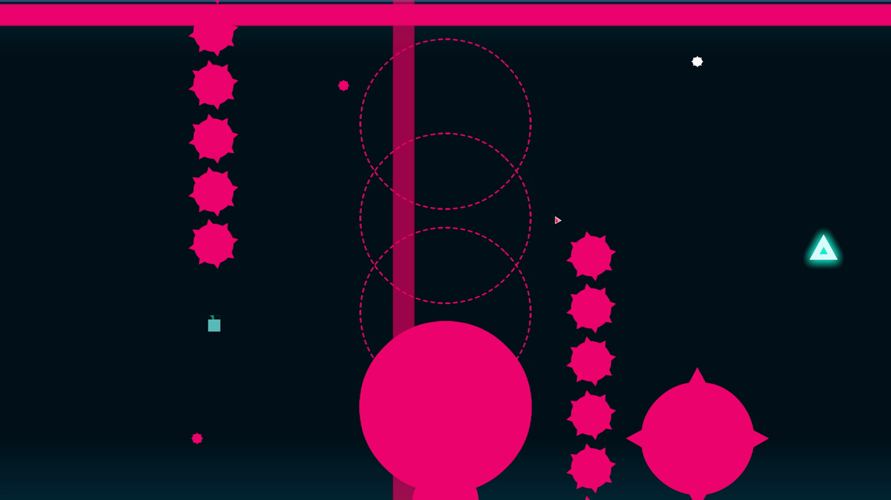

**Just Shapes & Beats 모작**은 음악에 맞춰 쏟아지는 도형 탄막을 피하는 리듬 회피 게임 *Just Shapes & Beats*의 **튜토리얼 스테이지("Corrupted")와 보스 스테이지("New Game")** 를 Unity 2D로 다시 만든 프로젝트입니다. 이동·대시부터 장애물, 음악과 패턴을 맞추는 진행 시스템, 보스전·게임오버·씬 전환 연출까지 개인 프로젝트로 진행했습니다.

| 항목 | 내용 |
|---|---|
| 장르 | 2D 리듬 탄막 회피 (원작 모작) |
| 기간 · 인원 | 2026.06.24 ~ 2026.07.09 (커밋 기준 16일) · 1인 |
| 분량 | 씬 7개 (메인 · 스테이지 선택 · 튜토리얼 · 보스 · 전환 · 게임오버 · 크레딧), 튜토리얼 9구간 + 보스4단계 |
| 내 역할 | 플레이어(이동 · 대시 · 피격 · 잔상), 장애물 생명주기, 패턴 9종, 음악 구간 루프, 보스전 시퀀스, 씬 전환 · 게임오버 연출, 메인 · 스테이지 선택 UI |
| 환경 | Unity 6 (6000.3.15f1, C#, URP 2D), Input System, TextMeshPro · 리소스: 원작 음원 · 스프라이트(학습용) |
| 링크 | [GitHub](https://github.com/KooHoo-Dev/3rd-2D-Project-crescentyun-stack) · [시연 영상](https://youtu.be/T8P4Q0cQ_FU) |

**핵심 기술 3가지**

| # | 기술 | 한 줄 설명 | 문서 위치 |
|---|---|---|---|
| 1 | **음악 구간 루프** | 곡을 9개 구간으로 나누고, 클리어 삼각형을 먹기 전까지 `AudioSource.time`을 되감아 현재 구간만 반복시켜, 플레이어가 늦게 깨도 음악과 패턴이 어긋나지 않게 했습니다 | 5장 |
| 2 | **경고 → 공격 → 소멸 장애물 + 패턴 상속** | 모든 장애물이 "예고 후 공격" 규칙을 스스로 지키게 만들고, 패턴은 앞 패턴을 상속해 새 요소만 더하는 방식으로 9종을 쌓았습니다 | 4장 |
| 3 | **코루틴으로 짠 연출 시퀀스** | 보스전 4단계, 클리어 전환, "IT'S NOT OVER" 게임오버를 `yield return`으로 이어 붙여 코드가 곧 연출 순서표가 되게 했습니다 | 6장 |

---

## 1. 프로젝트 개요

### 1.1 무엇을 만들었나 (What)

플레이어는 작은 사각형이 되어, 음악에 맞춰 화면을 덮는 탄막 · 레이저 · 원형 폭발 · 톱니바퀴를 피합니다. 맞으면 체력이 줄고 모양이 바뀌며, 체력이 다 떨어지면 게임오버입니다. 한 구간의 패턴을 버티면 **클리어 삼각형**이 나타나고, 그것을 먹으면 다음 구간으로 넘어갑니다.

| 스테이지 | 구성 | 곡 | 핵심 |
|---|---|---|---|
| 스테이지 선택 | 점선 위를 좌우로 이동, 원 안에서 Enter | — | 원에 들어가면 미리보기 이미지와 곡 일부가 재생 |
| 튜토리얼 | 9구간 | Corrupted (약 2분 57초) | 구간마다 새 패턴을 하나씩 더해 가는 학습 구조 |
| 보스 (New Game) | 4단계 | New Game | 삼각형 회전 탄막 → 보스의 내려찍기 → 신전 연쇄 상승 → 새 보스 등장 |

### 1.2 왜 만들었나 (Why)

#### 목표

수업에서 배운 Transform · 코루틴 · Lerp · 씬 관리를 **처음으로 한 게임 안에 엮어 보는 것**이 목표였습니다. 모작 대상으로 *Just Shapes & Beats*를 고른 이유는, 그래픽이 단순한 도형이라 2D 초보도 리소스 부담이 적으면서, **"패턴이 음악에 맞게 나온다"** 는 분명한 설계 과제가 있었기 때문입니다.

#### 원작을 분석하며 정한 문제

| 원작의 규칙 | 구현하며 풀어야 했던 문제 |
|---|---|
| 모든 공격은 먼저 **반투명 예고**를 보여준 뒤 실체화된다 | 장애물 수십 종이 이 규칙을 빠짐없이 지키게 하려면? |
| 패턴은 음악의 박자 · 분위기와 맞물린다 | 플레이어가 구간을 늦게 깨면 음악은 계속 흘러가 버린다. 곡은 177초인데 9개 구간을 플레이어 속도와 상관없이 맞추려면? |
| 튜토리얼은 앞에서 배운 패턴 위에 새 패턴을 하나씩 얹는다 | 비슷한 패턴 코드를 9번 복사하지 않으려면? |
| 대시하는 동안은 무적이다 | 대시 · 피격 무적 · 넉백 · 전환 연출이 겹칠 때 입력과 판정을 어떻게 막을까? |

#### 설계 기준

| 기준 | 적용 |
|---|---|
| 진행 판단은 한 곳에서만 | 패턴은 "끝났다" 신호만 보내고, 다음 구간으로 갈지는 `MusicLoopManager`만 결정 (5장) |
| 공격 전에는 반드시 예고 | 장애물이 생성되는 순간 콜라이더를 끄고, 경고 단계가 끝나야 켬 (4.1) |
| 새 패턴은 추가분만 작성 | 앞 패턴을 상속하고 `OnEnable`에서 새 코루틴 하나만 더함 (4.3) |

이 문서는 전체 구조(2장), 플레이어(3장), 장애물과 패턴(4장), 음악 구간 루프와 진행(5장), 레벨 구성과 연출(6장), 개발 과정(7장), 문제 해결 기록(8장), 돌아보기(9장)를 차례로 설명합니다.

### 1.3 조작법

| 장소 | 입력 | 결과 |
|---|---|---|
| 메인 | `↑` `↓` / 마우스 올리기 | 메뉴 선택 (선택된 버튼 스프라이트 교체) |
| 메인 | `Enter` / 클릭 | 시작 · 종료 |
| 스테이지 선택 | `←` `→` | 점선 위 이동, 원 안에 들어가면 미리보기 + 곡 재생 |
| 스테이지 선택 | `Enter` | 원 안이면 해당 스테이지 입장 |
| 스테이지 선택 | `ESC` | 메인으로 |
| 인게임 | 방향키 | 8방향 이동 |
| 인게임 | `Space` | 대시 (0.2초, 대시 중 무적, 쿨타임 0.2초) |
| 게임오버 | `Enter` 연타 | 3·4번째: 조각이 튀어오름, 5번째: 조각이 모여 "IT'S **NOT** OVER" → 재도전 |

### 1.4 핵심 루프

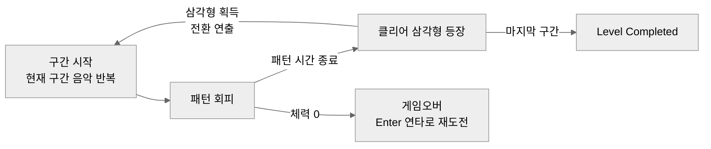

한 구간 안에서는 같은 음악 구간이 반복되며 패턴을 피하고, 삼각형을 먹을 때마다 곡이 다음 구간으로 넘어가며 패턴이 하나씩 더해집니다.

### 1.5 제공 코드와 내가 작성한 범위

수업 레포(강사 `Initial commit`) 위에서 작업했지만, 게임 폴더(`Just Shape and Beats/`)의 스크립트는 **모두 직접 작성**했습니다. 템플릿의 `9. Utils`(`ComponentPool`, `SimpleInput` 등)는 이 프로젝트에서 쓰지 않았습니다.

| 구분 | 클래스 | 하는 일 |
|---|---|---|
| **작성** | `PlayerController` · `PlayerHP` | 이동, 대시 무적, 넉백, 체력 · 피격 무적, 사망 연출 (3장) |
| **작성** | `WaveTrailEffect` · `EchoPieceController` | 이동 · 대시 잔상 (3.3) |
| **작성** | `Obstacle` · `CircleObstacle` · `Gear` · `Barrage` | 경고 → 공격 → 소멸 생명주기, 피격 판정 (4장) |
| **작성** | `BulletMover` · `GearWallMover` · `GearRotator` | 스포너가 붙이는 이동 전용 컴포넌트 (4.2) |
| **작성** | `StagePhase1` ~ `StagePhase9` | 튜토리얼 구간별 패턴 (4.3, 6.1) |
| **작성** | `MusicLoopManager` · `StageClear` · `StageTransition` · `WaveEffect` | 음악 구간 루프, 삼각형 획득, 구간 전환 연출 (5장) |
| **작성** | `BossController` · `TriangleStack` · `FistPunch` · `TempleBuilder` · `CameraForcedDescent` · `LaserBeam` | 보스전 4단계 (6.2) |
| **작성** | `GameManager` · `LevelManager` · `TransitionManager` · `GameOverManager` · `CreditManager` | 메인 메뉴, 스테이지 선택, 씬 전환, 게임오버, 크레딧 (6.3) |
| 미사용 | `Music` (초기 버전) · `Player` (빈 클래스) · `SpikeField` | 8.3에서 `MusicLoopManager`로 대체, 정리하지 못하고 남음 (9.3) |

---

## 2. 전체 구조

### 2.1 씬 구성

| 씬 | 역할 | 주요 스크립트 |
|---|---|---|
| `00. Main` | 메인 메뉴. 키보드 · 마우스 모두로 선택 | `GameManager` |
| `01. Stage` | 스테이지 선택. 점선 위를 이동해 원 안에서 입장 | `LevelManager` |
| `02. Tutorial` | 튜토리얼 9구간 | `MusicLoopManager`, `StagePhase1~9`, `StageTransition` |
| `04. New Game(Boss)` | 보스전 4단계 | `BossController` 외 패턴 4종 |
| `98. Transition` | 모든 씬 이동이 거쳐 가는 전환 씬 (Let's GO / 곡명 / Level Completed) | `TransitionManager` |
| `99. GameOver` | "IT'S OVER" → Enter 연타 → "IT'S NOT OVER" | `GameOverManager` |
| `100. Credit` | 보스 클리어 후 크레딧, Enter로 메인 | `CreditManager` |

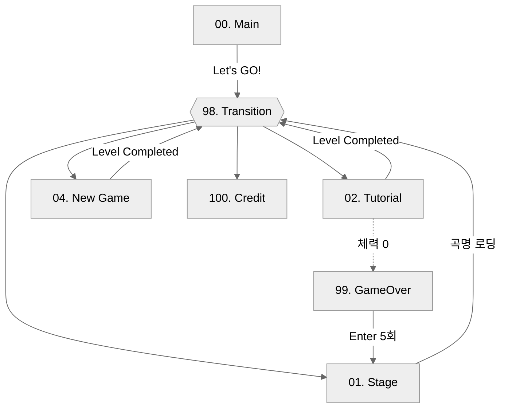

### 2.2 아키텍처 (튜토리얼 씬 기준)

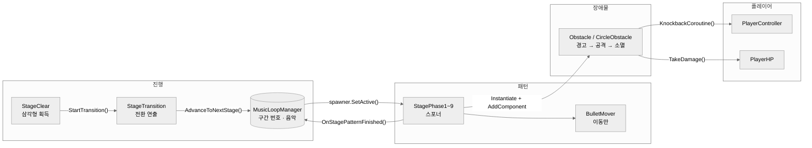

화살표가 `MusicLoopManager`로 들어오는 경로는 두 개뿐입니다. 패턴의 **"끝났다" 신호**와 삼각형 획득 후의 **"다음으로" 요청**입니다. 구간을 넘길지는 매니저만 결정하므로, 진행이 꼬였을 때 확인할 곳이 한 곳입니다.

### 2.3 클래스 역할

| 클래스 | 하는 일 | 하지 않는 일 |
|---|---|---|
| `MusicLoopManager` | 현재 구간 번호 관리, 음악을 구간 안에서 반복, 구간에 맞는 스포너 하나만 켜기, 삼각형 생성 | 패턴 내용 (스포너가 담당) |
| `StagePhaseN` | `OnEnable`에서 패턴 시작, `OnDisable`에서 정리, 일정 시간 뒤 "끝" 신호 | 다음 구간으로 넘기기 |
| `Obstacle` | 경고 → 공격 → 소멸 상태 진행, 공격 상태일 때만 피격 처리 | 이동 (`BulletMover`) |
| `BulletMover` | 경고가 끝난 뒤부터 직선 이동 · 회전, 화면 밖이면 삭제 | 피격 판정 |
| `PlayerController` | 이동, 대시, 넉백, 입력 잠금 플래그 | 체력 |
| `PlayerHP` | 체력 감소, 피격 무적, 체력별 스프라이트, 사망 → 게임오버 | 넉백 (`PlayerController`) |
| `StageTransition` | 삼각형 회전 낙하 → 물결 → 플레이어 재등장 → 다음 구간 요청 | 구간 판단 |
| `TransitionManager` | 목적지 · 연출 타입을 받아 전환 씬에서 연출 후 이동 | 씬별 로직 |
| `BossController` | 보스전 단계를 순서대로 호출 | 각 단계의 실제 움직임 (`TriangleStack` 등) |

### 2.4 고민과 선택: 씬 사이에 "어디로, 어떤 연출로"를 어떻게 넘길 것인가

> **결정 대상:** 모든 씬 이동은 전환 씬(`98. Transition`)을 거칩니다. 출발 씬에서 정한 목적지와 연출 타입을, 씬이 바뀐 뒤 전환 씬이 알아야 합니다. 이 두 값을 어디에 둘 것인가?

| | [A] `DontDestroyOnLoad` 매니저 | [B] `PlayerPrefs` ✓ | [C] `static` 변수 |
|---|---|---|---|
| 방식 | 전환 매니저를 씬 전환에도 남겨 둠 | 정수 1개 · 문자열 1개를 키-값으로 저장 | 정적 필드에 담아 둠 |
| 장점 | 연출 상태를 한 오브젝트가 계속 관리 | 수업에서 배운 방식, 코드 3줄. 어느 씬에서 시작해도 동작 | 가장 가볍고 디스크 저장 없음 |
| 단점 | 첫 씬에 있어야 하고 중복 생성 방지 필요 | 저장이 목적이 아닌 값을 디스크에 씀 | 없음에 가까움 (당시에는 떠올리지 못함) |

**[최종 결정]** [B]를 선택했습니다. 넘길 값이 두 개뿐이었고, 수업에서 익힌 방식이라 바로 안정적으로 쓸 수 있었습니다. 호출하는 쪽은 `GoTo()` 한 줄만 알면 되도록 정적 함수로 감쌌습니다.

```csharp
// TransitionManager.cs — 어디서든 한 줄로 씬 이동
public static void GoTo(string targetScene, TransitionType type)
{
    PlayerPrefs.SetInt("TransitionType", (int)type);
    PlayerPrefs.SetString("TargetScene", targetScene);
    PlayerPrefs.Save();
    SceneManager.LoadScene("98. Transition");
}

void Start()   // 전환 씬이 열리면 저장된 값을 읽어 연출 선택
{
    var type = (TransitionType)PlayerPrefs.GetInt("TransitionType", 0);
    string target = PlayerPrefs.GetString("TargetScene", "");
    StartCoroutine(PlayTransition(type, target)); // 패널 표시 → 2.5초 → 목적지 로드
}
```

**[감수한 대가]** 게임을 끄기 직전의 전환 정보가 디스크에 남습니다. 또 같은 문제를 [C] `static` 필드로 풀 수 있었다는 것을, 이후 미니골프 프로젝트에서 클리어 기록을 `static HashSet`으로 관리하며 알게 됐습니다. 지금 다시 만든다면 [C]를 고릅니다(9.3).

---

## 3. 시스템 ① 플레이어

### 3.1 이동과 대시

방향키 4개를 각각 검사해 더하므로 두 키를 함께 누르면 대각선으로 움직입니다. `Space`를 누르면 입력 방향으로 0.2초 동안 대시하고, 대시 동안은 무적입니다.

| 설정값 (인스펙터) | 값 | 의미 |
|---|---|---|
| `moveSpeed` | 5 | 초당 이동 거리 |
| `dashSpeed` | 5 (튜토리얼 4) | 대시 속도 |
| `dashTime` | 0.2초 | 대시 지속 · 무적 시간 |
| `dashCooltime` | 0.2초 | 대시 후 재사용 대기 |

#### 핵심 기능: 대시 한 번을 코루틴 하나로

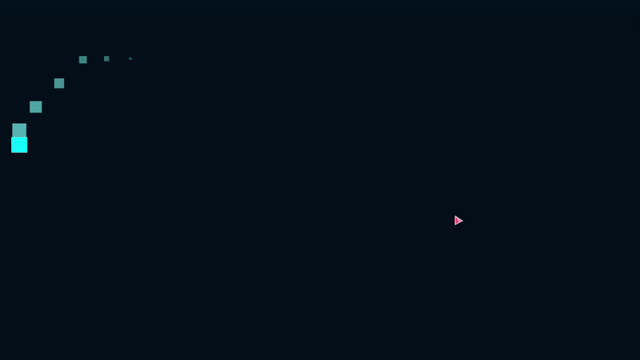

```csharp
// PlayerController.cs
public IEnumerator DashCoroutine(Vector2 direction)
{
    canDash = false;
    isDashing = true;

    // (Why) 원작처럼 대시는 '회피기' → 대시 동안 충돌체를 꺼서 무적
    plyaerCollider2D.enabled = false;

    rb2D.linearVelocity = direction * dashSpeed;   // 대시 시작
    yield return new WaitForSeconds(dashTime);

    rb2D.linearVelocity = Vector2.zero;            // 대시 끝
    isDashing = false;

    yield return new WaitForSeconds(dashCooltime);
    canDash = true;
    plyaerCollider2D.enabled = true;               // 무적 해제
}
```

"시작 → 유지 → 정지 → 쿨타임"이 시간 순서대로 한 함수에 적혀 있어, 타이머 변수를 `Update`에서 따로 깎는 방식보다 흐름이 한눈에 보입니다.

#### 예외 처리

| 상황 | 처리 |
|---|---|
| 방향 입력 없이 `Space` | `transform.right`(오른쪽)로 대시 → 제자리에서도 항상 반응 |
| 대시 중 다시 `Space` | `isDashing`이면 입력 무시 |
| 넉백 중 · 구간 전환 연출 중 | `isKnockedBack` · `isTransitioning`이면 이동 · 대시 모두 무시 |

### 3.2 피격과 무적

장애물에 맞으면 **넉백 · 깜빡임 · 체력 감소**가 동시에 일어나고, 1.5초 동안 무적이 됩니다. 체력이 줄어들 때마다 플레이어 사각형이 깨진 모양의 스프라이트로 바뀝니다.

```csharp
// PlayerHP.cs
public void TakeDamage()
{
    // (Why) 대시 무적 · 피격 무적 중에는 무시
    //       → 겹친 장애물 여러 개에 한 프레임에 여러 번 맞는 것을 방지
    if ((playerController != null && playerController.isDashing) || isHurt) return;

    currentHP--;
    UpdatePlayerSprite();            // HpSprites[maxHp - currentHP]

    if (currentHP < 0) Die();        // 축소 연출 → 99. GameOver
    StartCoroutine(InvincibilityRoutine());   // 콜라이더 OFF + 0.1초 간격 깜빡임, 1.5초
}
```

넉백은 장애물 중심에서 플레이어 쪽으로 밀어내되, `Mathf.Lerp(knockbackForce, 0, t)`로 **점점 느려지게** 해서 툭 끊기지 않고 미끄러지듯 멈추게 했습니다.

#### 고민과 선택: 무적을 어떻게 구현할 것인가

> **결정 대상:** 대시 중 · 피격 직후에는 장애물에 닿아도 데미지를 받지 않아야 합니다. 무엇으로 막을 것인가?

| | [A] 콜라이더를 끔 ✓ | [B] `isInvincible` 플래그로 데미지만 무시 |
|---|---|---|
| 장점 | 한 줄로 끝남. 판정 자체가 일어나지 않아 확실함 | 무적 중에도 다른 트리거(삼각형 등)는 정상 동작 |
| 단점 | 무적 중에는 **모든** 트리거가 꺼짐 (삼각형도 못 먹음) | 데미지를 주는 모든 곳에서 플래그를 확인해야 함 |

**[최종 결정]** [A]를 선택했습니다. 대시를 처음 만들 때는 플레이어가 닿을 수 있는 것이 장애물뿐이었고, 판정이 아예 일어나지 않는 쪽이 가장 확실했습니다. `TakeDamage()` 안의 `isDashing` 검사는 콜라이더를 끄기 전 같은 프레임에 들어온 판정을 막는 두 번째 방어입니다.

**[감수한 대가]** 나중에 클리어 삼각형이 생기면서, **무적 중에 삼각형 위를 지나가도 먹어지지 않는** 문제가 생겼습니다. 대시나 피격 직후에 삼각형에 닿으면 무적이 풀린 뒤 다시 닿아야 합니다. 판정 대상이 늘어날 것을 생각했다면 [B]가 맞았습니다(9.3).

### 3.3 이동 · 대시 잔상


원작처럼 플레이어가 움직이면 뒤에 작아지며 사라지는 잔상이 남습니다. 이동 중에는 0.06초, 대시 중에는 0.02초 간격으로 더 촘촘하게 생성됩니다.

```csharp
// WaveTrailEffect.cs — 잔상 생성 판단
float moveDistance = Vector3.Distance(transform.position, lastPosition);
bool isMoving = moveDistance > 0.001f;           // (Why) 속도가 아닌 위치 변화로 판단 (8.2)

if ((playerController != null && playerController.isDashing) || isMoving)
{
    if (timeLeft <= 0)
    {
        SpawnEchoPiece();
        timeLeft = playerController.isDashing ? dashTimeBetweenSpawns : walkTimeBetweenSpawns;
    }
    else timeLeft -= Time.deltaTime;
}
lastPosition = transform.position;
```

생성된 잔상(`EchoPieceController`)은 0.3초 동안 크기를 5%까지 줄이며 투명해진 뒤 스스로 삭제됩니다. 잔상은 플레이어보다 정렬 순서를 1 낮춰 항상 플레이어 뒤에 그려지게 했습니다.

---

## 4. 시스템 ② 장애물과 패턴

### 4.1 장애물 생명주기 — 경고 → 공격 → 소멸


원작의 가장 중요한 규칙은 **"공격 전에 반드시 예고한다"** 입니다. 장애물마다 이 규칙을 따로 짜지 않도록, 프리팹에 `Obstacle`만 붙이면 생성되는 순간부터 스스로 상태를 진행하게 했습니다.

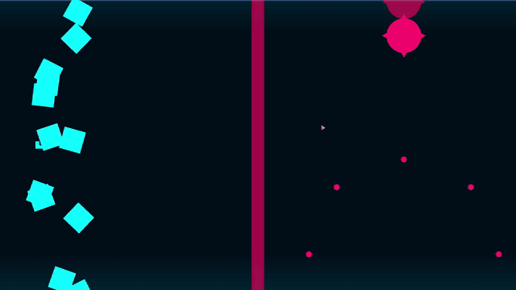

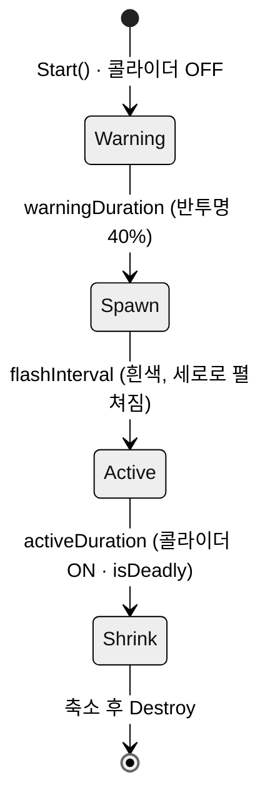

#### 핵심 기능

```csharp
// Obstacle.cs
IEnumerator ObstacleRoutine()
{
    // 1. 경고: 반투명. 콜라이더가 꺼져 있어 닿아도 안전
    color.a = 0.4f;
    spriteRenderer.color = color;
    yield return new WaitForSeconds(warningDuration);

    // 2. 생성: 흰색으로 번쩍이며 세로 0 → 원래 크기
    while (elapsed < flashInterval) { /* localScale.y Lerp */ yield return null; }

    // 3. 공격: 원래 색 + 판정 ON
    spriteRenderer.color = originalColor;
    collider2d.enabled = true;
    isDeadly = true;
    yield return new WaitForSeconds(activeDuration);

    // 4. 소멸: 판정 OFF → 작아지며 사라짐
    collider2d.enabled = false;
    isDeadly = false;
    /* localScale Lerp → 0 */
    Destroy(gameObject);
}

private void OnTriggerEnter2D(Collider2D collision)
{
    // (Why) 콜라이더 ON/OFF에 더해 isDeadly를 한 번 더 확인
    //       → 프리팹에서 콜라이더가 켜진 채 저장돼 있어도 경고 중에는 맞지 않음
    if (collision.CompareTag("Player") && isDeadly) { /* 넉백 · 깜빡임 · TakeDamage */ }
}
```

원형 장애물(`CircleObstacle`)은 같은 흐름을 **점선 원 → 채워진 원**으로 보여줍니다.

#### 패턴에서 시간값 덮어쓰기

같은 레이저 프리팹을 여러 패턴에서 다른 속도로 쓰기 위해, 스포너가 생성 직후 시간값을 바꿉니다.

| 패턴 | 경고 | 공격 | 느낌 |
|---|---|---|---|
| 기본값 | 1.0초 | 2.0초 | 천천히 읽을 수 있는 공격 |
| Phase3 연속 레이저 | 0.3초 | 0.7초 | 좌 → 우로 빠르게 훑는 레이저 |
| Phase4 레이저 세트 | 0.5초 | 0.95초 | 2개 → 3개 세트로 사이를 비집고 들어가기 |

### 4.2 이동은 따로 — `BulletMover`

같은 `Obstacle` 탄막이 Phase1에서는 오른쪽에서 왼쪽으로 회전하며 날아가고, Phase2에서는 8방향으로 퍼집니다. "언제 위험한가"와 "어떻게 움직이나"를 분리하기 위해, 이동은 스포너가 생성 직후 `AddComponent<BulletMover>()`로 붙입니다.

```csharp
// BulletMover.cs
void Start()
{
    // (Why) 경고가 끝나기 전에 움직이면 예고한 자리와 공격하는 자리가 달라짐
    //       → 경고 + 번쩍임 시간이 지난 뒤에 출발
    Obstacle obstacle = GetComponent<Obstacle>();
    if (obstacle != null)
        StartCoroutine(WaitAndMove(obstacle.warningDuration + obstacle.flashInterval));
    else
        canMove = true;
}
```

### 4.3 패턴 9종 — 상속으로 누적


원작 튜토리얼은 "앞에서 배운 패턴 + 새 패턴" 순서로 진행됩니다. 이 구조를 그대로 상속 관계로 옮겼습니다.

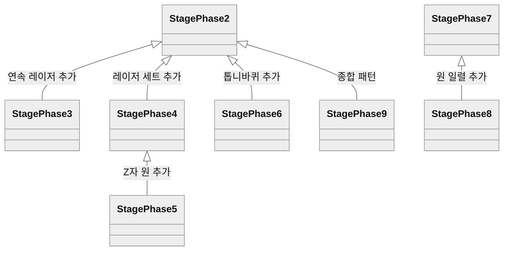

```csharp
// StagePhase5.cs — Phase2(8방향 폭발) + Phase4(레이저 세트) 위에 Z자 원만 추가
public class StagePhase5 : StagePhase4
{
    protected override void OnEnable()
    {
        base.OnEnable();                 // 부모들의 패턴 시작
        StartCoroutine(CircleRoutine()); // 새로 더하는 것은 이것 하나
    }

    protected override void OnDisable()
    {
        base.OnDisable();                // StopAllCoroutines · CancelInvoke로 부모 · 자식 패턴 모두 정리
    }
}
```

`MusicLoopManager`는 스포너 오브젝트를 `SetActive(true/false)` 하기만 하고, 패턴 시작과 정리는 각 패턴의 `OnEnable` · `OnDisable`이 맡습니다. 그래서 매니저는 패턴이 몇 종인지, 안에서 무엇을 하는지 몰라도 됩니다.

#### 고민과 선택: 비슷한 패턴을 어떻게 재사용할 것인가

> **결정 대상:** Phase4 · 5 · 9는 Phase2의 8방향 폭발을 그대로 포함합니다. 겹치는 패턴을 어떻게 공유할 것인가?

| | [A] 패턴마다 독립 클래스 | [B] 상속으로 누적 ✓ | [C] 패턴 조각 컴포넌트를 여러 개 붙이기 |
|---|---|---|---|
| 장점 | 서로 영향 없음 | 원작의 "앞 패턴 + 새 요소" 구조와 1:1로 맞음. 정리 코드도 상속됨 | 가장 유연. 아무 조합이나 가능 |
| 단점 | Phase2 코드를 4번 복사 | 상속이 깊어지면 부모 수정이 자식 전부에 영향 | 조각끼리 시작 · 정리 타이밍을 맞추는 설계가 따로 필요 |

**[최종 결정]** [B]를 선택했습니다. 튜토리얼 자체가 누적 구조라 상속 관계가 자연스럽게 맞았고, 무엇보다 **`OnDisable`의 정리 코드까지 상속**되어 구간이 바뀔 때 이전 패턴이 남는 실수를 막을 수 있었습니다. 상속 깊이는 최대 3단계(Phase2 → 4 → 5)로 제한했습니다. Phase6은 31줄(톱니바퀴 켜고 끄기)만으로 Phase2의 폭발 패턴 전체를 재사용합니다.

**[감수한 대가]** Phase9는 Phase2를 상속했지만 `OnDisable`을 `base` 없이 다시 써서, 부모의 정리 코드와 같은 내용을 중복으로 갖고 있습니다. 또 "레이저 + 원"처럼 형제 패턴끼리 섞고 싶을 때는 상속으로 표현할 수 없어서, Phase9는 원 · 레이저 · 기둥 패턴을 다시 작성했습니다. 조합이 늘어나면 [C]가 맞습니다(9.3).

#### 고민과 선택: 피격 판정을 어디에 둘 것인가

> **결정 대상:** 플레이어가 장애물에 닿았을 때, 판정 코드를 플레이어 쪽에 둘 것인가, 장애물 쪽에 둘 것인가?

| | [A] 플레이어가 판정 (초기 구현) | [B] 장애물이 판정 ✓ |
|---|---|---|
| 방식 | `PlayerController.OnTriggerEnter2D`에서 태그 `Obstacle` 확인 | 각 장애물의 `OnTriggerEnter2D`에서 `Player` 확인 후 `TakeDamage()` |
| 장점 | 판정 코드가 한 곳 | 장애물이 자기 상태(경고 중인지 공격 중인지)를 알고 있음 |
| 단점 | 플레이어는 장애물이 경고 중인지 모름 | 장애물 종류마다 비슷한 코드가 반복됨 |

**[최종 결정]** [B]로 옮겼습니다. 처음에는 플레이어에서 판정했지만(`PlayerController`에 주석으로 남아 있음), "경고 중에는 안전하다"는 규칙이 생기자 **위험한지 아는 쪽은 장애물**이었습니다.

**[감수한 대가]** 넉백 + 깜빡임 + 체력 감소 코드가 `Obstacle` · `CircleObstacle` · `Gear` · `Barrage` 네 곳에 반복됩니다. 그중 보스전 탄막인 `Barrage`에는 넉백이 빠져 있어, **장애물마다 맞는 느낌이 다릅니다**(9.3).

---

## 5. 시스템 ③ 음악 구간 루프와 진행

### 5.1 음악 구간 루프

튜토리얼 곡을 **9개 구간**으로 나누어 인스펙터에 등록합니다(`AudioStageSegment`: 시작 · 끝 시간, 켤 스포너). 플레이어가 클리어 삼각형을 먹기 전까지는 **현재 구간 안에서 음악을 되감습니다.**

| 구간 | 1 | 2 | 3 | 4 | 5 | 6 | 7 | 8 | 9 |
|---|---|---|---|---|---|---|---|---|---|
| 루프 (초) | 4~18 | 17~30 | 31~44 | 45~59 | 59~72 | 72~86 | 87~100 | 101~115 | 116~곡 끝 |

```csharp
// MusicLoopManager.cs
void Update()
{
    if (!isMusicStarted || currentStageIndex >= stageSegments.Count) return;

    AudioStageSegment seg = stageSegments[currentStageIndex];
    // (Why) 삼각형을 먹기 전까지는 '이 구간의 음악'만 반복
    //       → 늦게 클리어해도 패턴과 음악 분위기가 어긋나지 않음
    if (audioSource.time >= seg.loopEndTime)
        audioSource.time = seg.loopStartTime;
}
```

마지막 9구간은 루프를 돌지 않습니다. `StagePhase9`가 `WaitUntil(() => !audio.isPlaying)`으로 **곡이 끝나는 순간** 마지막 삼각형을 띄워, 곡 끝과 튜토리얼 끝이 맞물리게 했습니다.

#### 고민과 선택: 음악과 패턴을 어떻게 맞출 것인가

> **결정 대상:** 플레이어마다 구간을 깨는 속도가 다릅니다. 음악과 패턴이 어긋나지 않게 하려면 어떤 기준으로 동기화할 것인가?

| | [A] 곡 전체 타임라인 (원작 방식) | [B] 구간 반복 + 삼각형으로 진행 ✓ | [C] 패턴은 시간 기준, 음악은 BGM |
|---|---|---|---|
| 방식 | 곡 재생 시간에 맞춰 모든 패턴을 미리 배치 | 구간 끝에 닿으면 구간 시작으로 되감기, 삼각형을 먹으면 다음 구간으로 점프 | 음악은 그냥 반복, 패턴은 `WaitForSeconds`로 |
| 장점 | 원작과 같음. 박자 단위로 정교한 연출 | 플레이어가 늦어도 어긋나지 않음. 구간 하나씩 만들고 테스트 가능 | 가장 간단 |
| 단점 | 177초 분량을 초 단위로 배치해야 함 (Timeline 등 새로 학습 필요). 실패 시 되감기 처리 필요 | 구간 경계에서 음악이 툭 튀는 느낌 | 음악과 패턴이 무관해져 리듬 게임이 아님 |

**[최종 결정]** [B]를 선택했습니다. 2주 안에 Timeline을 새로 익혀 177초 분량을 배치하는 것은 무리였고, [C]는 "리듬 게임 모작"이라는 목적을 놓칩니다. [B]는 구간 시작 · 끝 시간 18개만 인스펙터에 입력하면 되고, 실제로 7/3에 Phase1~4, 7/5에 Phase5~9처럼 **구간 단위로 완성하며 진행**할 수 있었습니다.

**[감수한 대가]** 구간 경계에서 되감기가 일어날 때 음악이 매끄럽게 이어지지 않습니다. 또 패턴의 박자는 음악 시간이 아니라 `WaitForSeconds` 숫자로 맞췄기 때문에, 박자를 바꾸려면 코드의 숫자를 고쳐야 합니다(9.3).

### 5.2 클리어 삼각형과 구간 진행

```csharp
// MusicLoopManager.cs
public void OnStagePatternFinished()   // 패턴이 "끝났다"고 알릴 때
{
    if (isTriangleSpawned) return;     // (Why) 화면에 삼각형은 항상 최대 1개 (8.3)
    isTriangleSpawned = true;
    SpawnTriangle();
}

public void AdvanceToNextStage()       // 삼각형을 먹었을 때
{
    if (!isMusicStarted) { /* 첫 삼각형 → 음악 시작 */ return; }

    isTriangleSpawned = false;
    currentStageIndex++;
    if (currentStageIndex >= stageSegments.Count)
    {
        TransitionManager.GoTo("01. Stage", TransitionManager.TransitionType.TutorialClear);
        return;
    }
    ApplyStageSettings();                                               // 스포너 교체
    audioSource.time = stageSegments[currentStageIndex].loopStartTime; // 다음 구간으로 점프
}

void ApplyStageSettings()
{
    CancelInvoke("OnStagePatternFinished");                  // (Why) 이전 구간의 예약 제거 (8.3)
    foreach (var s in stageSegments) s.spawner?.SetActive(false);
    stageSegments[currentStageIndex].spawner?.SetActive(true);
}
```

| 상황 | 처리 |
|---|---|
| 게임 시작 | 음악 없이 시작 삼각형만 표시. 먹으면 음악 재생 (원작과 같은 시작) |
| 패턴이 "끝" 신호를 여러 번 보냄 | `isTriangleSpawned`로 1개만 생성 |
| 구간이 바뀌었는데 이전 구간 예약이 남음 | `CancelInvoke`로 제거 |
| 마지막 구간 클리어 | `TransitionManager`로 Level Completed 연출 후 스테이지 선택으로 |

### 5.3 구간 전환 연출

삼각형을 먹으면 바로 다음 구간으로 넘어가지 않고, 원작처럼 짧은 연출을 보여줍니다.

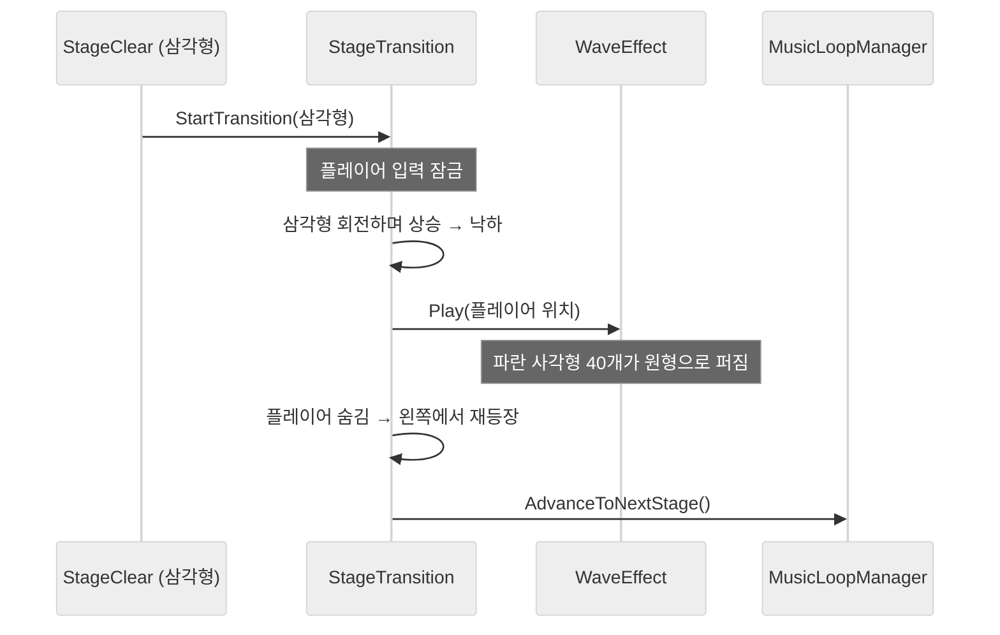

삼각형 낙하에는 `Lerp(top, player, t * t)`로 **EaseIn**을 줘서 점점 빨라지며 떨어지게 했고, 물결의 사각형 40개는 각도에 ±3°, 속도에 ±5%의 무작위 값을 섞어 기계적으로 보이지 않게 했습니다.

---

## 6. 레벨 구성과 연출

### 6.1 튜토리얼 9구간

원작 튜토리얼처럼 **구간마다 새 요소를 하나씩 더하는** 순서로 구성했습니다.

| 구간 | 새로 나오는 것 | 구성 | 클래스 |
|---|---|---|---|
| 1 | 직선 탄막 | 오른쪽에서 회전하며 날아오는 탄막 | `StagePhase1` |
| 2 | 폭발 | 위 · 아래에서 번갈아 들어와 커진 뒤 8방향으로 터짐 | `StagePhase2` |
| 3 | 레이저 | 2 + 왼쪽부터 순서대로 내려오는 세로 레이저 9개 | `StagePhase3` |
| 4 | 레이저 사이 피하기 | 2 + 레이저 2개 세트 → 3개 세트 | `StagePhase4` |
| 5 | 원형 폭발 | 4 + Z자 순서로 터지는 원 | `StagePhase5` |
| 6 | 고정 위험 지대 | 2 + 위아래 톱니바퀴 벽 | `StagePhase6` |
| 7 | 움직이는 벽 | 오른쪽에서 밀려오는 톱니바퀴 기둥 | `StagePhase7` |
| 8 | 겹침 | 7 + 상하 원 일렬 | `StagePhase8` |
| 9 | 종합 | 원 일렬 → 랜덤 레이저 · 절반 기둥 · 세로 원 동시, 곡 끝까지 | `StagePhase9` |

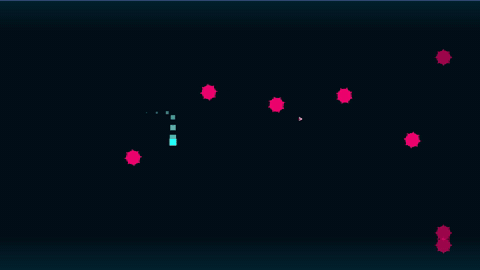

### 6.2 보스전 시퀀스

보스전은 **지휘자(`BossController`) + 연주자(패턴 스크립트)** 구조로 나눴습니다. `BossController`는 순서만 알고, 실제 움직임은 각 스크립트가 맡습니다.

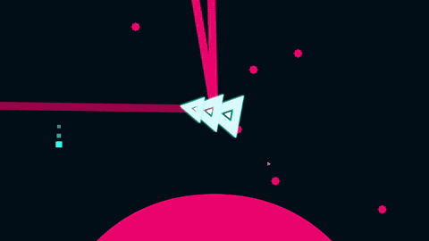

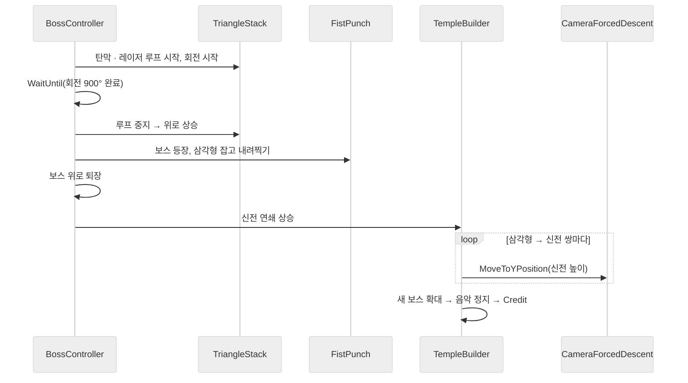

#### 핵심 기능

```csharp
// BossController.cs — 앞 단계가 '끝나야' 다음 단계가 시작된다
Coroutine bulletLoop = StartCoroutine(triangleStack.RandomBulletLoop());
Coroutine laserLoop  = StartCoroutine(triangleStack.RandomLaserLoop());
triangleStack.SetRotating(true);
yield return new WaitUntil(() => triangleStack.IsRotationFinished);  // 회전하는 동안만 공격
StopCoroutine(bulletLoop);
StopCoroutine(laserLoop);

yield return StartCoroutine(triangleStack.AscendToTop());
yield return StartCoroutine(fistPunch.SpawnAndStabSequence());
/* 보스 퇴장 */
yield return StartCoroutine(temple.BuildTempleChainSequence());
```

| 연출 | 구현에서 신경 쓴 점 |
|---|---|
| 삼각형 2바퀴 반 회전 | 프레임마다 회전량을 누적해 900°에 닿으면 `rotation = 180°`로 **보정**. `deltaTime`이 프레임마다 달라 정확히 900°에서 멈추지 않기 때문 |
| 보스가 삼각형 잡고 내려찍기 | 보스를 삼각형 위에 놓고 `triangle.SetParent(boss)`로 **한 몸으로 묶어** 이동. 따로 움직이면 프레임 오차로 둘이 벌어짐. 내려찍기는 0.15초로 짧게 해 타격감 강조 |
| 신전 연쇄 상승 | 삼각형 → 신전 → 카메라 이동을 박자 간격(0.25 · 0.2 · 0.4 · 0.3초)으로 반복. 새 세트가 켜질 때 2칸 전 세트는 꺼서 오브젝트가 쌓이지 않게 함 |

#### 고민과 선택: 보스전 순서를 무엇으로 제어할 것인가

> **결정 대상:** 보스전은 "회전이 끝나면 상승, 상승이 끝나면 내려찍기…"처럼 순서가 정해진 연출입니다. 이 순서를 무엇으로 표현할 것인가?

| | [A] 코루틴 연결 ✓ | [B] `Update` + 상태 enum | [C] Timeline |
|---|---|---|---|
| 장점 | 순서가 코드에 위에서 아래로 그대로 적힘. "끝날 때까지 기다리기"가 `yield return` 한 줄 | 상태가 명시적이라 중간 상태를 확인하기 쉬움 | 박자에 맞춘 배치를 눈으로 보며 조정 |
| 단점 | 중간에 끊거나 건너뛰기가 어려움 | 단계가 늘수록 `switch`와 타이머 변수가 늘어남 | 처음 쓰는 도구라 학습 시간이 필요 |

**[최종 결정]** [A]를 선택했습니다. 보스전은 분기 없이 한 방향으로만 흐르는 연출이라, "앞 단계가 끝나면 다음"을 그대로 적을 수 있는 코루틴이 가장 읽기 쉬웠습니다. 튜토리얼의 장애물 · 전환 연출도 모두 코루틴으로 만들어, 같은 방식으로 통일할 수 있었습니다.

**[감수한 대가]** 플레이어가 보스전 중에 죽어도 시퀀스를 중간에서 멈추거나 특정 단계부터 다시 시작할 수 없습니다. 또 보스의 움직임까지 모두 `Lerp`로 짰기 때문에, 위치 · 크기 · 시간 숫자를 코드에서 바꿔 가며 맞춰야 했습니다. 이 경험이 이후 미니골프 프로젝트에서 Animator를 따로 공부해 쓰게 된 계기가 됐습니다(9.4).

### 6.3 씬 전환과 게임오버 연출

| 연출 | 내용 |
|---|---|
| 전환 씬 (`98. Transition`) | 메인 → 스테이지: "Let's GO!" + 로딩 음 / 스테이지 → 인게임: 오른쪽 아래 곡명 / 클리어: "Level Completed" + 승리 음. 모두 2.5초 후 목적지로 |
| 스테이지 선택 | 점선 위 좌우 이동만 허용(X 클램프, Y 고정). 원 반경 1 안에 들어가는 **순간**만 미리보기 이미지 · 곡 재생을 켜고 끔 (매 프레임 Play 호출 방지) |
| 게임오버 (`99. GameOver`) | "IT'S OVER"와 함께 플레이어가 조각으로 깨져 바닥에 떨어짐 → Enter 3 · 4번째에 조각이 점점 높이 튀어오름 → 5번째에 조각이 중앙으로 모이며 **NOT**이 끼어들어 "IT'S NOT OVER" → 다시 합쳐진 사각형이 회전하며 날아올라 스테이지 선택으로 |


게임오버는 원작의 "포기하지 않으면 끝나지 않는다" 연출을 Enter 횟수로 단계를 나눠 구현했습니다. 연출 중(`isAnimating`)에는 Enter 입력을 받지 않아, 연타해도 단계가 건너뛰어지지 않습니다.

---

## 7. 개발 과정

### 7.1 개발 타임라인

커밋 24개로 진행했습니다. 커밋 메시지에 날짜와 작업 장소(학원 · 집)를 적어 하루 단위로 진행을 기록했습니다.

| 날짜 | 한 일 |
|---|---|
| 06/24 | 이동 · 대시 · 장애물 충돌 첫 구현 |
| 06/25 | BGM, 장애물(`Obstacle`) 경고 단계, 클리어 삼각형, 음악 루프 첫 버전(`Music`), 게임오버 씬. **대시 입력 누락 수정** (8.1) |
| 06/26 ~ 06/28 | 대시 무적, 체력(`PlayerHP`), 잔상 첫 버전, 메인 화면 디자인 |
| 06/29 ~ 07/01 | **잔상 재작성** (8.2), 보스 씬 착수, 삼각형 회전 · 레이저 · 내려찍기 |
| 07/02 | 게임오버 화면, 스테이지 선택(`LevelManager`), 구간 전환 연출(`StageTransition`), 스크립트 폴더 정리 |
| 07/03 | 튜토리얼 Phase1~4, `CircleObstacle`, `BulletMover`, **`MusicLoopManager` 재작성** (8.3) |
| 07/05 | Phase5~9, 톱니바퀴 → **튜토리얼 9구간 완성** |
| 07/06 ~ 07/07 | 보스 신전 패턴, 크레딧, 전환 씬(`TransitionManager`) → **처음부터 끝까지 한 바퀴 도는 흐름 완성** |
| 07/09 | 마무리 |

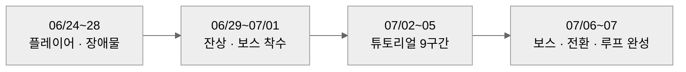

첫 주는 **플레이어 조작감**(대시 · 무적 · 잔상)에, 둘째 주는 **콘텐츠**(튜토리얼 9구간, 보스전)와 그것을 하나로 잇는 전환 씬에 썼습니다.

### 7.2 외부 리소스 활용

| 대상 | 출처 | 내가 한 일 | 가져다 쓴 것 |
|---|---|---|---|
| 음원 (메뉴 · Corrupted · New Game · 크레딧 · 효과음) | 원작 | 구간 루프 시간 측정 · 설정, 전환 · 클리어 사운드 배치 | 음원 파일 |
| 보스 · 신전 등 스프라이트 | 원작 | 배치, 보스 Idle 애니메이션 1개 제작, 나머지 움직임은 코드로 | 이미지 |
| 탄막 · 레이저 · 원 · 사각형 | 직접 제작 (기본 도형) | 프리팹 · 색 · 크기 구성 | — |
| 폰트 | 외부 폰트 | TextMeshPro 폰트 에셋으로 변환 | 폰트 |


| AI | 내가 한 일 | 맡긴 일 |
| --- | --- | --- |


원작 리소스는 **학습 목적의 모작**에만 사용했습니다.

---

## 8. 문제 해결 기록

### 8.1 대시 입력이 가끔 씹히는 문제

- **(문제)** `Space`를 눌러도 대시가 나가지 않는 경우가 자주 있었습니다.
- **(원인)** 이동 · 대시를 `FixedUpdate`에서 처리했는데, `wasPressedThisFrame`은 **키가 눌린 그 렌더 프레임에만** true입니다. `FixedUpdate`는 고정 주기(0.02초)로 불리므로, 렌더 프레임이 더 빠르면 키가 눌린 프레임에 `FixedUpdate`가 한 번도 호출되지 않아 입력이 사라졌습니다.
- **(해결)** 입력 감지를 `Update`로 옮기고, 대시 속도 적용은 코루틴에서 처리했습니다 (6/25 커밋 "fixed update를 update로 수정함").
- **(결과)** 대시 입력 누락이 사라졌습니다. 같은 날 쿨타임도 0.5초 → 0.2초로 줄여 원작의 빠른 회피감에 맞췄습니다.
- **(배운 점)** "한 프레임만 true인 입력"은 `Update`에서 읽어야 합니다. 이후 미니골프 프로젝트에서는 처음부터 **입력은 `Update`에서 플래그로 남기고, 물리는 `FixedUpdate`에서 소비**하는 구조로 만들었습니다.

### 8.2 대시할 때만 잔상이 나오고, 평소 이동에는 안 나오는 문제

- **(문제)** 이동 중에도 잔상이 나와야 하는데, 대시할 때만 잔상이 생겼습니다. 또 잔상 크기가 플레이어와 달랐습니다.
- **(원인)** 첫 구현(`DashEcho`)은 `rb2D.linearVelocity.magnitude > 0.1`로 이동 여부를 판단했습니다. 그런데 평소 이동은 `transform.position +=`로 하고 있어 **물리 속도가 항상 0**이었고, velocity를 쓰는 대시에서만 잔상이 나왔습니다. 크기는 잔상에 `localScale`을 복사했기 때문에, 부모 스케일이 곱해진 플레이어의 실제 크기와 달랐습니다.
- **(해결)** `WaveTrailEffect`를 새로 작성해 **지난 프레임과 현재 프레임의 위치 차이**로 이동을 판단하고, 크기는 실제 월드 크기인 `lossyScale`을 넣었습니다.

| | As-Is (`DashEcho`) | To-Be (`WaveTrailEffect`) |
|---|---|---|
| 이동 판단 | `rb2D.linearVelocity.magnitude > 0.1` | `Distance(현재 위치, 이전 위치) > 0.001` |
| 감지되는 이동 | velocity 이동(대시)만 | Translate · velocity · 연출 이동 모두 |
| 잔상 크기 | `localScale` 복사 → 크기 어긋남 | `lossyScale` → 항상 같은 크기 |
| 정렬 | 지정 없음 | 플레이어 정렬 순서 − 1 (항상 뒤) |

- **(결과)** 이동 방식과 관계없이 움직이면 항상 잔상이 생기고, 이동 0.06초 · 대시 0.02초 간격으로 대시가 더 촘촘해졌습니다.
- **(배운 점)** 조건문이 틀린 게 아니라 **"무엇을 기준으로 판단하는가"** 가 틀릴 수 있습니다. 이동이 transform으로 일어나는지 물리로 일어나는지를 먼저 확인해야 합니다.

### 8.3 클리어 삼각형이 여러 개 생기거나, 넘어간 구간의 삼각형이 늦게 나타나는 문제

- **(문제)** 한 구간에 삼각형이 2개 이상 생기거나, 다음 구간이 시작된 뒤에 이전 구간의 삼각형이 튀어나왔습니다.
- **(원인)** 초기 `Music`은 ① 삼각형을 이미 만들었는지 기록하지 않아서, 패턴이 "끝" 신호를 여러 번 보내면 그만큼 생성됐고, ② 스포너 없는 구간에서 걸어 둔 `Invoke("OnStagePatternFinished")` 예약을 구간이 바뀌어도 **취소하지 않았습니다.**
- **(해결)** `MusicLoopManager`로 다시 작성했습니다. `isTriangleSpawned` 플래그로 화면에 삼각형을 최대 1개로 제한하고, `ApplyStageSettings()` 시작 시 `CancelInvoke()`로 이전 구간의 예약을 지웠습니다. 각 패턴도 `OnDisable`에서 `CancelInvoke()`를 부릅니다.

| | As-Is (`Music`) | To-Be (`MusicLoopManager`) |
|---|---|---|
| 구간 수 | 5개 가정 | 인스펙터 목록 길이 (9개) |
| 게임 시작 | 씬 로드 즉시 음악 시작 | 시작 삼각형을 먹어야 음악 시작 (원작과 같음) |
| 삼각형 중복 | 방어 없음 | `isTriangleSpawned`로 1개 보장 |
| 예약 호출 | 취소 안 함 | 구간 전환 시 `CancelInvoke` |
| 마지막 구간 | `Scene_Boss` 직접 로드 | `TransitionManager`로 Level Completed 후 이동 |

- **(결과)** 9개 구간을 진행하는 동안 삼각형이 중복되거나 늦게 생기지 않습니다.
- **(배운 점)** 코루틴 · `Invoke`처럼 **"나중에 실행될 일"을 예약하면, 취소하는 코드도 같이 짜야** 합니다. 이후 모든 패턴의 `OnDisable`에 `StopAllCoroutines()`와 `CancelInvoke()`를 기본으로 넣었습니다.

---

## 9. 돌아보기

### 9.1 목표는 이뤘나

| 목표 | 결과 | 비고 |
|---|---|---|
| 원작 튜토리얼 재현 | ✅ | 9구간, 곡 끝과 마지막 구간이 맞물림 |
| 원작 보스 재현 | △ | "New Game" 연출 4단계만 축약 구현, 보스와의 공방은 없음 |
| 공격 전 예고 규칙 | ✅ | 모든 장애물이 `Obstacle` · `CircleObstacle`의 경고 단계를 거침 |
| 늦게 깨도 음악과 패턴이 맞음 | ✅ | 구간 루프 + 구간 시작 점프 (5.1) |
| 처음부터 끝까지 이어지는 게임 | ✅ | 메인 → 선택 → 튜토리얼 · 보스 → 클리어 · 게임오버 · 크레딧 |

### 9.2 아쉬운 점: 수치로 확인하지 못한 성능과 남은 버그

탄막 · 레이저 · 잔상을 매번 `Instantiate` / `Destroy`합니다. 보스 1단계는 0.15초마다 탄막을, 플레이어는 대시 중 0.02초마다 잔상을 만듭니다. 플레이 중 끊김은 느끼지 못했지만, **프로파일러로 GC 할당을 측정하지 않아** "문제없다"고 말할 근거가 없습니다. 템플릿에 `ComponentPool`이 있었는데도 쓰지 않았습니다.

문서를 정리하며 코드를 다시 읽다가 찾은 버그도 있습니다.

| 버그 | 원인 | 영향 |
|---|---|---|
| 최대 체력보다 한 번 더 맞아야 죽음 | 사망 조건이 `currentHP < 0` (의도는 `<= 0`) | 체력 4일 때 5번째 피격에 사망 |
| 장애물 소멸 연출이 거의 안 보임 | 소멸 단계가 앞 단계의 `elapsed`를 0으로 되돌리지 않고 이어 씀 | 0.25초여야 할 축소가 약 0.05초로 끝남 |
| 무적 중 삼각형을 못 먹음 | 무적을 콜라이더 OFF로 구현 (3.2) | 대시로 삼각형을 지나가면 획득 안 됨 |

### 9.3 남은 과제

| 항목 | 현재 | 개선 방향 |
|---|---|---|
| 오브젝트 생성 | 매번 Instantiate / Destroy | `ComponentPool`로 탄막 · 잔상 풀링, 프로파일러로 전후 GC Alloc 비교 |
| 무적 처리 | 콜라이더 OFF | `isInvincible` 플래그로 데미지만 무시 |
| 피격 판정 | 장애물 4종에 반복, `Barrage`만 넉백 없음 | 공통 `HitPlayer()` 함수로 통일 |
| 체력 · 소멸 버그 | `< 0`, `elapsed` 이어 씀 | `<= 0`, 단계마다 `elapsed = 0` |
| 씬 간 데이터 | PlayerPrefs | `static` 필드 (2.4) |
| 씬 이름 | `"01. Stage"` 등 문자열이 여러 파일에 흩어짐 | 상수 클래스로 모으기 |
| 입력 | 대시 방향만 구 `Input.GetAxisRaw`, 나머지는 Input System | Input System으로 통일 |
| 패턴 박자 | 코드 안의 `WaitForSeconds` 숫자 | ScriptableObject로 타이밍 데이터 분리 |
| 미사용 코드 | `Music` · `Player` · `SpikeField` · 주석 처리된 이전 코드 | 정리 |

### 9.4 다음 작업에 가져갈 것

- **진행 판단은 한 곳에.** 진행을 `MusicLoopManager`로 모은 뒤에야 삼각형 중복 같은 버그의 원인을 바로 찾을 수 있었습니다(8.3).
- **예약한 것은 취소까지 한 세트.** 코루틴 · `Invoke`를 시작하는 코드를 쓸 때 `OnDisable`의 정리 코드를 함께 씁니다(4.3, 8.3).
- **판단 기준을 의심하기.** 입력이 언제 true인지(8.1), 이동이 무엇으로 일어나는지(8.2)를 확인하는 것만으로 풀린 문제가 많았습니다.
- **움직임의 모양은 도구로.** 이 프로젝트에서는 보스 · 신전 · 게임오버 조각까지 모든 움직임을 `Lerp` 코루틴으로 짜며 숫자를 반복 조정했습니다. 이 경험으로 Animator를 따로 공부했고, 다음 프로젝트(미니골프)에서는 움직이는 기믹을 애니메이션으로 만들었습니다.
